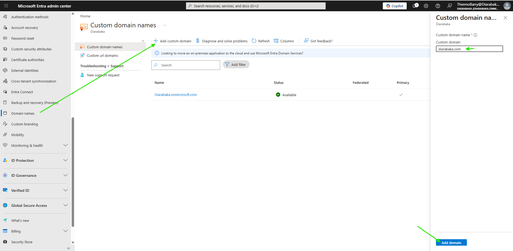
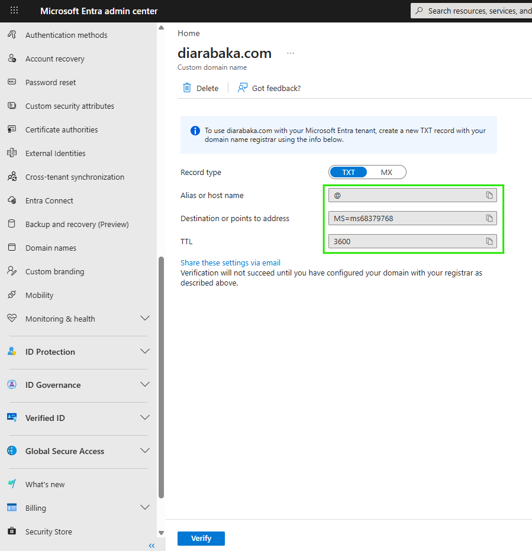
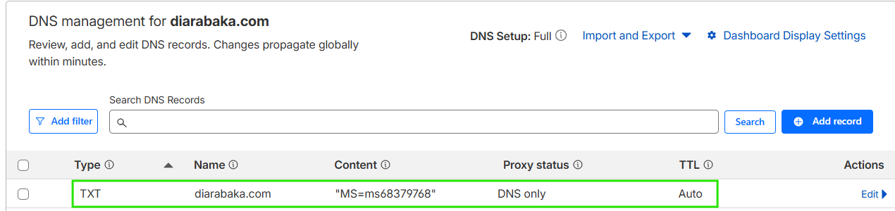
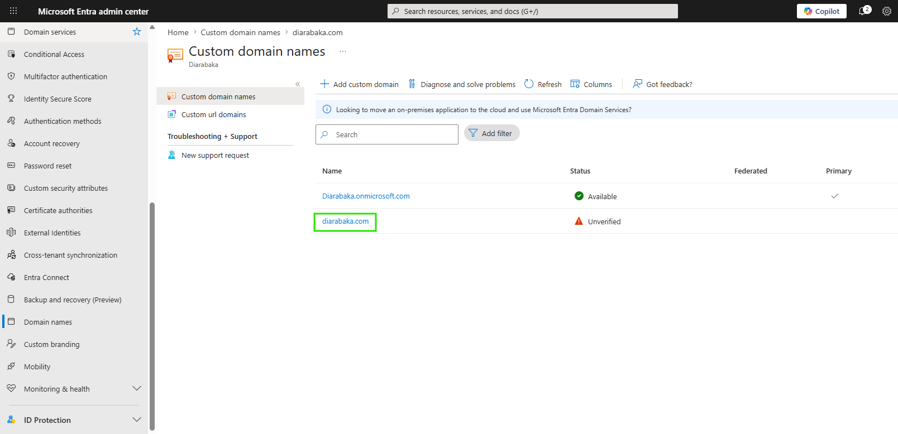
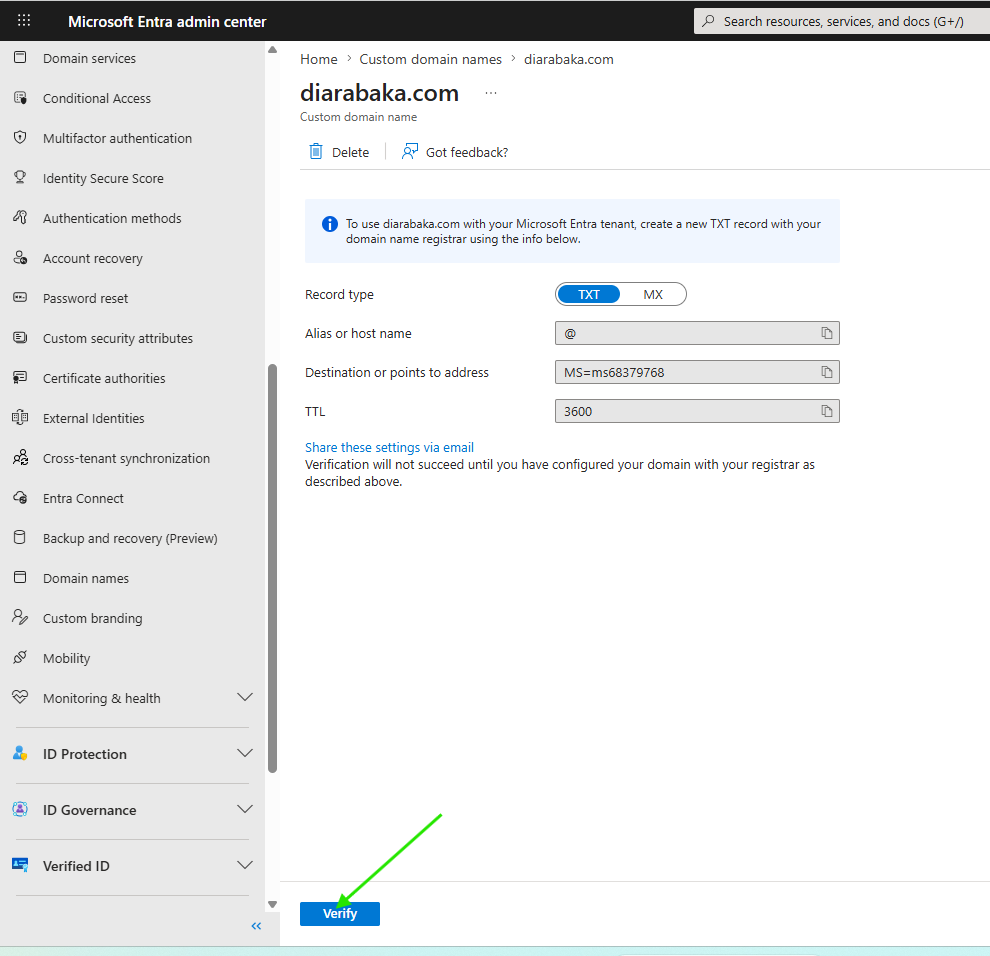
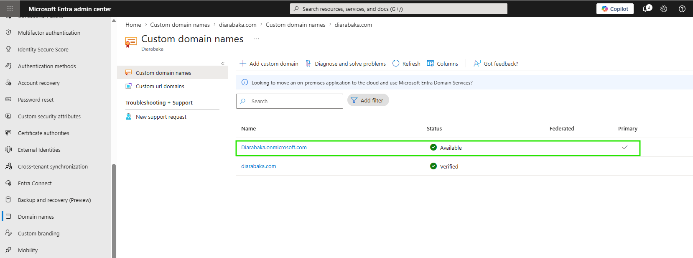
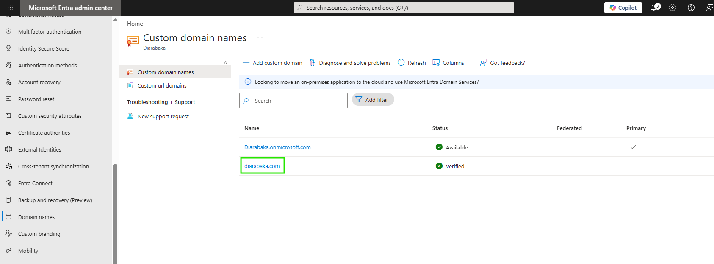
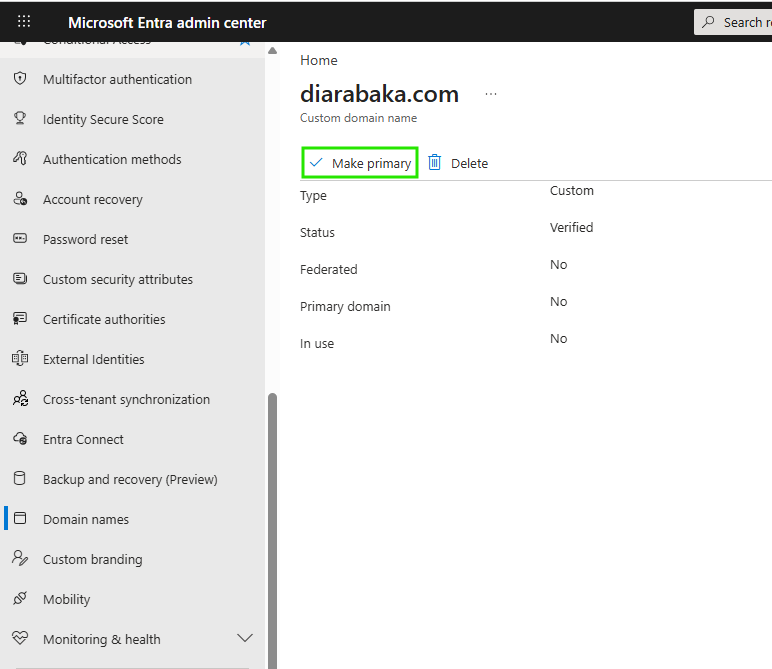
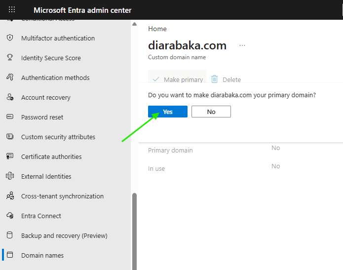
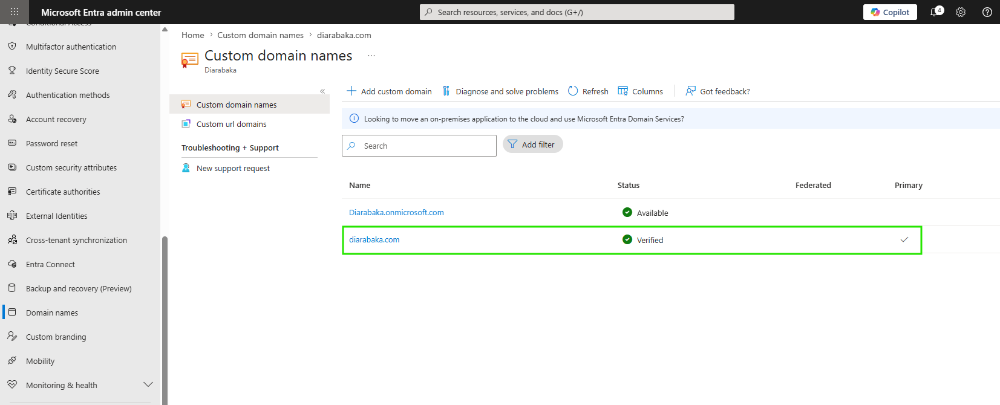

# Ajouter un domaine personnalisé dans Microsoft Entra ID

Le domaine `diarabaka.com` a été ajouté à Microsoft Entra ID, vérifié via le DNS public dans Cloudflare, puis défini comme domaine principal.

## 1. Ajouter le domaine

Dans **Domain names → Custom domain names**, je clique sur **Add custom domain**, je saisis `diarabaka.com`, puis je valide avec **Add domain**.

## 2. Publier l’enregistrement TXT dans Cloudflare

Microsoft Entra ID fournit un enregistrement **TXT** pour vérifier que je contrôle le domaine. Le nom `@` correspond à la racine de `diarabaka.com`.

Dans Cloudflare, j’ajoute le TXT à la zone DNS publique de `diarabaka.com` avec la valeur fournie par Microsoft.

## 3. Vérifier le domaine

Dans Microsoft Entra ID, `diarabaka.com` apparaît d’abord avec le statut **Unverified**.

J’ouvre la fiche du domaine et je clique sur **Verify**. Microsoft recherche alors l’enregistrement TXT dans le DNS public.

Le statut passe à **Verified**. À ce stade, `diarabaka.onmicrosoft.com` est encore le domaine principal.

## 4. Définir le domaine comme principal

Je sélectionne `diarabaka.com` dans la liste des domaines.

Sur sa fiche, je clique sur **Make primary**.

Je confirme le changement en cliquant sur **Yes**.

## Résultat

`diarabaka.com` affiche le statut **Verified** et la coche **Primary**. Le suffixe `@diarabaka.com` est désormais proposé par défaut lors de la création de nouveaux utilisateurs dans le portail Entra.

