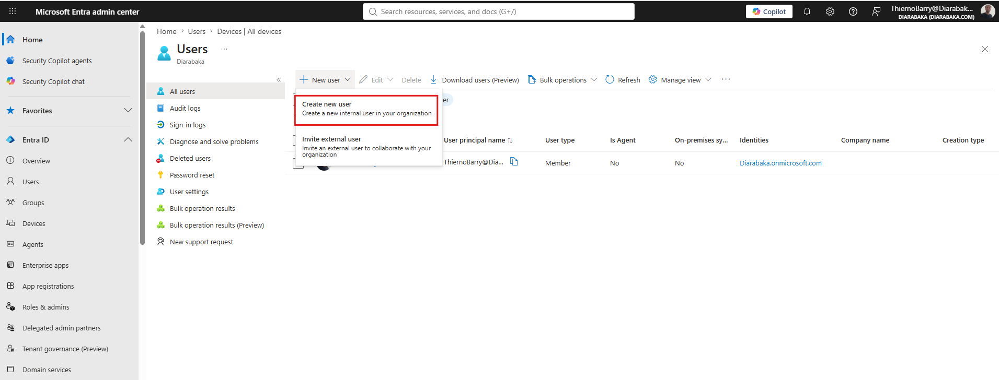
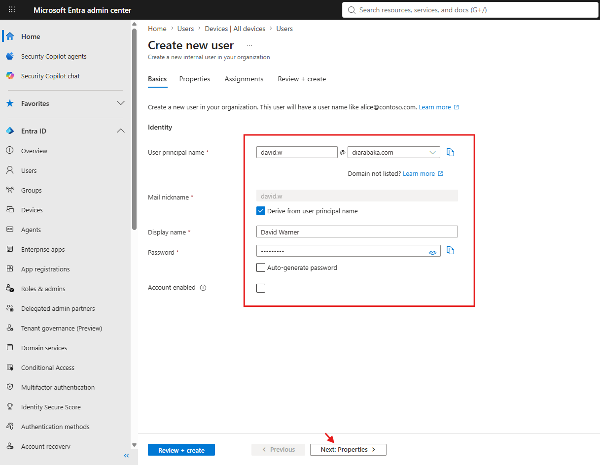
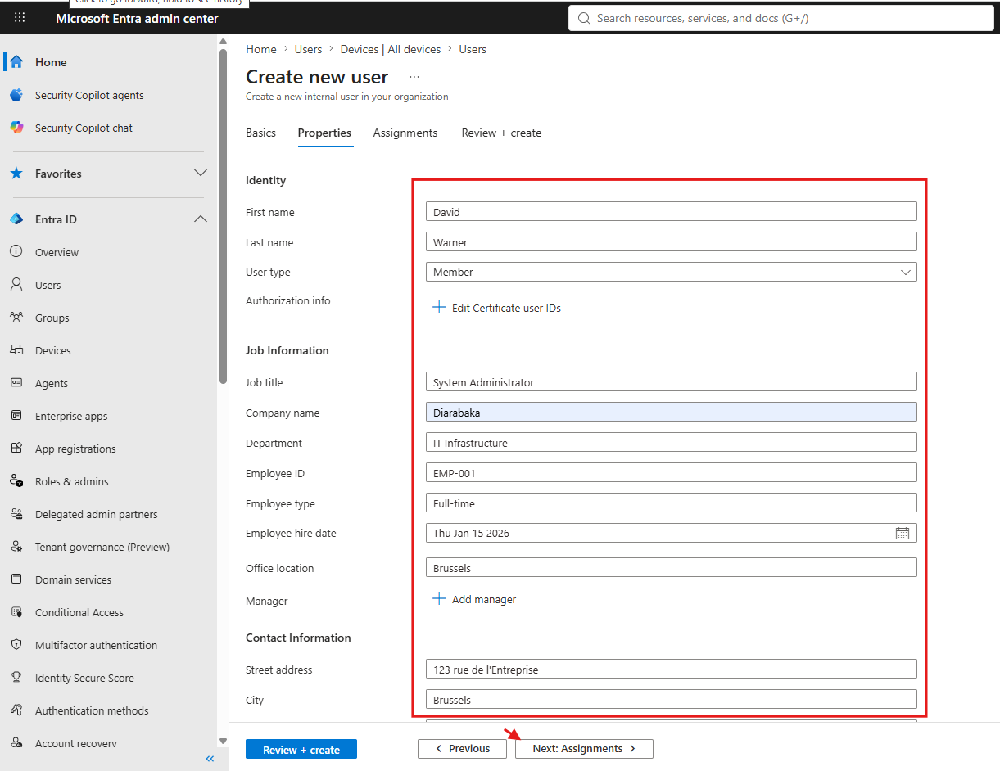
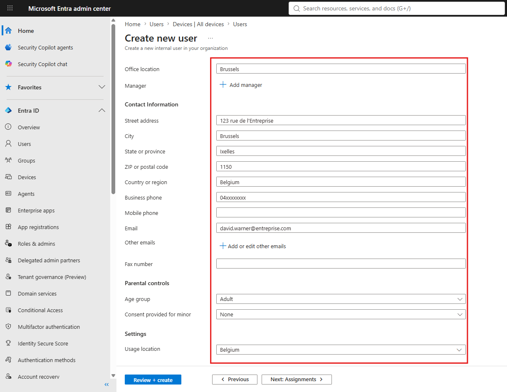
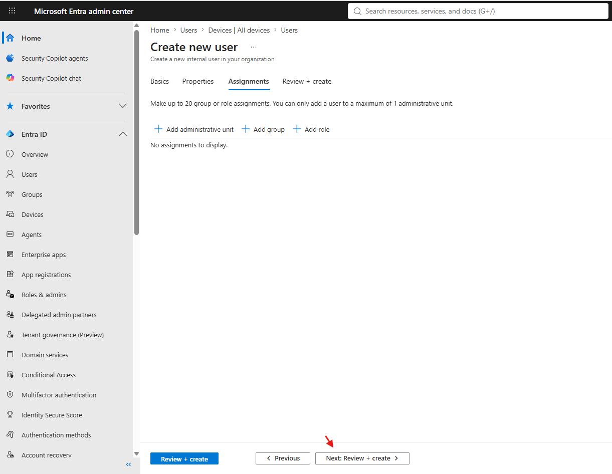
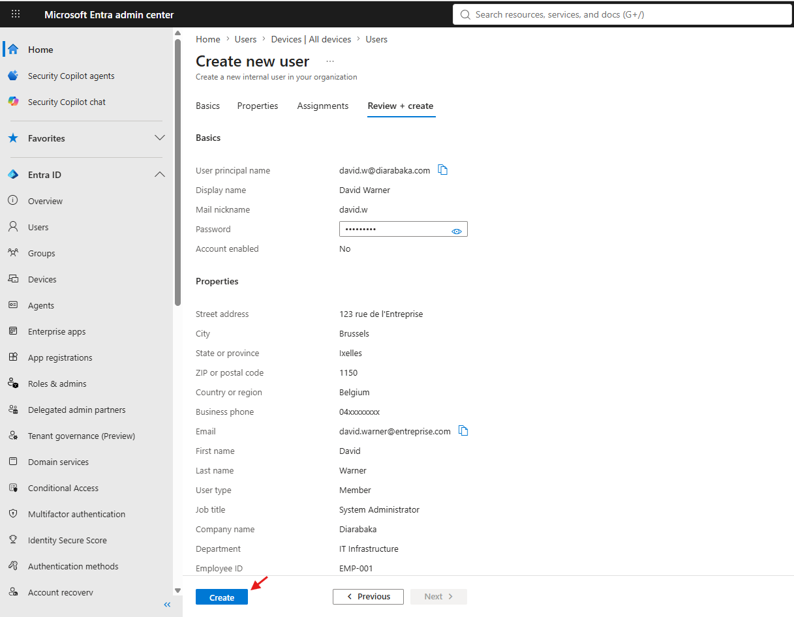
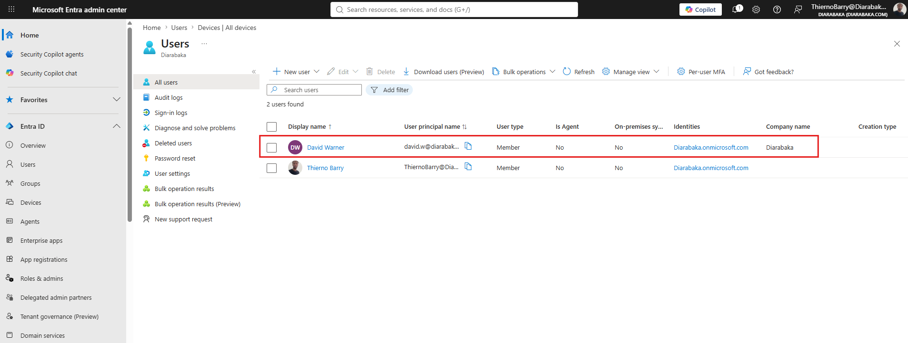
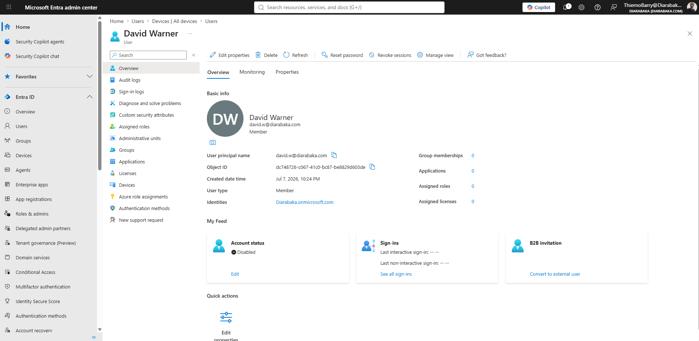

# Créer un compte utilisateur dans Microsoft Entra ID

Je crée un compte interne pour **David Warner** avec l’identifiant de connexion `david.w@diarabaka.com`, puis je l’active après sa création.

## 1. Créer l’utilisateur

Dans **Entra ID → Users**, je sélectionne **New user → Create new user**.

Dans **Basics**, je renseigne l’identifiant de connexion (UPN), le nom d’affichage et le mot de passe initial. Je laisse **Account enabled** décoché pour créer le compte à l’état désactivé.

## 2. Renseigner le profil

Dans **Properties**, je sélectionne le type **Member** et je renseigne les informations professionnelles, dont le poste **System Administrator** et le service **IT Infrastructure**.

Je complète les coordonnées et je sélectionne **Belgium** dans **Usage location**.

## 3. Vérifier et créer le compte

Dans **Assignments**, je continue sans attribuer de groupe, de rôle ni d’unité administrative.

Dans **Review + create**, je vérifie les informations et je clique sur **Create**.

David Warner apparaît dans **All users** avec le type **Member**.

## 4. Activer le compte

Sur la fiche de l’utilisateur, **Account status** affiche d’abord **Disabled**.

Après activation, **Account status** affiche **Enabled**. Le compte `david.w@diarabaka.com` est créé et activé.

