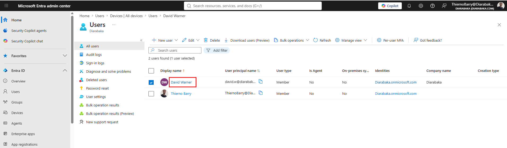
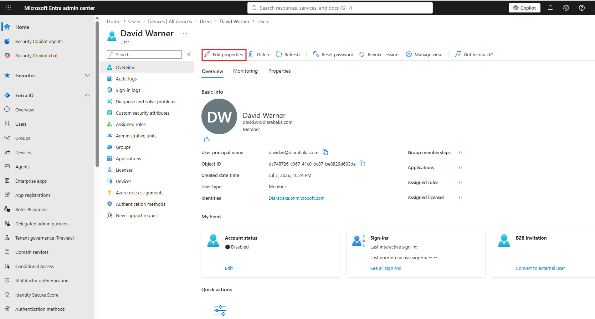
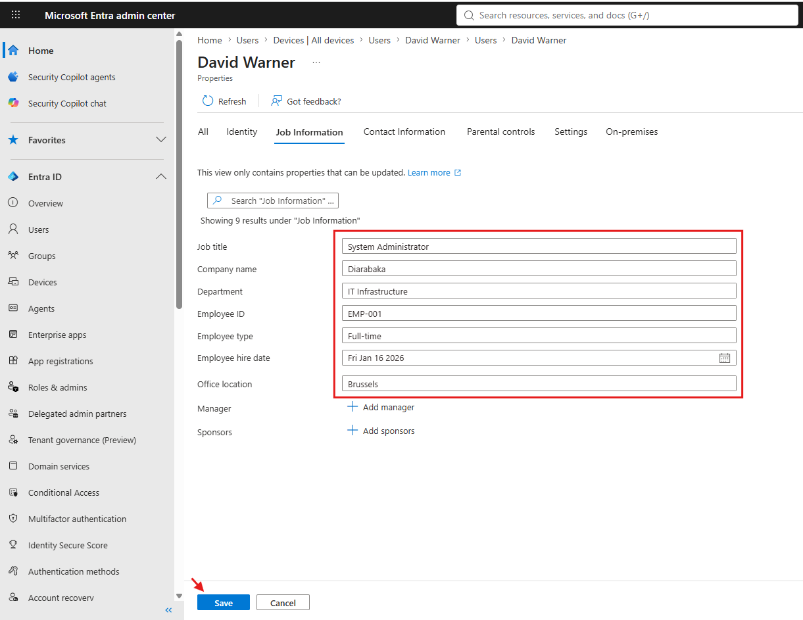
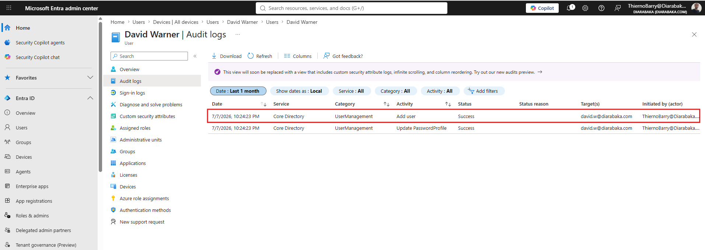
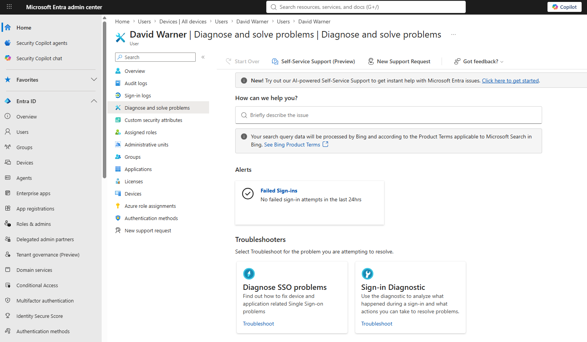
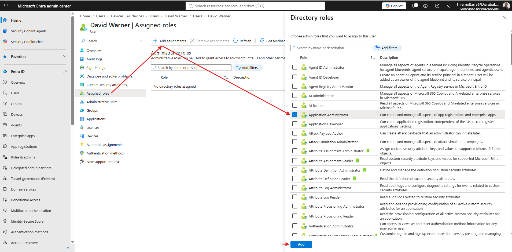
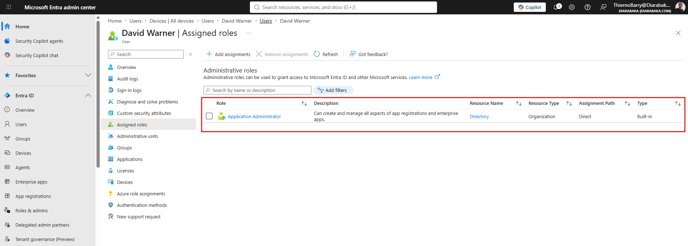

# Gérer les comptes utilisateurs dans Microsoft Entra ID

Dans ce lab, je modifie le profil de **David Warner**, je consulte ses journaux et je lui attribue le rôle **Application Administrator**.

## 1. Modifier le profil utilisateur

Dans **Entra ID → Users → All users**, je sélectionne **David Warner**.

Sur sa fiche, je clique sur **Edit properties** pour accéder aux paramètres du compte.

Dans **Job Information**, je mets à jour les informations professionnelles, comme le poste, le service et le lieu de travail, puis je clique sur **Save**.

## 2. Consulter les journaux et le diagnostic

Dans **Audit logs**, l’événement **Add user** affiche le statut **Success**, ce qui confirme la création du compte.

Dans **Diagnose and solve problems**, je consulte la section **Failed Sign-ins**. Elle indique qu’aucune tentative de connexion n’a échoué au cours des 24 dernières heures.

## 3. Attribuer et vérifier le rôle

Dans **Assigned roles → Add assignments**, je sélectionne **Application Administrator** et je clique sur **Add**. Ce rôle permet de gérer les inscriptions d’applications et les applications d’entreprise.

Le rôle apparaît dans **Assigned roles** avec le mode **Direct** et la portée **Organization**. L’attribution à David Warner est confirmée.

