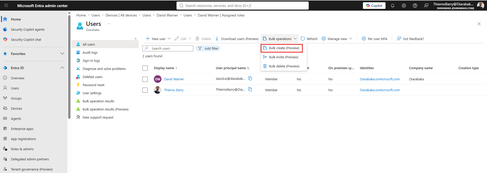
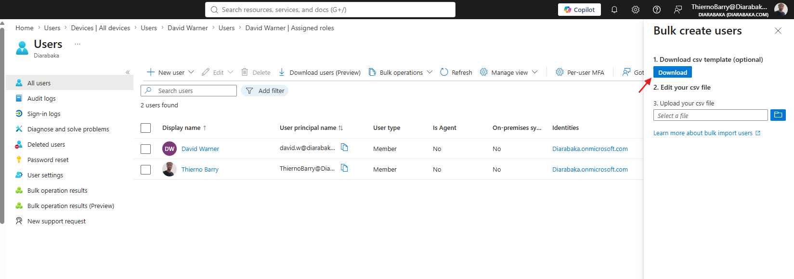
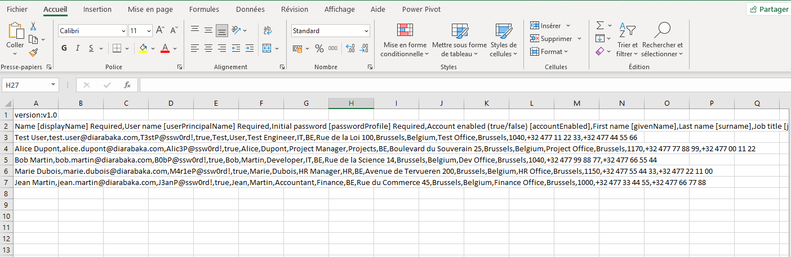
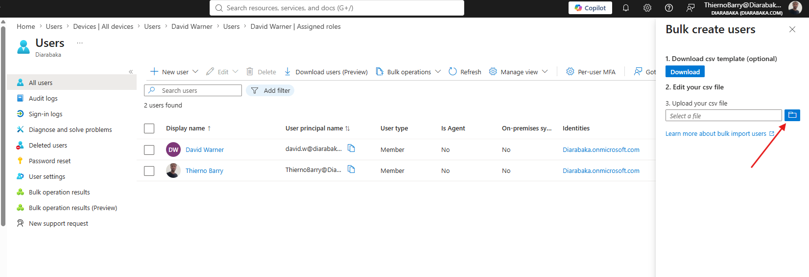
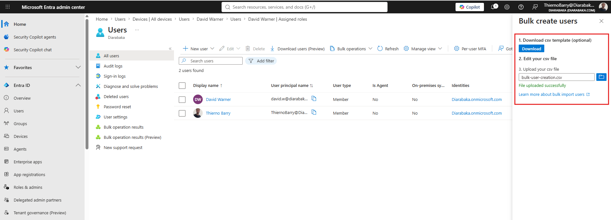
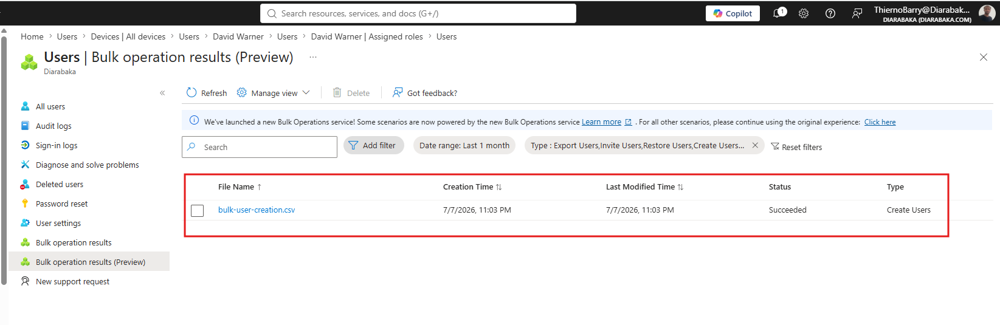
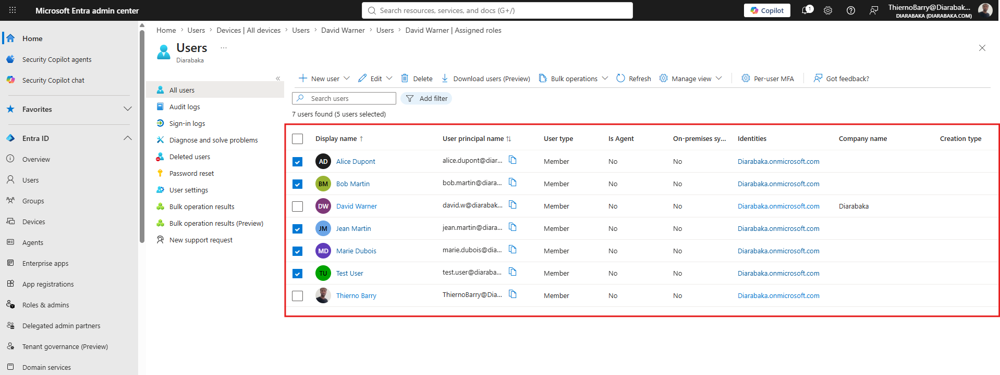

# Créer des utilisateurs en masse via CSV dans Microsoft Entra ID

Dans ce lab, je crée cinq comptes de test dans le domaine `diarabaka.com` à partir d’un seul fichier CSV.

## 1. Télécharger le modèle CSV

Dans **Entra ID → Users → All users**, je sélectionne **Bulk operations → Bulk create (Preview)**.

Dans le panneau **Bulk create users**, je clique sur **Download** pour récupérer le modèle CSV.

## 2. Préparer et importer le fichier

Je conserve la ligne de version et les en-têtes du modèle. J’ajoute une ligne par utilisateur avec son nom d’affichage, son identifiant de connexion (UPN), son mot de passe initial et l’état du compte.

Dans **Bulk create users**, je sélectionne le fichier `bulk-user-creation.csv`.

Le message **File uploaded successfully** confirme que le fichier a été téléversé.

## 3. Vérifier la création des comptes

Dans **Bulk operation results (Preview)**, l’opération **Create Users** affiche le statut **Succeeded**.

Dans **All users**, je retrouve les cinq nouveaux comptes au milieu des deux comptes existants. La liste affiche désormais **7 utilisateurs**.

