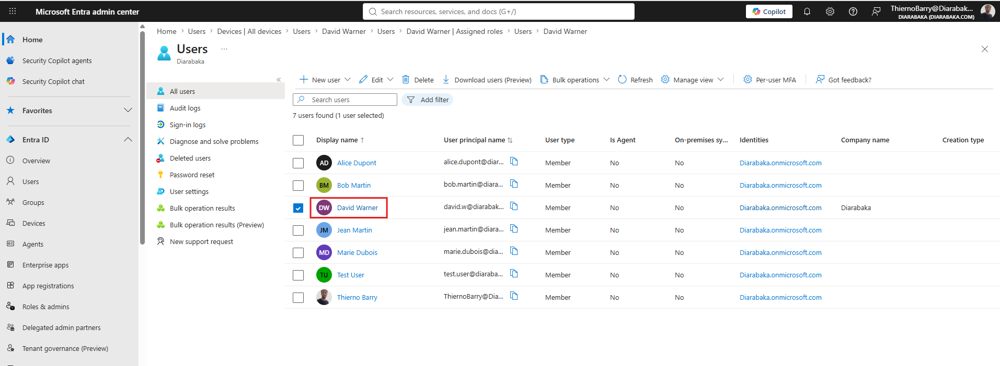
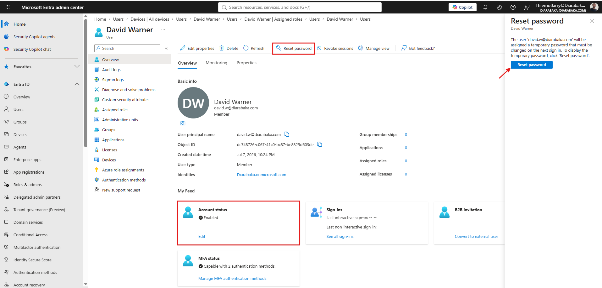
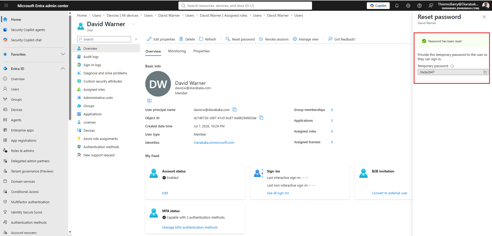
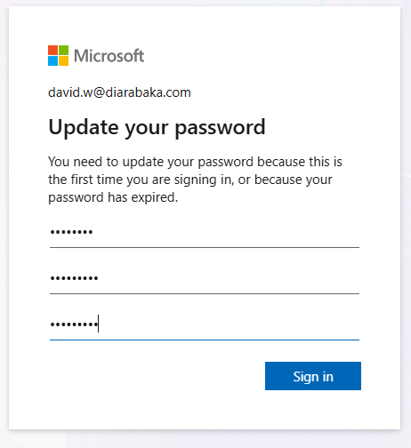
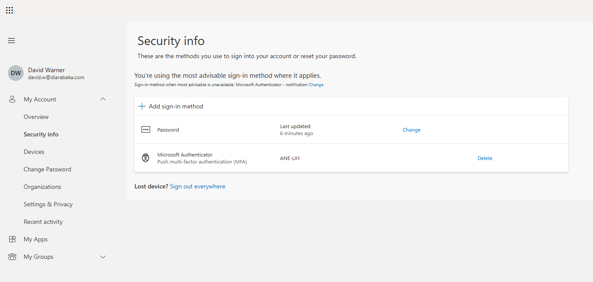

# Réinitialiser le mot de passe d’un utilisateur dans Microsoft Entra ID

Dans ce lab, je réinitialise le mot de passe de **David Warner**, puis je vérifie que l’utilisateur a pu le modifier à sa prochaine connexion.

## 1. Réinitialiser le mot de passe

Dans **Entra ID → Users → All users**, je sélectionne le compte **David Warner**.

Sur la fiche du compte, je clique sur **Reset password**, puis je confirme dans le panneau latéral.

Le message **Password has been reset** confirme la réinitialisation. Microsoft Entra ID génère un mot de passe temporaire que l’utilisateur devra remplacer à sa prochaine connexion.

## 2. Modifier le mot de passe à la connexion

David se connecte à [Mon compte Microsoft](https://myaccount.microsoft.com/) avec son mot de passe temporaire. Sur l’écran **Update your password**, il choisit et confirme un nouveau mot de passe.

## 3. Vérifier le résultat

Une fois connecté, David ouvre **Security info**. Le champ **Last updated** indique que le mot de passe a été modifié récemment.

