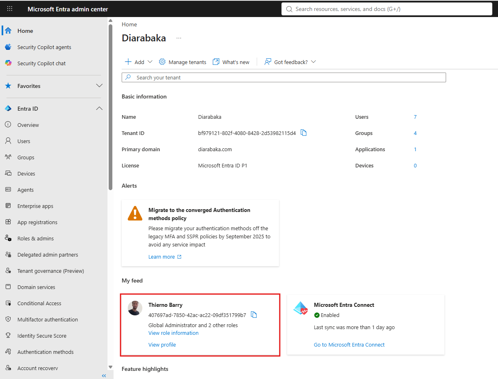
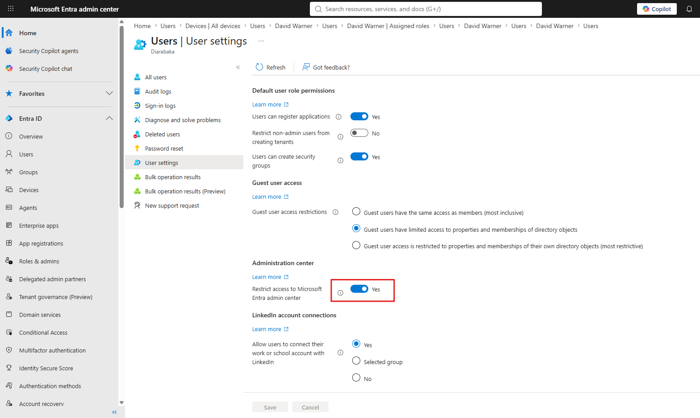

# Restreindre l’accès au centre d’administration Microsoft Entra

Dans ce lab, j’active un paramètre qui limite l’accès des utilisateurs sans rôle d’administration à certaines pages du portail Microsoft Entra.

## 1. Ouvrir le centre d’administration

Je me connecte au tenant **Diarabaka** avec un compte disposant du rôle **Global Administrator**.

## 2. Activer la restriction

Dans **Entra ID → Users → User settings**, je repère la section **Administration center** et je règle **Restrict access to Microsoft Entra admin center** sur **Yes**.

## Portée du réglage

La deuxième capture confirme que le paramètre est réglé sur **Yes**. Ce réglage limite l’accès à certaines pages du portail. Les permissions existantes de l’utilisateur via Microsoft Graph ou PowerShell restent applicables. [Documentation Microsoft](https://learn.microsoft.com/en-us/entra/fundamentals/users-default-permissions)
