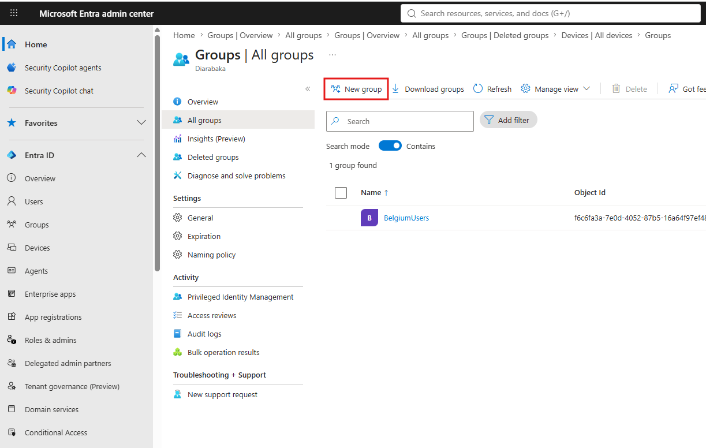
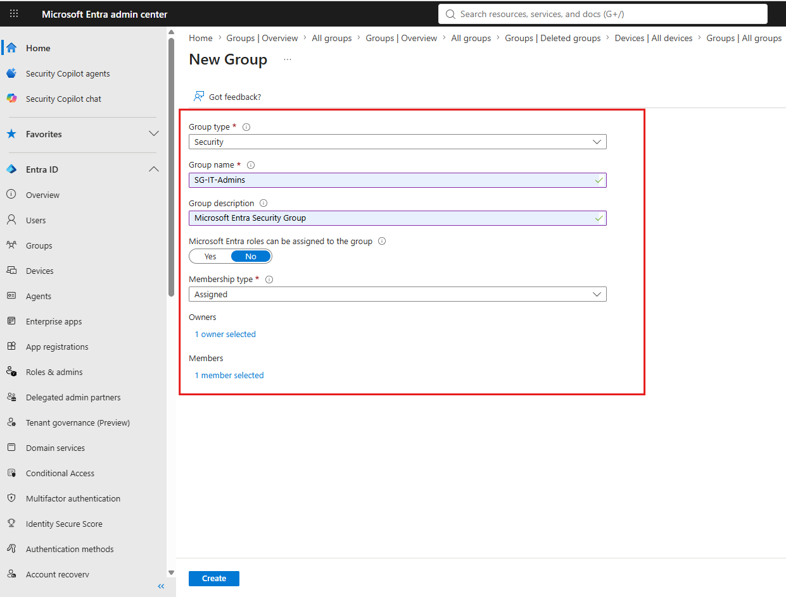
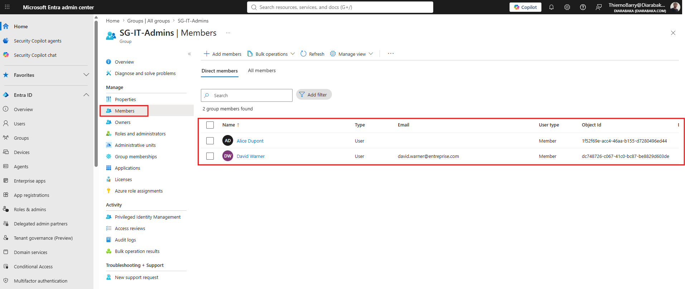
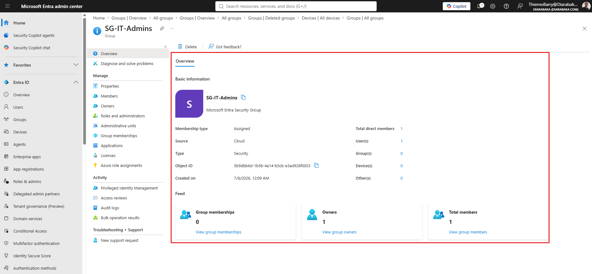
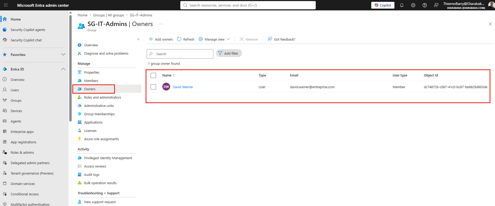
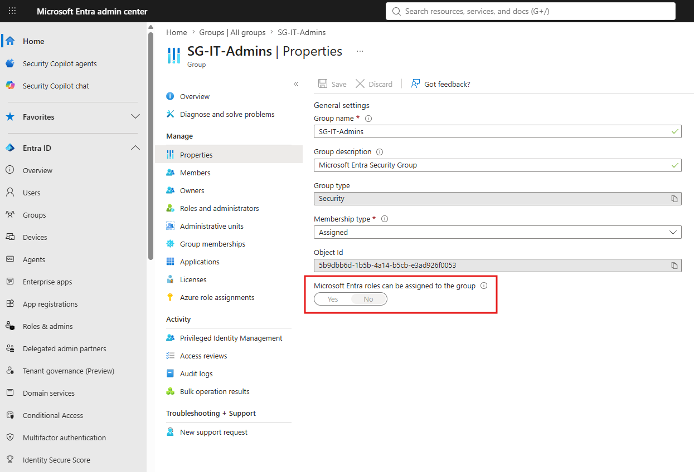

# Créer un groupe de sécurité dans Microsoft Entra ID

Dans ce lab, je crée le groupe de sécurité **SG-IT-Admins**, puis je vérifie ses membres, son propriétaire et ses paramètres.

## 1. Créer le groupe

Dans **Entra ID → Groups → All groups**, je clique sur **New group**.

Je nomme le groupe **SG-IT-Admins**, je choisis le type **Security** et le mode d’appartenance **Assigned** pour sélectionner les membres manuellement. Je sélectionne un propriétaire et un membre, je laisse l’attribution de rôles Microsoft Entra sur **No**, puis je clique sur **Create**.

## 2. Vérifier le groupe

Dans **Members → Direct members**, je retrouve **Alice Dupont** et **David Warner**.

Dans **Overview**, je vérifie que **SG-IT-Admins** est un groupe de sécurité créé dans le cloud, avec le mode d’appartenance **Assigned**.

Dans **Owners**, je confirme que **David Warner** est le propriétaire du groupe.

Dans **Properties**, je vérifie que l’attribution de rôles Microsoft Entra au groupe est désactivée.

