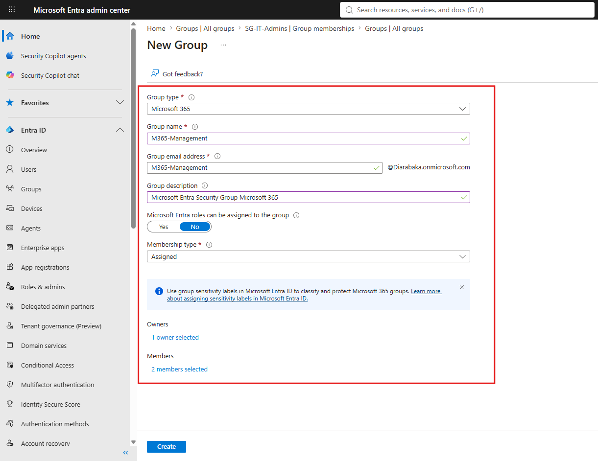
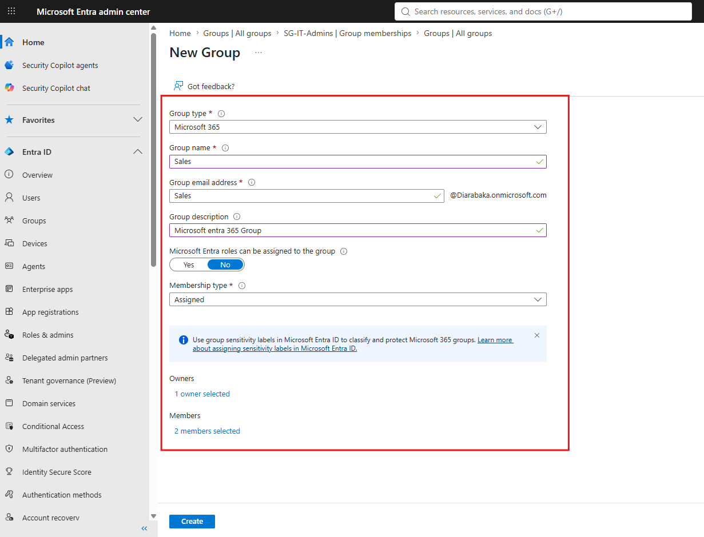
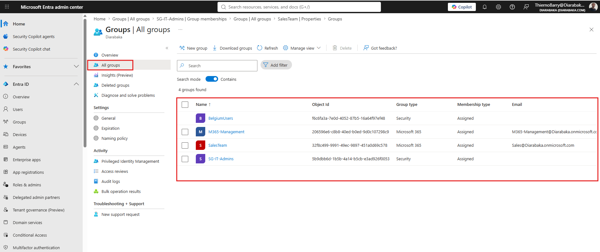

# Créer des groupes Microsoft 365 dans Microsoft Entra ID

Dans ce lab, je crée deux groupes Microsoft 365 pour les équipes Management et Sales.

## 1. Créer le groupe Management

Dans **Entra ID → Groups → All groups → New group**, je sélectionne le type **Microsoft 365**. Je renseigne le nom **M365-Management** et l’adresse du groupe. Je choisis **Assigned** pour sélectionner les membres manuellement, puis je sélectionne un propriétaire et deux membres avant de cliquer sur **Create**.

## 2. Créer le groupe Sales

Je répète la procédure avec le nom **Sales** et l’adresse `Sales@diarabaka.onmicrosoft.com`. Je sélectionne également un propriétaire et deux membres.

## 3. Vérifier les groupes

Dans **All groups**, je retrouve **M365-Management** et **SalesTeam**. Le groupe saisi sous le nom **Sales** apparaît dans la liste sous le nom **SalesTeam**, avec l’adresse `Sales@diarabaka.onmicrosoft.com`. Les deux groupes sont de type **Microsoft 365** avec le mode d’appartenance **Assigned**.

