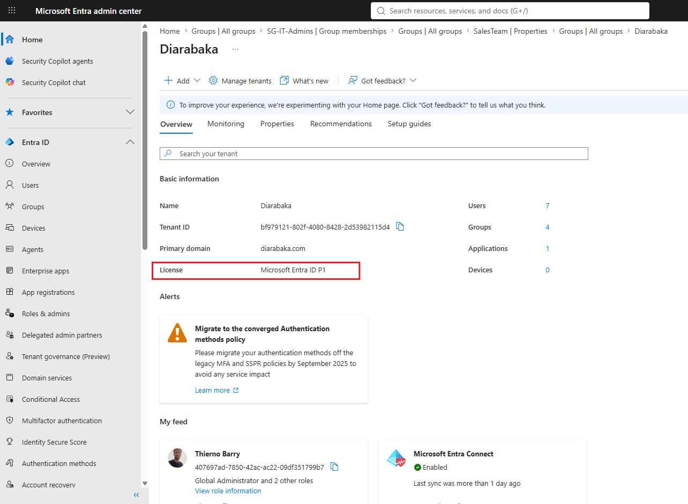
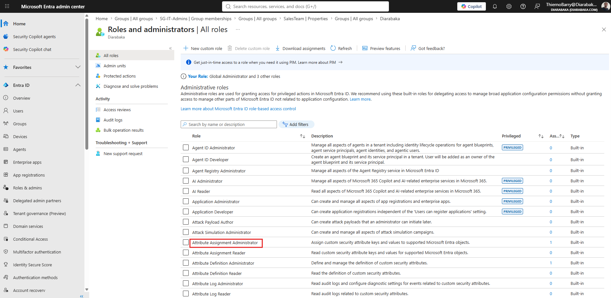
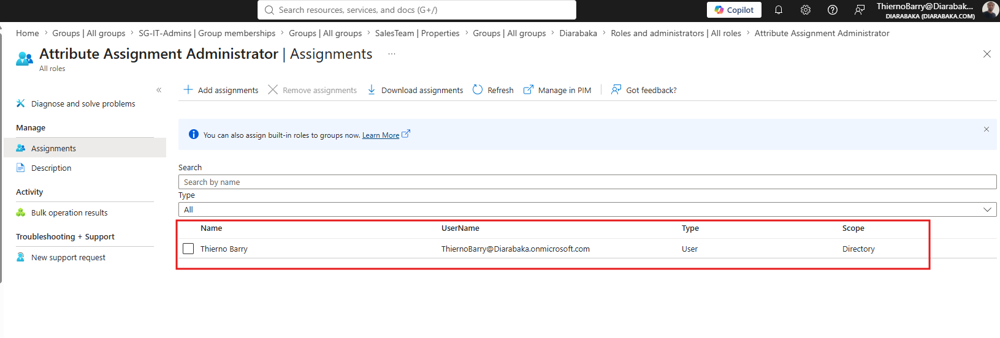
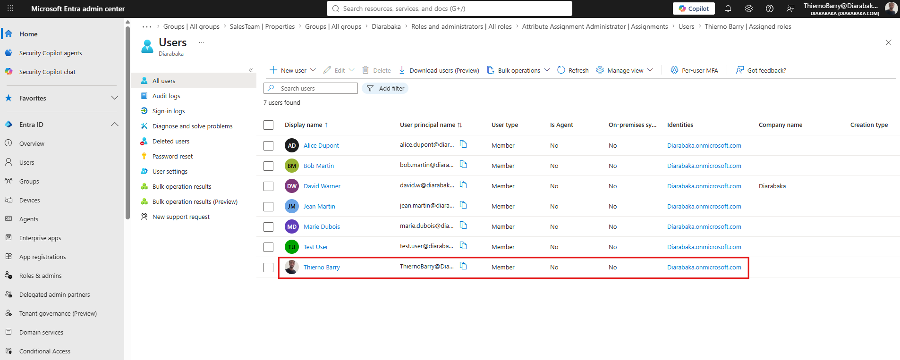
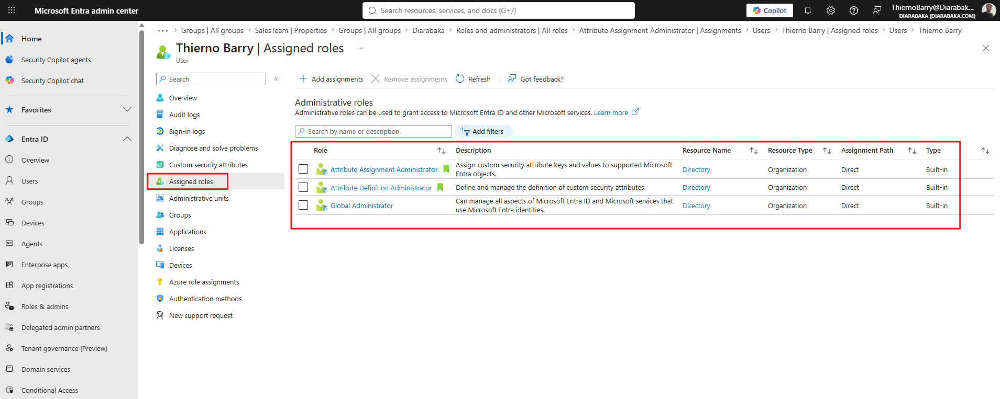

# Attribuer un rôle Microsoft Entra ID à un utilisateur

Dans ce lab, j’attribue le rôle **Attribute Assignment Administrator** à **Thierno Barry**, puis je vérifie l’attribution depuis le rôle et depuis la fiche utilisateur.

## 1. Sélectionner le rôle

Depuis la vue d’ensemble du tenant **Diarabaka**, j’ouvre **Entra ID → Roles and administrators**.

Dans **All roles**, je sélectionne **Attribute Assignment Administrator**. Ce rôle permet d’attribuer des valeurs d’attributs de sécurité personnalisés aux objets Microsoft Entra pris en charge.

## 2. Attribuer le rôle

Dans **Assignments → Add assignments**, j’ajoute **Thierno Barry**. La liste des attributions affiche son compte avec la portée **Directory**.

## 3. Vérifier l’attribution depuis le compte

Dans **Entra ID → Users → All users**, j’ouvre la fiche de **Thierno Barry**.

Dans **Assigned roles**, je vérifie que **Attribute Assignment Administrator** apparaît avec le mode **Direct**. La fiche affiche aussi les rôles **Attribute Definition Administrator** et **Global Administrator**.

