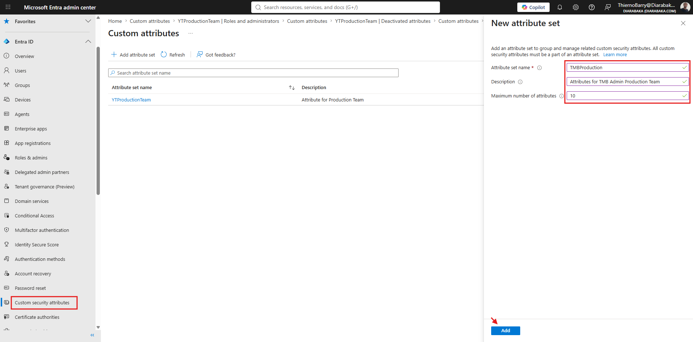
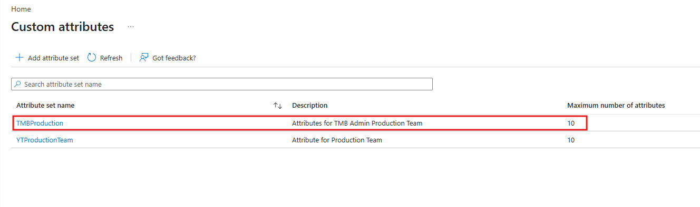
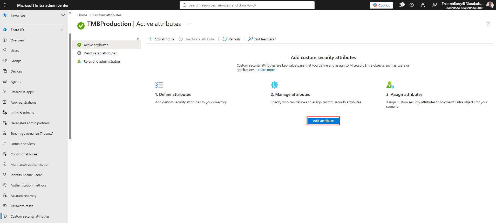
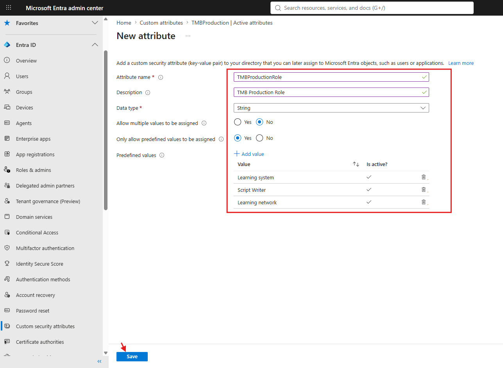
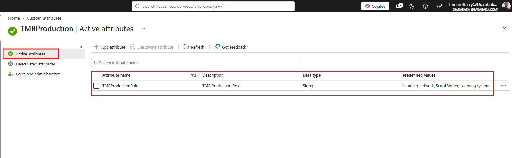
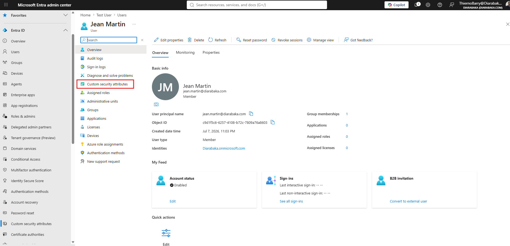
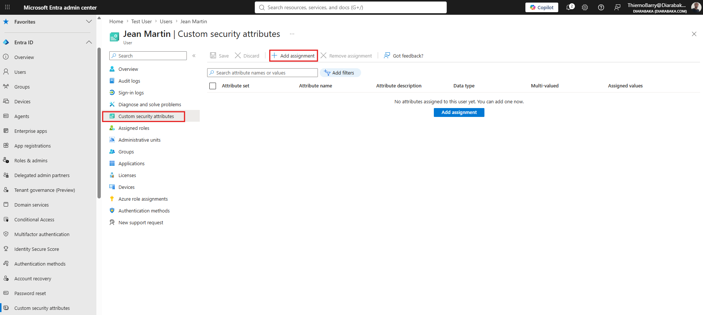
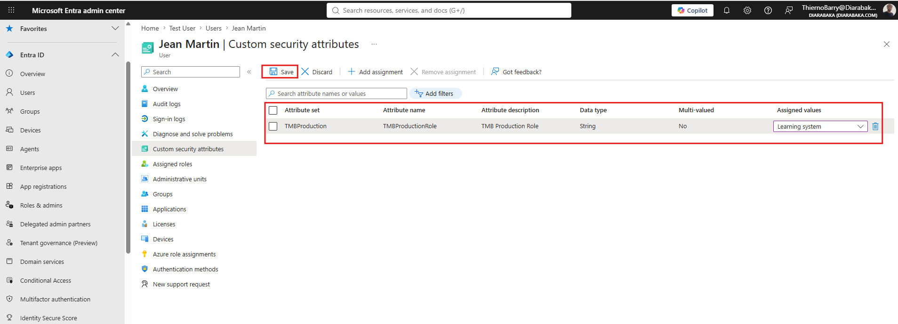
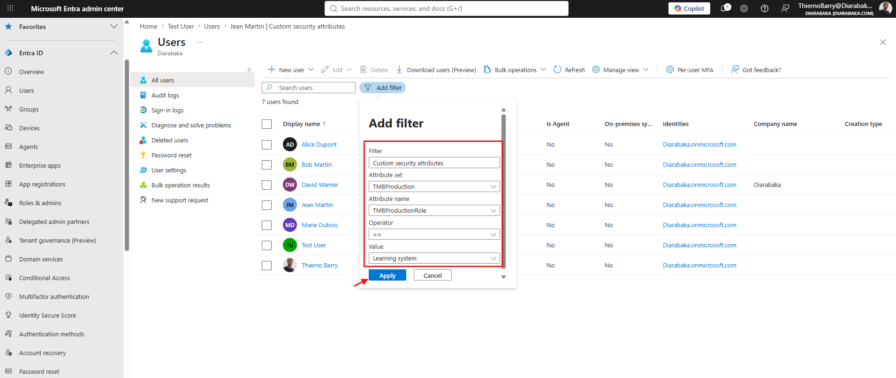
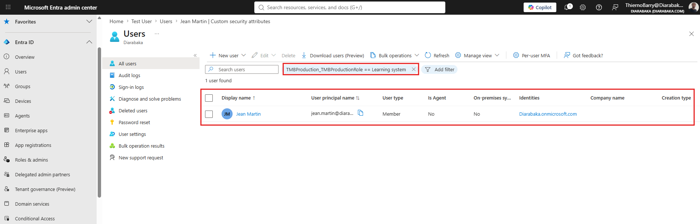

# Créer et attribuer des attributs de sécurité personnalisés dans Microsoft Entra ID

Dans ce lab, je crée l’attribut `TMBProductionRole`, j’attribue la valeur `Learning system` à **Jean Martin**, puis je vérifie l’attribution avec un filtre.

## 1. Créer un ensemble d’attributs

Dans **Entra ID → Custom security attributes → Add attribute set**, je crée l’ensemble `TMBProduction` avec une limite de **10 attributs**.

Je vérifie que `TMBProduction` apparaît dans la liste, puis je l’ouvre.

## 2. Définir l’attribut

Dans **Active attributes**, je clique sur **Add attribute**.

Je crée `TMBProductionRole` avec le type **String**. L’attribut accepte une seule valeur, choisie parmi `Learning system`, `Script Writer` et `Learning network`. Je clique sur **Save**.

Je vérifie que `TMBProductionRole` apparaît dans **Active attributes**.

## 3. Attribuer une valeur à Jean Martin

Dans **Entra ID → Users**, j’ouvre la fiche de **Jean Martin**, puis **Custom security attributes**.

Je clique sur **Add assignment** pour ajouter une attribution.

Je sélectionne `TMBProductionRole` dans l’ensemble `TMBProduction`, je choisis `Learning system`, puis je clique sur **Save**.

## 4. Vérifier l’attribution

Dans **All users → Add filter**, je sélectionne **Custom security attributes** et je filtre sur `TMBProductionRole` avec la valeur `Learning system`.

Le filtre renvoie un seul utilisateur, **Jean Martin**, ce qui confirme l’attribution.

