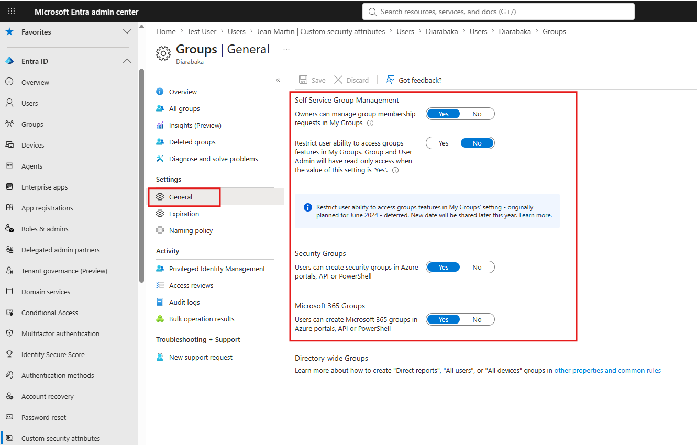
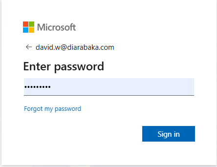
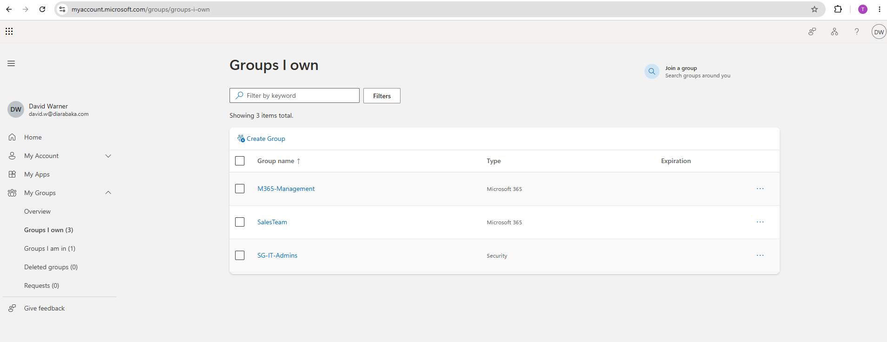

# Configurer la gestion des groupes en libre-service dans Microsoft Entra ID

Dans ce lab, j’active la gestion des demandes d’adhésion par les propriétaires de groupes, puis je vérifie l’accès à **My Groups** avec le compte de David Warner.

## 1. Configurer le libre-service

Dans **Entra ID → Groups → General**, je configure les paramètres suivants.

| Paramètre                                                                      | Valeur  |
| ------------------------------------------------------------------------------ | ------- |
| Autoriser les propriétaires à gérer les demandes d’adhésion dans **My Groups** | **Yes** |
| Restreindre l’accès aux fonctionnalités de **My Groups**                       | **No**  |
| Autoriser les utilisateurs à créer des groupes de sécurité                     | **Yes** |
| Autoriser les utilisateurs à créer des groupes Microsoft 365                   | **Yes** |

## 2. Se connecter avec le compte de test

Je me connecte à [Mon compte Microsoft](https://myaccount.microsoft.com/) avec le compte `david.w@diarabaka.com`.

## 3. Vérifier l’accès à My Groups

Dans **My Groups → Groups I own**, David voit les trois groupes dont il est propriétaire, **M365-Management**, **SalesTeam** et **SG-IT-Admins**. Le bouton **Create Group** est également visible.

