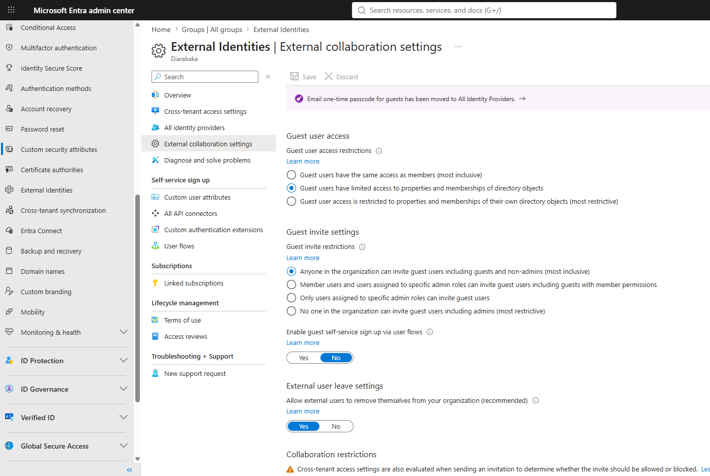
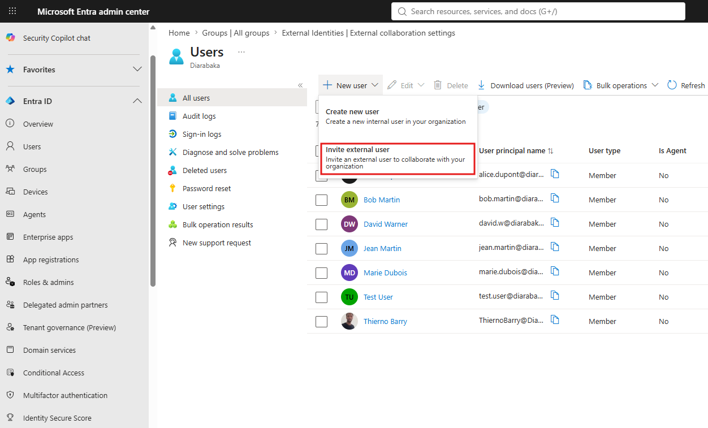
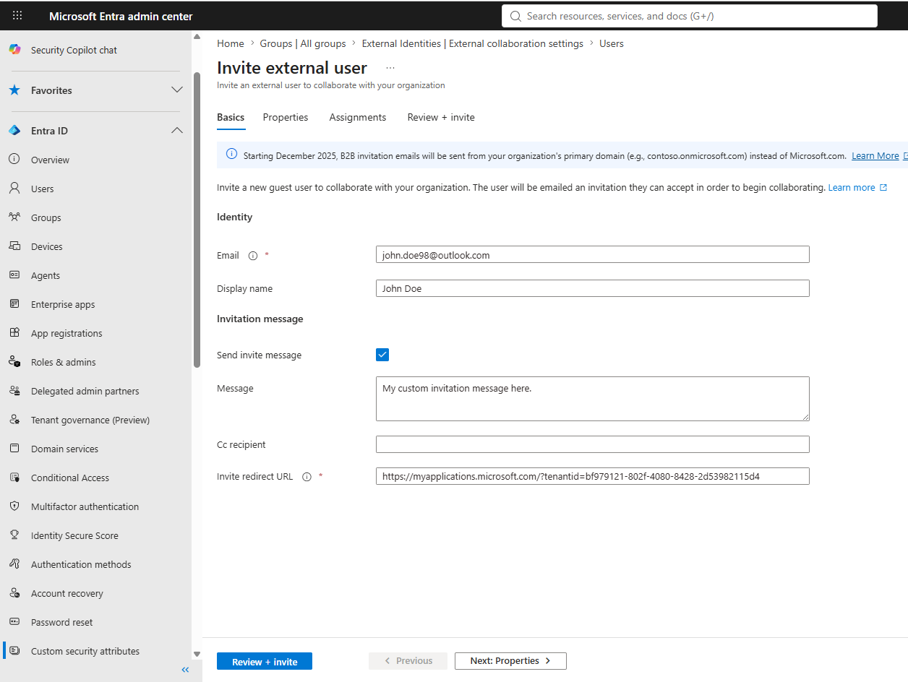
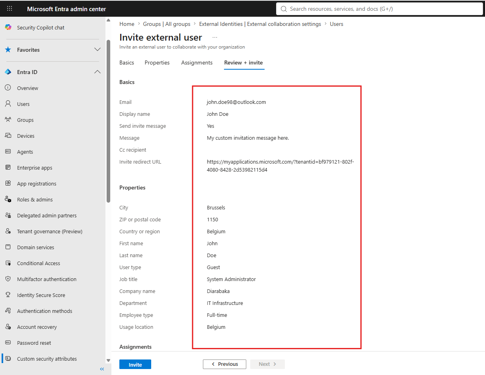
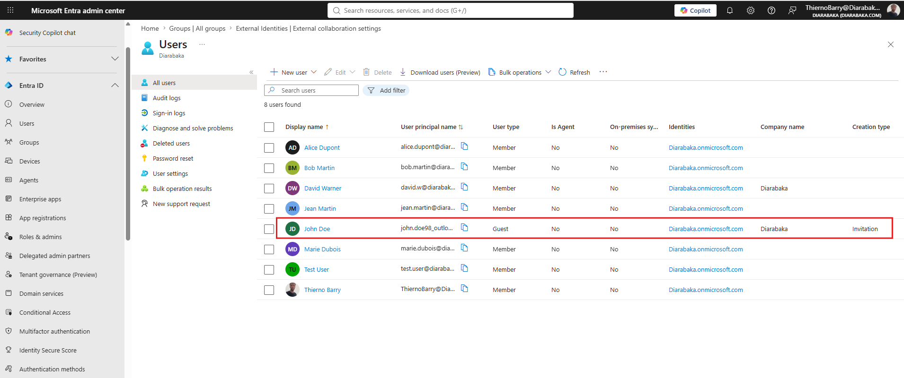
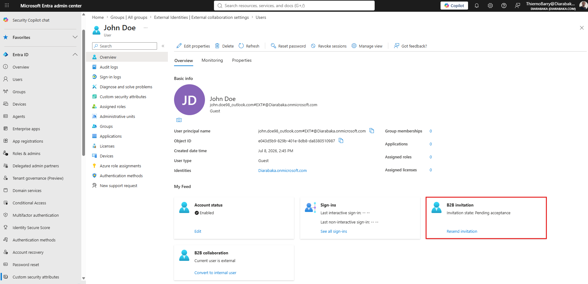

# Inviter un utilisateur externe dans Microsoft Entra ID (B2B)

Dans ce lab, j’invite **John Doe** dans le tenant **Diarabaka**, puis je vérifie la création de son compte invité et l’état de son invitation.

## 1. Vérifier les paramètres de collaboration externe

Dans **Entra ID → External Identities → External collaboration settings**, je vérifie que l’accès des invités aux propriétés et aux appartenances des objets de l’annuaire est limité. Dans ce lab, l’envoi d’invitations est autorisé pour tous les utilisateurs du tenant, y compris les invités.

## 2. Envoyer l’invitation

Dans **Entra ID → Users → All users**, je sélectionne **New user → Invite external user**.

Je renseigne l’adresse externe et le nom d’affichage de **John Doe**, puis je laisse **Send invite message** coché et j’ajoute un message personnalisé.

Dans **Review + invite**, je vérifie les informations et le type **Guest**, puis je clique sur **Invite**.

## 3. Vérifier le compte invité

Dans **All users**, **John Doe** apparaît avec le type **Guest** et le mode de création **Invitation**.

Sur sa fiche, la section **B2B invitation** affiche **Pending acceptance**. Le compte invité est créé et l’invitation attend encore d’être acceptée.

