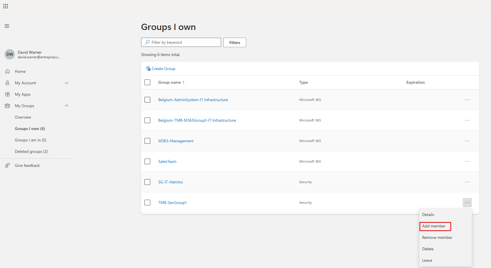
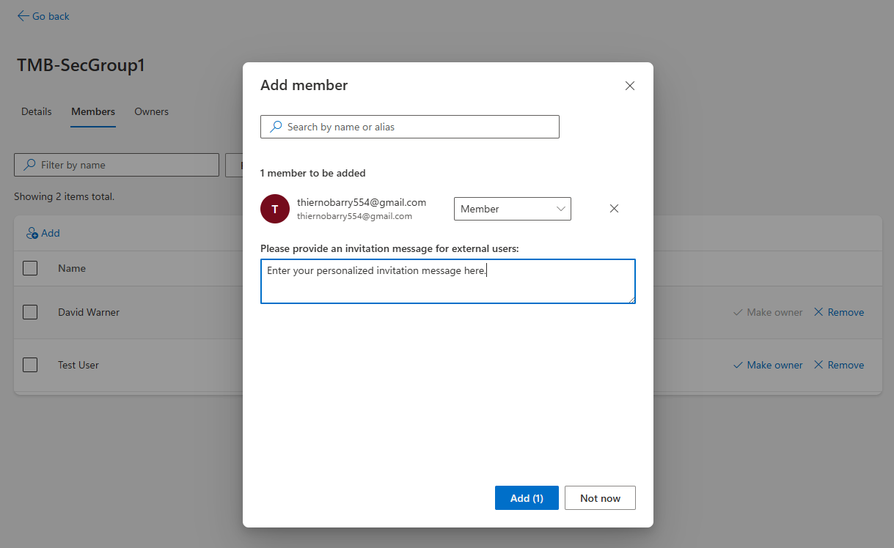
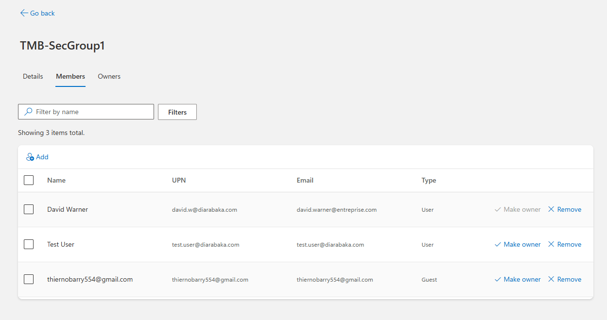

# Inviter un utilisateur externe dans un groupe depuis My Groups

Dans ce lab, **David Warner** invite un utilisateur externe à rejoindre le groupe de sécurité **TMB-SecGroup1** depuis le portail **My Groups**.

## 1. Ouvrir le groupe

Avec le compte de David, j’ouvre **My Groups → Groups I own**. Dans le menu du groupe **TMB-SecGroup1**, je sélectionne **Add member**.

## 2. Envoyer l’invitation

Dans **Add member**, je sélectionne l’adresse externe, je conserve le rôle **Member** dans le groupe et je renseigne le message d’invitation. Je clique sur **Add (1)** pour valider.

## 3. Vérifier l’ajout au groupe

Dans l’onglet **Members**, le compte externe apparaît parmi les trois membres du groupe. La colonne **Type** affiche **Guest**.

