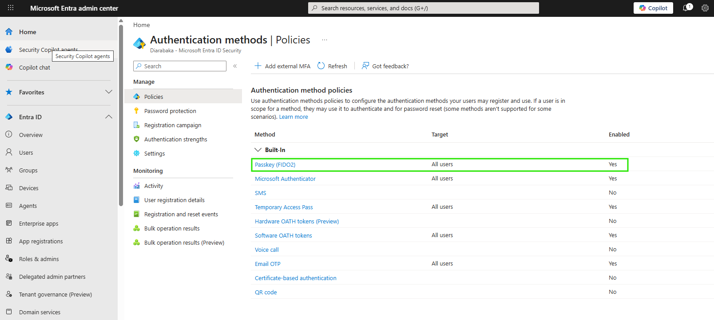
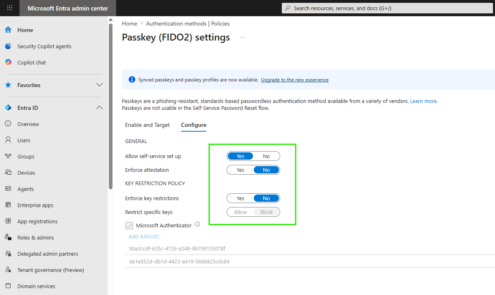

# Activer les passkeys (FIDO2) dans Microsoft Entra ID

Les passkeys permettent une authentification sans mot de passe et résistante au phishing. Dans ce lab, j’active cette méthode pour tous les utilisateurs du tenant **Diarabaka**.

## 1. Activer la méthode Passkey (FIDO2)

Dans **Entra ID → Authentication methods → Policies**, je vérifie que **Passkey (FIDO2)** affiche **Enabled = Yes** et **Target = All users**.

## 2. Configurer l’inscription des passkeys

Dans **Passkey (FIDO2) → Configure**, je vérifie les trois réglages du lab.

| Paramètre                     | Valeur  | Effet                                                                 |
| ----------------------------- | ------- | --------------------------------------------------------------------- |
| **Allow self-service set up** | **Yes** | Les utilisateurs peuvent enregistrer eux-mêmes une passkey.           |
| **Enforce attestation**       | **No**  | L’attestation de la clé n’est pas exigée lors de l’inscription.       |
| **Enforce key restrictions**  | **No**  | Aucune liste de modèles de clés approuvés ou bloqués n’est appliquée. |

