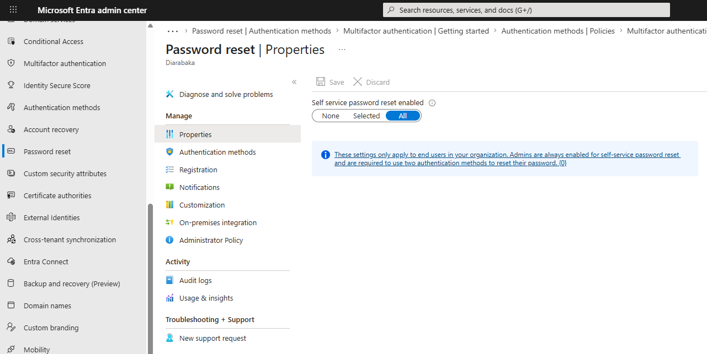
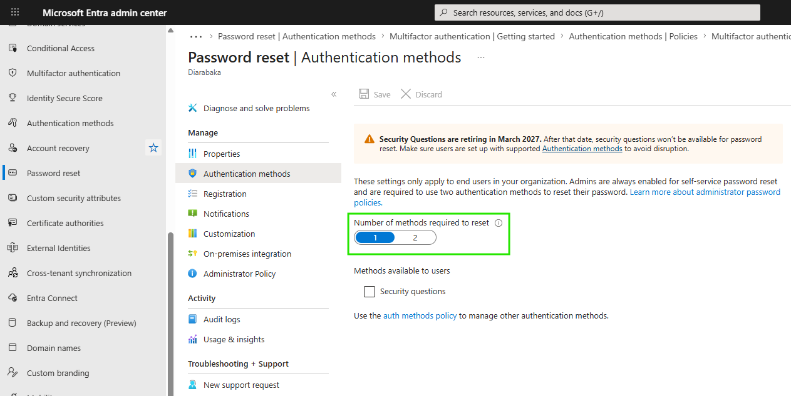
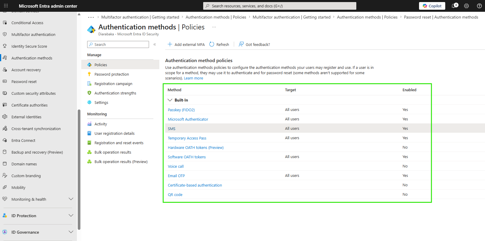

# Configurer les méthodes d’authentification dans Microsoft Entra ID

Dans ce lab, je configure la réinitialisation du mot de passe en libre-service (SSPR) et je vérifie les méthodes d’authentification activées dans le tenant **Diarabaka**.

## 1. Activer la réinitialisation en libre-service

Dans **Entra ID → Password reset → Properties**, je sélectionne **All** pour activer le SSPR pour tous les utilisateurs.

## 2. Définir le nombre de méthodes requises

Dans **Password reset → Authentication methods**, je sélectionne **1** dans **Number of methods required to reset**. Les questions de sécurité sont désactivées. Le portail indique que les administrateurs doivent utiliser deux méthodes pour réinitialiser leur mot de passe.

## 3. Vérifier la stratégie d’authentification

Dans **Entra ID → Authentication methods → Policies**, je vérifie l’état des méthodes du tenant.

| État            | Méthodes                                                                                                 |
| --------------- | -------------------------------------------------------------------------------------------------------- |
| **Activées**    | Passkey (FIDO2), Microsoft Authenticator, SMS, Temporary Access Pass, jetons OATH logiciels et Email OTP |
| **Désactivées** | Jetons OATH matériels, appel vocal, authentification par certificat et code QR                           |

