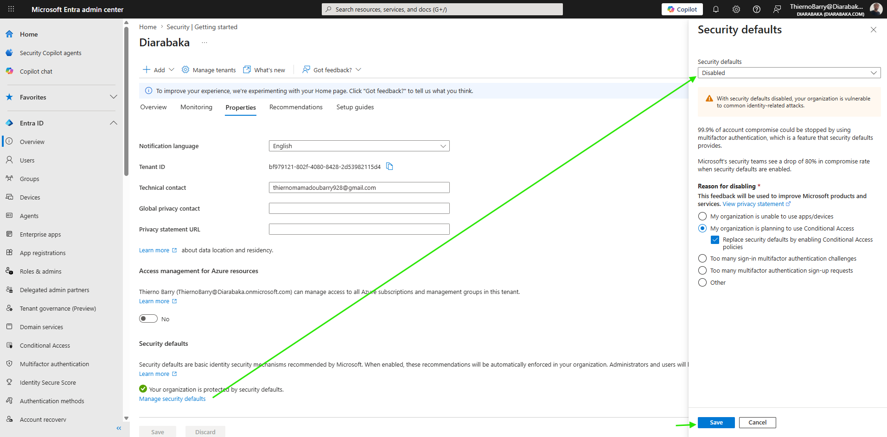
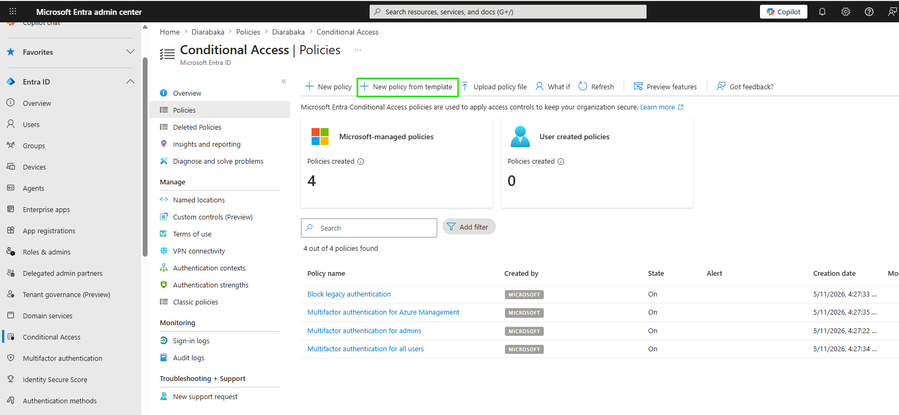
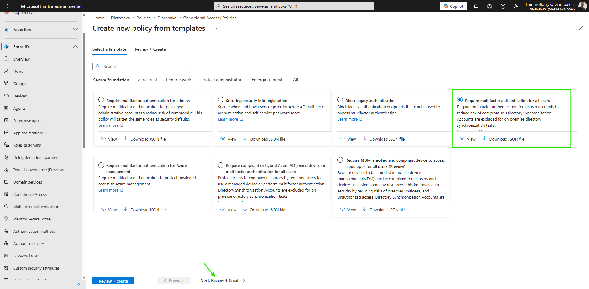
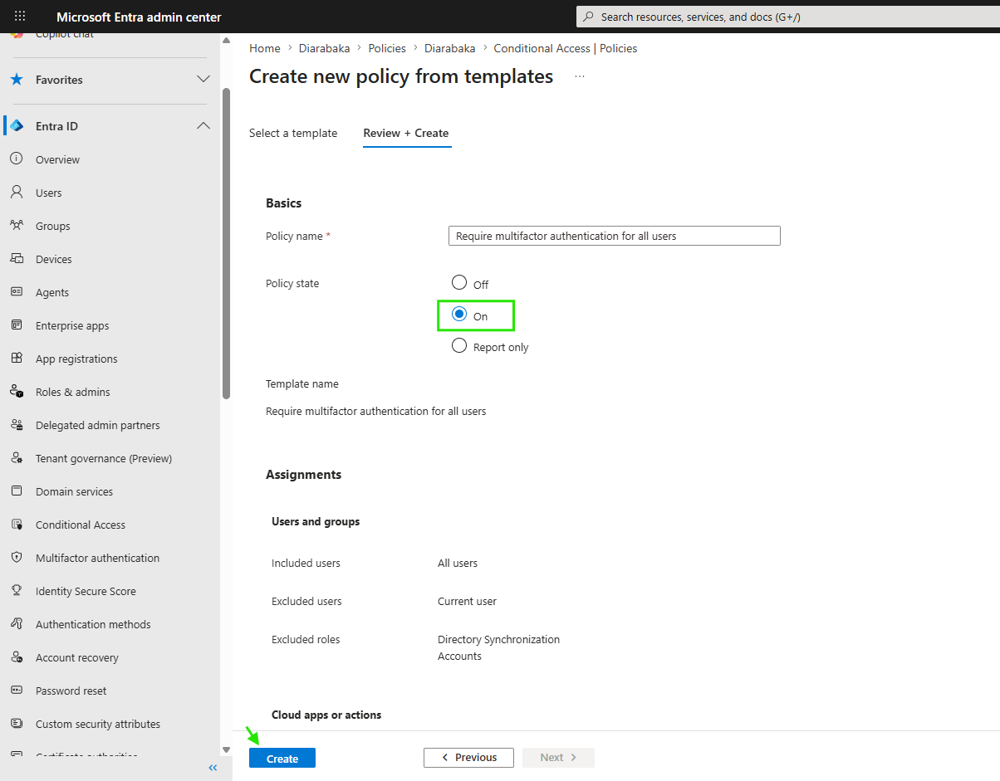
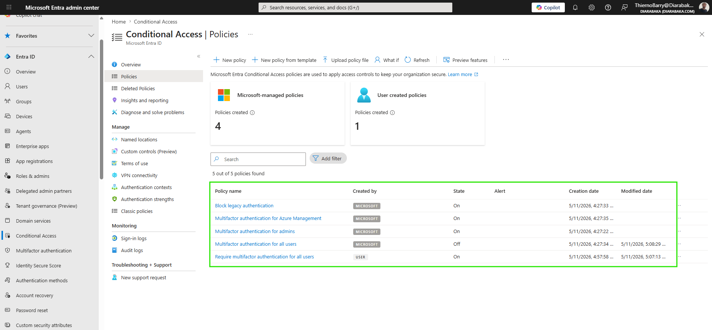

# Exiger le MFA avec l’accès conditionnel dans Microsoft Entra ID

Dans le tenant de lab **Diarabaka**, je passe des paramètres de sécurité par défaut à l’accès conditionnel et j’active une stratégie MFA à partir d’un modèle Microsoft.

## 1. Passer à l’accès conditionnel

Dans **Entra ID → Overview → Properties → Manage security defaults**, je sélectionne **Disabled** et je coche l’option de remplacement par des stratégies d’accès conditionnel avant d’enregistrer.

## 2. Créer la stratégie MFA

Dans **Conditional Access → Policies**, je clique sur **New policy from template**.

Je sélectionne le modèle **Require multifactor authentication for all users**.

Dans **Review + Create**, je règle **Policy state** sur **On**. La stratégie cible **All users** et exclut le compte actuellement connecté ainsi que le rôle **Directory Synchronization Accounts**. Je clique sur **Create**.

## 3. Vérifier l’activation

Dans **Conditional Access → Policies**, la stratégie créée affiche **On**. La stratégie équivalente gérée par Microsoft, **Multifactor authentication for all users**, affiche **Off**.

