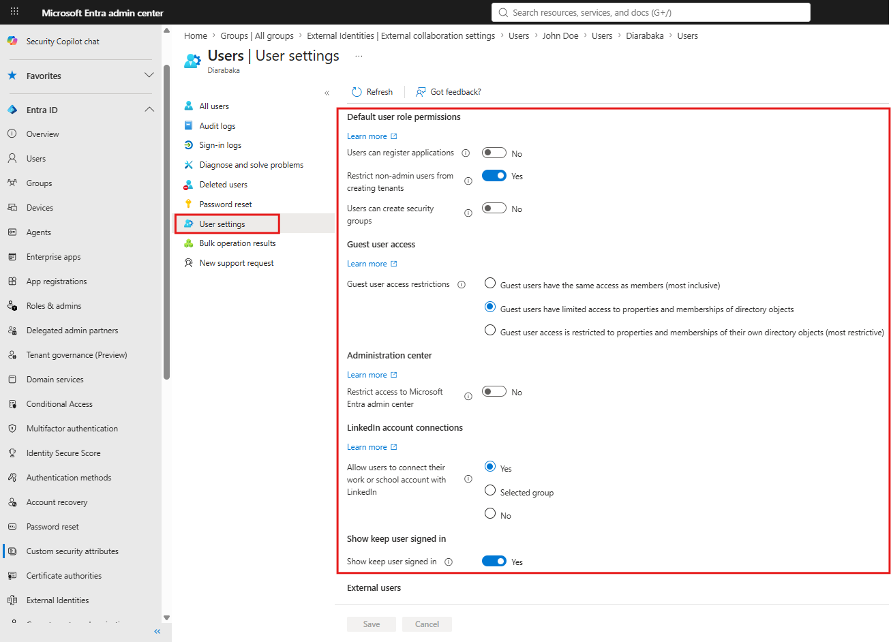

# Configurer les paramètres utilisateur dans Microsoft Entra ID

Dans le tenant **Diarabaka**, j’ouvre **Entra ID → Users → User settings** pour vérifier les permissions par défaut des utilisateurs et les paramètres d’accès des invités.

| Paramètre                                                                      | Valeur affichée |
| ------------------------------------------------------------------------------ | --------------- |
| Autoriser les utilisateurs à inscrire des applications                         | **No**          |
| Empêcher les utilisateurs non administrateurs de créer des tenants             | **Yes**         |
| Autoriser les utilisateurs à créer des groupes de sécurité                     | **No**          |
| Accès des invités aux propriétés et aux appartenances des objets de l’annuaire | **Limité**      |
| Restreindre l’accès au centre d’administration Microsoft Entra                 | **No**          |
| Autoriser la connexion du compte professionnel ou scolaire à LinkedIn          | **Yes**         |
| Afficher l’invite « Rester connecté ? »                                        | **Yes**         |

