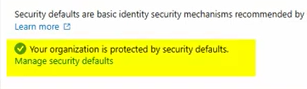
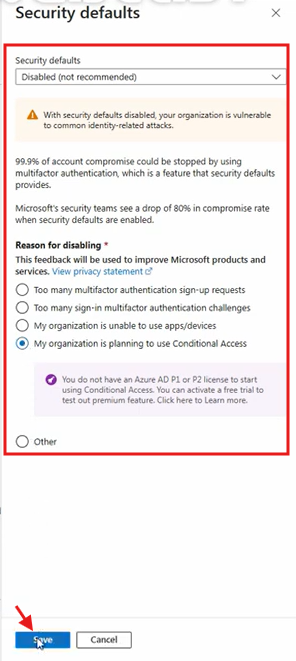
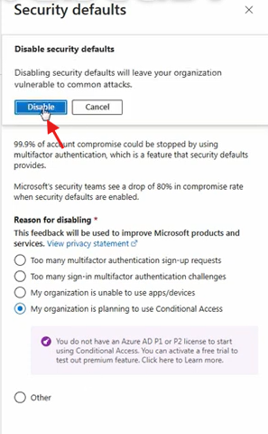
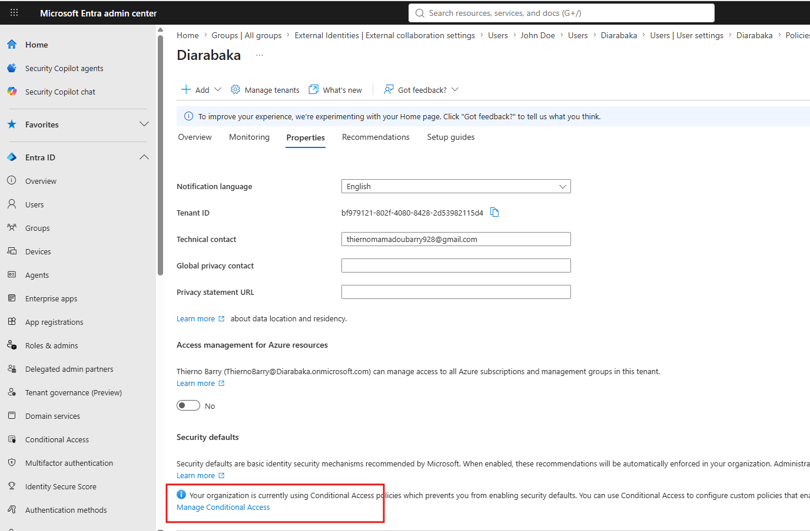

# Désactiver les paramètres de sécurité par défaut dans Microsoft Entra ID

Dans le tenant de lab **Diarabaka**, je désactive les **Security defaults** pour passer à des stratégies d’accès conditionnel (**Conditional Access**).

## 1. Vérifier l’état initial

Dans **Entra ID → Overview → Properties**, la section **Security defaults** indique que les paramètres de sécurité par défaut sont actifs. Je clique sur **Manage security defaults**.

## 2. Désactiver les paramètres de sécurité par défaut

Je sélectionne **Disabled (not recommended)**, puis le motif **My organization is planning to use Conditional Access**. Je clique sur **Save**.

Dans la fenêtre de confirmation, je clique sur **Disable**.

## 3. Vérifier le résultat

Dans **Properties → Security defaults**, le portail indique que le tenant utilise des stratégies d’accès conditionnel. Le lien **Manage Conditional Access** ouvre la gestion de ces stratégies.

