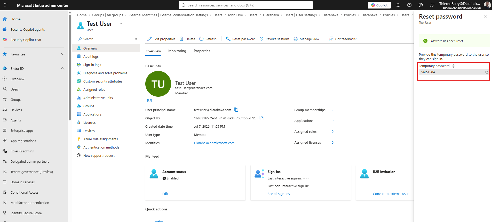
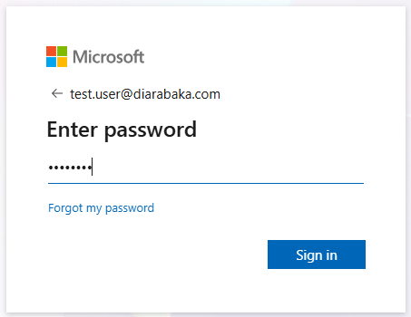
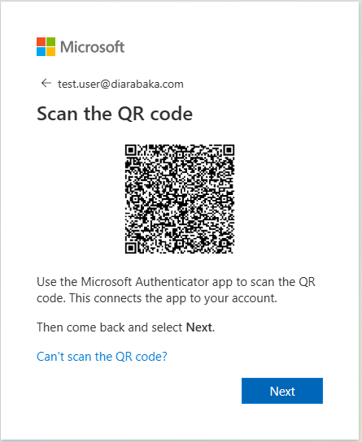
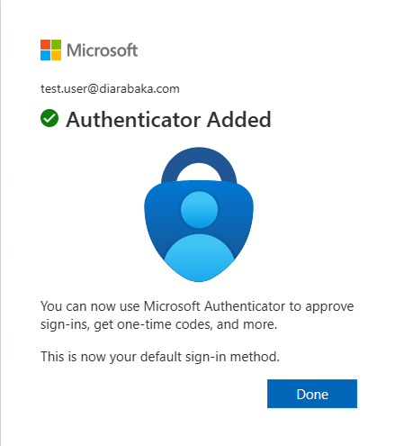
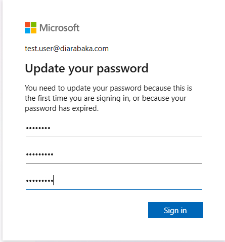
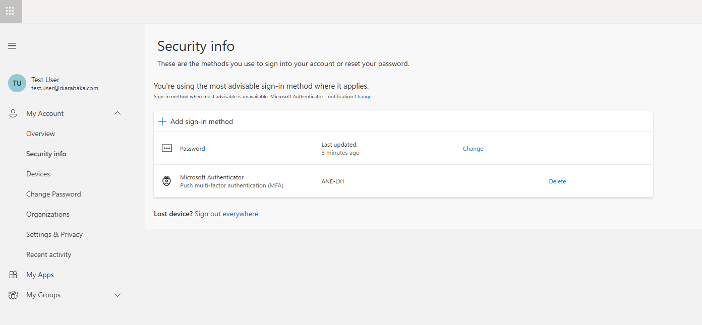
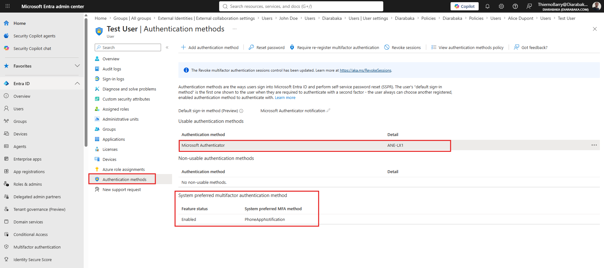

# Configurer les informations de sécurité à la connexion dans Microsoft Entra ID

Dans ce lab, j’enregistre **Microsoft Authenticator** comme méthode MFA pour le compte de test, puis je vérifie son inscription côté utilisateur et côté administrateur.

## 1. Préparer la connexion

Dans le centre d’administration Microsoft Entra, je réinitialise le mot de passe de **Test User** pour obtenir un mot de passe temporaire.

Je me connecte avec `test.user@diarabaka.com` et le mot de passe temporaire.

## 2. Enregistrer Microsoft Authenticator

À l’invite **Scan the QR code**, je scanne le code avec l’application **Microsoft Authenticator**, puis je clique sur **Next**.

Le message **Authenticator Added** confirme l’inscription de l’application comme méthode de connexion par défaut.

Sur l’écran **Update your password**, je remplace le mot de passe temporaire par un nouveau mot de passe.

## 3. Vérifier l’inscription

Dans **Mon compte → Security info**, je retrouve **Microsoft Authenticator** comme méthode MFA par notification.

Dans **Entra ID → Users → Test User → Authentication methods**, je vérifie que **Microsoft Authenticator** figure parmi les méthodes utilisables et que **PhoneAppNotification** est la méthode MFA préférée par le système.

