# Utiliser un Temporary Access Pass dans Microsoft Entra ID

Dans ce lab, je génère un **Temporary Access Pass (TAP)** pour le compte de test **Rama Barry**. Je l’utilise pour me connecter et accéder aux informations de sécurité du compte.

## 1. Configurer la stratégie TAP

Dans **Entra ID → Authentication methods → Policies**, je vérifie que **Temporary Access Pass** est activé pour **All users**.

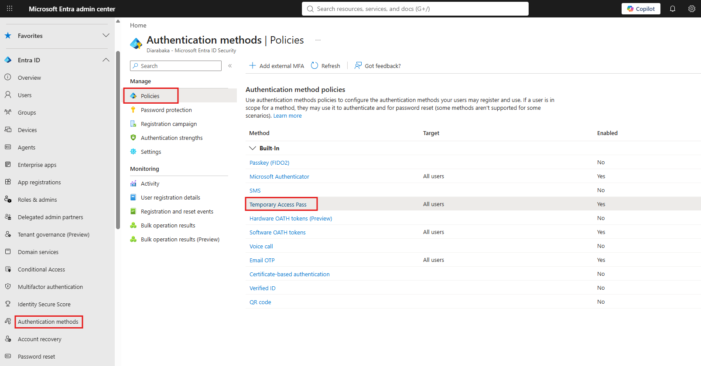

Dans **Configure**, je règle la durée minimale et la durée par défaut sur **1 heure**, la durée maximale sur **8 heures** et la longueur du code sur **12 caractères**. L’usage unique est désactivé dans ce lab.

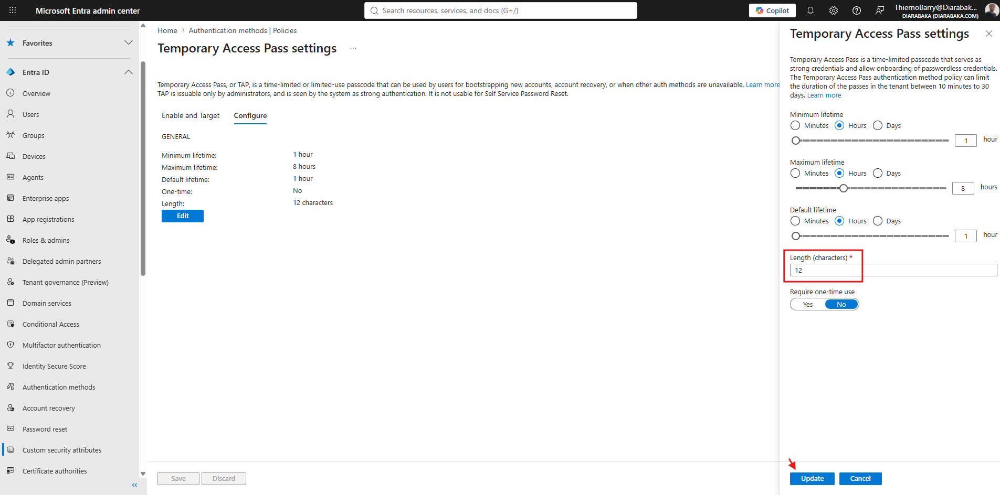

## 2. Créer le compte de test

Dans **Users → New user → Create new user**, je prépare le compte `rama@diarabaka.com` avec un mot de passe généré automatiquement.

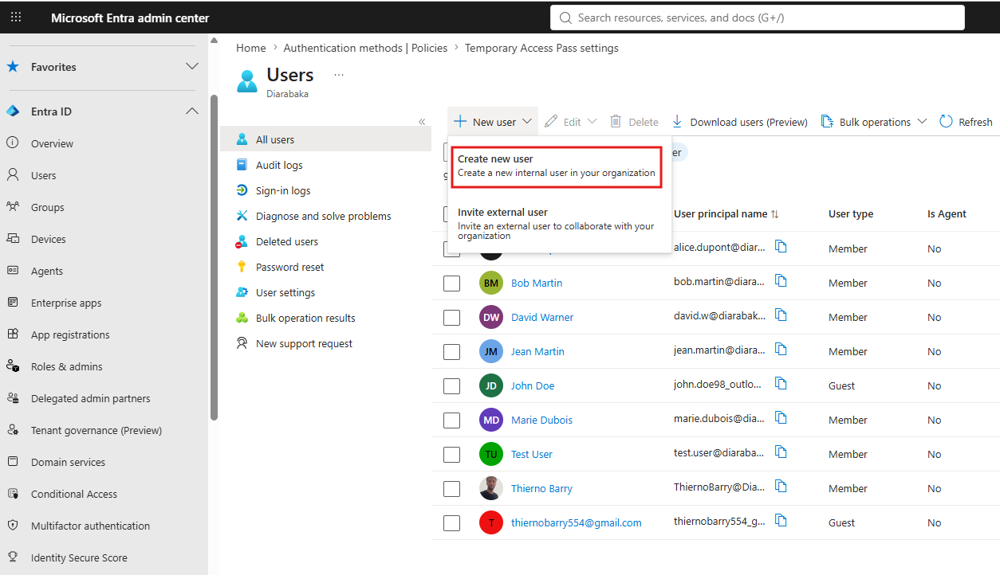
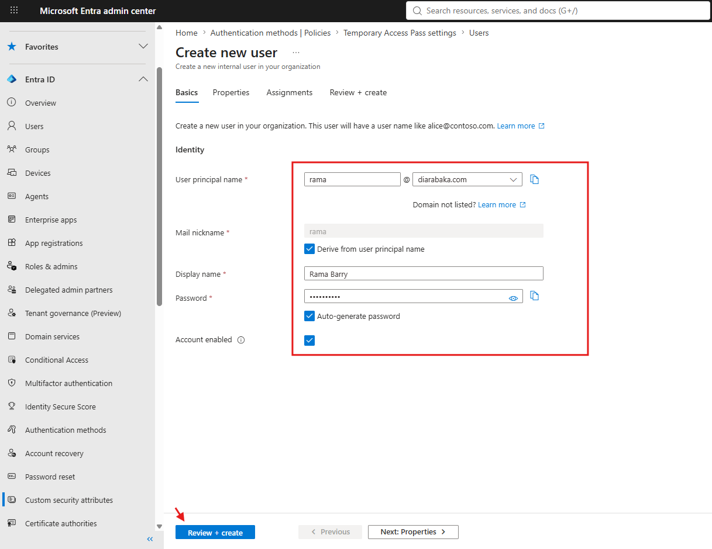

Je vérifie le récapitulatif, je clique sur **Create**, puis je retrouve **Rama Barry** dans **All users**.

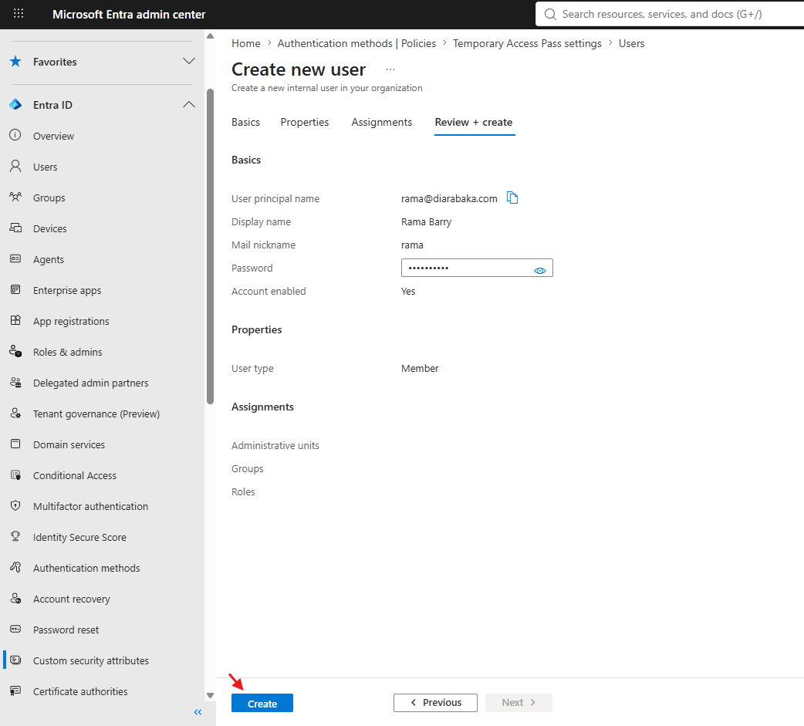
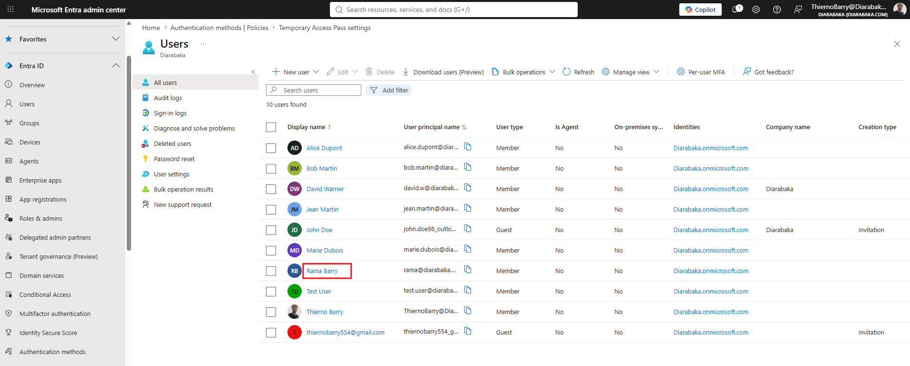

## 3. Générer le TAP

Sur la fiche de **Rama Barry**, j’ouvre **Authentication methods → Add authentication method**. Je sélectionne **Temporary Access Pass** et je crée un code valable **1 heure**, utilisable plusieurs fois pendant cette période.

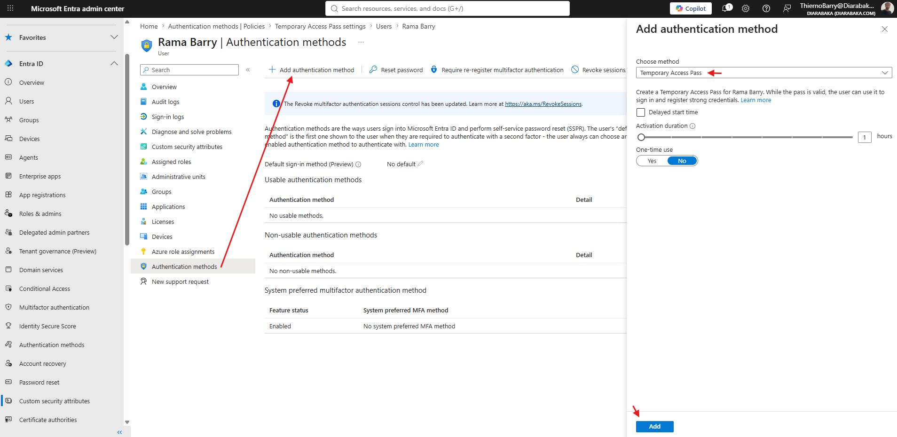

Le panneau **Temporary Access Pass details** affiche le code et son heure d’expiration.

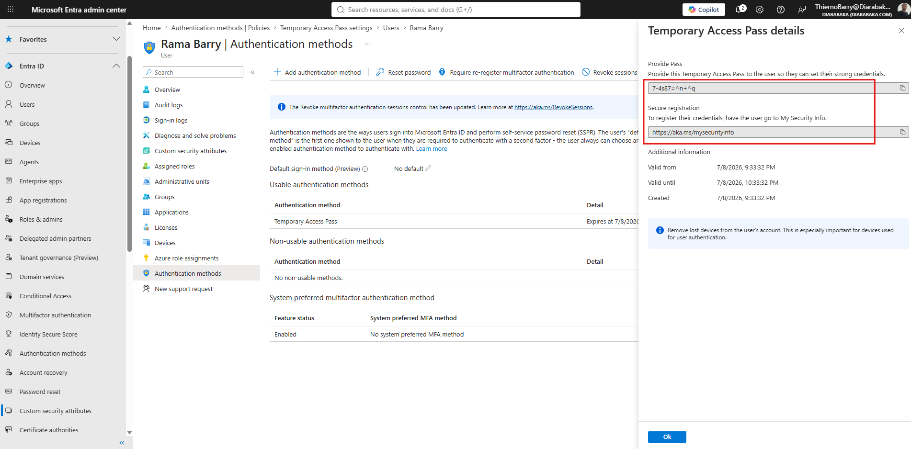

## 4. Tester la connexion et vérifier les méthodes

Je me connecte à [Security info](https://aka.ms/mysecurityinfo) avec le compte de test et je saisis le TAP. Une fois connecté, je vérifie que **Microsoft Authenticator** et **Temporary access pass** figurent dans les méthodes du compte.

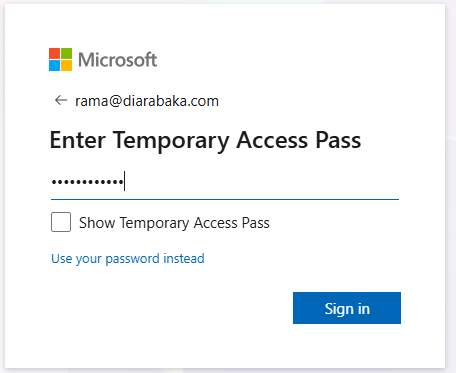
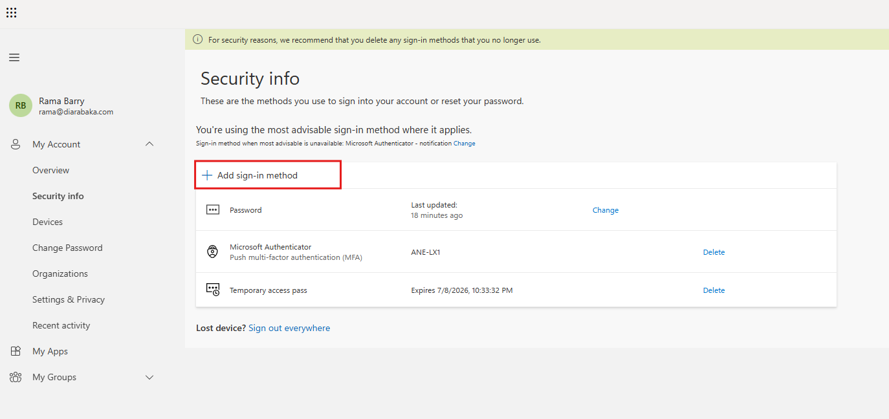

## 5. Vérifier le TAP côté administrateur

Dans **Authentication methods**, je retrouve le TAP et son expiration. Le menu de la méthode propose **Delete** pour retirer le code avant son expiration.

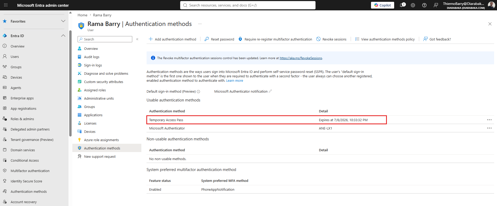
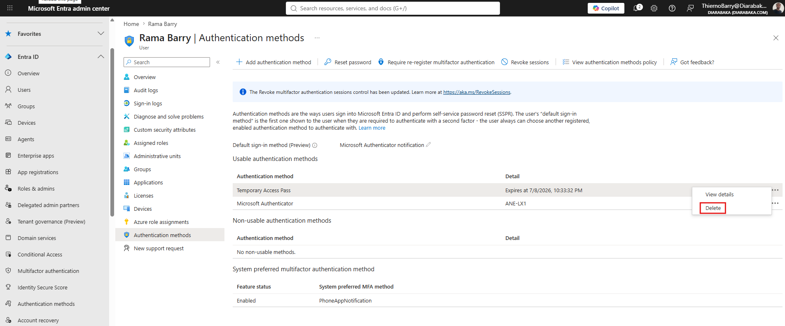
