# Ajouter des méthodes MFA dans Microsoft Entra ID

Dans ce lab, j’ajoute un numéro de téléphone au compte **Rama Barry**, j’active les SMS pour un groupe de test et je vérifie l’inscription de **Microsoft Authenticator**.

## 1. Ajouter un numéro de téléphone

Dans **Entra ID → Users → Rama Barry → Authentication methods**, je clique sur **Add authentication method**, puis je sélectionne **Phone number** et **Primary mobile**.

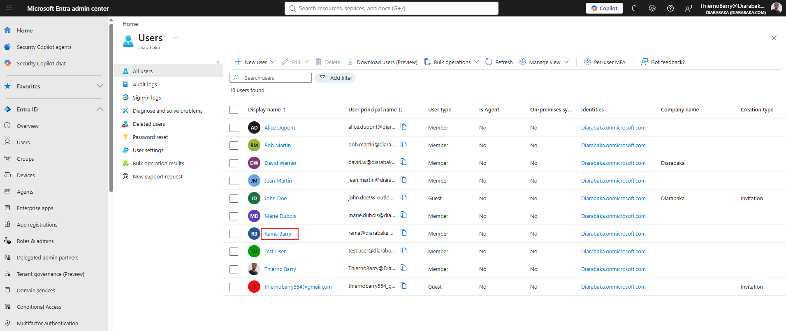
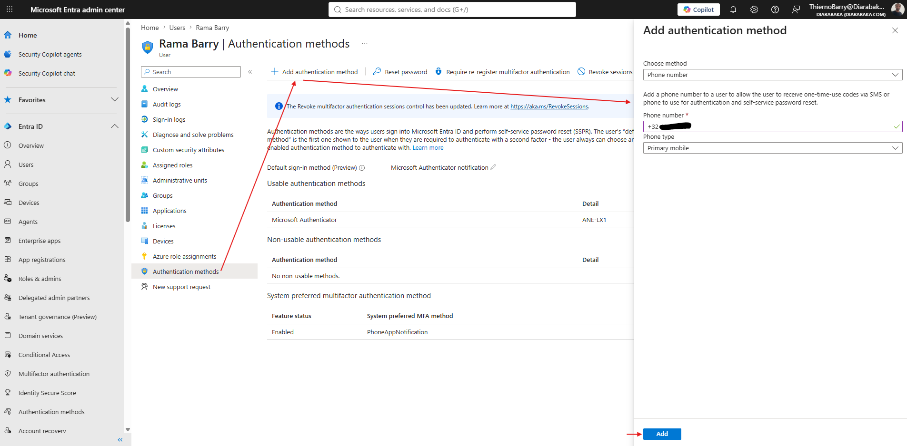

Le numéro est enregistré, mais il apparaît dans **Non-usable authentication methods** avec la mention **Disabled by policy**. Dans **Authentication methods → Policies**, la méthode **SMS** affiche **No**.

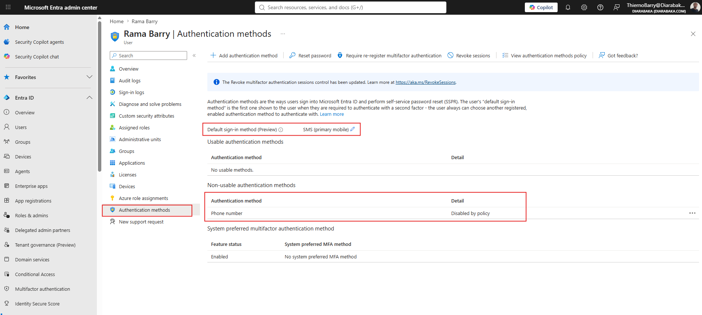
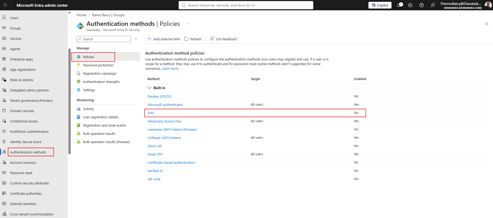

## 2. Activer les SMS pour le groupe de test

Dans **SMS settings**, j’active la méthode, puis je passe de **All users** à **Select groups**. Je sélectionne **TMB-SecGroup1** et j’enregistre.

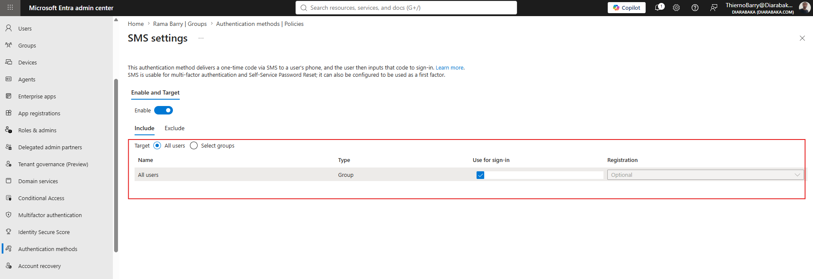
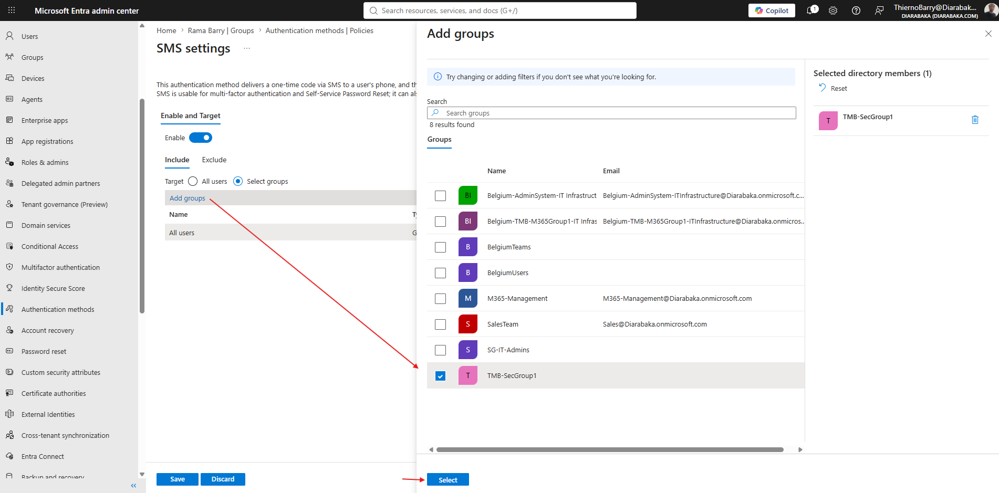
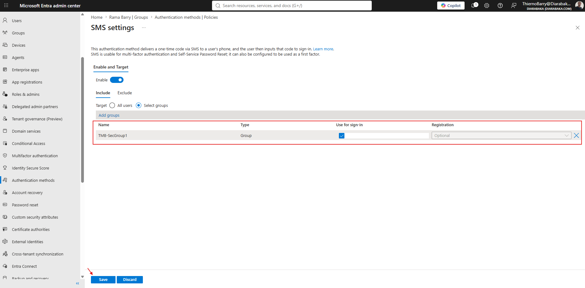

La liste des stratégies confirme que les SMS sont activés pour **1 group**. Sur la fiche de Rama, le numéro figure désormais parmi les méthodes utilisables.

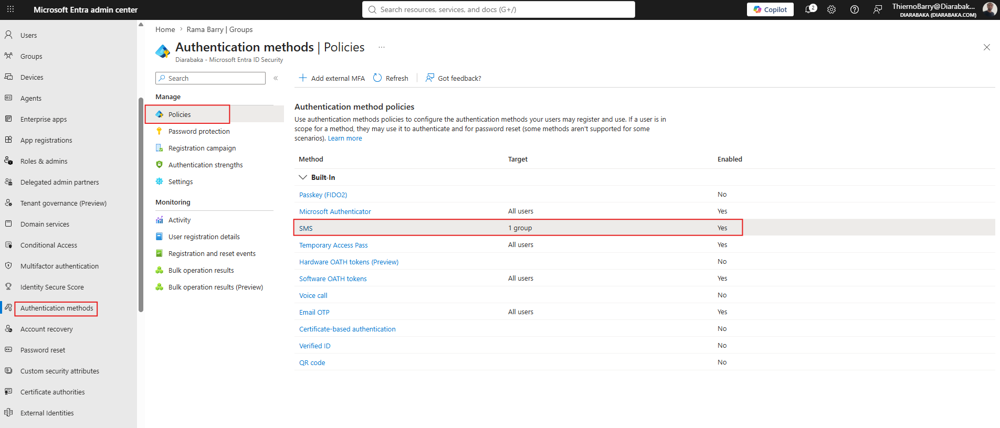
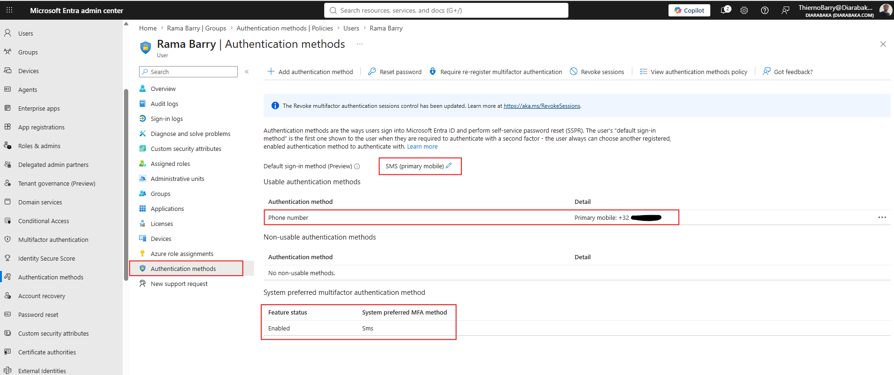

## 3. Enregistrer Microsoft Authenticator

À la connexion, le compte est invité à configurer **Microsoft Authenticator**. Une demande d’approbation avec correspondance de numéro s’affiche ensuite.

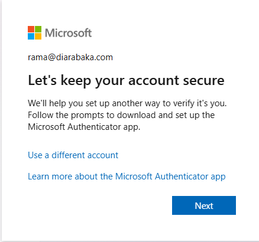
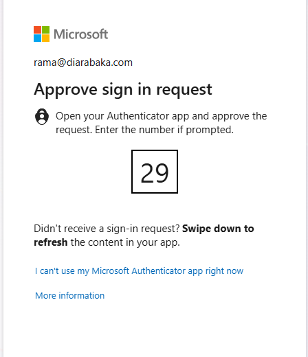

## 4. Vérifier les méthodes et les connexions

Dans **Security info**, je retrouve le téléphone et **Microsoft Authenticator**. Dans **Sign-in logs**, plusieurs connexions du compte affichent **Success**.

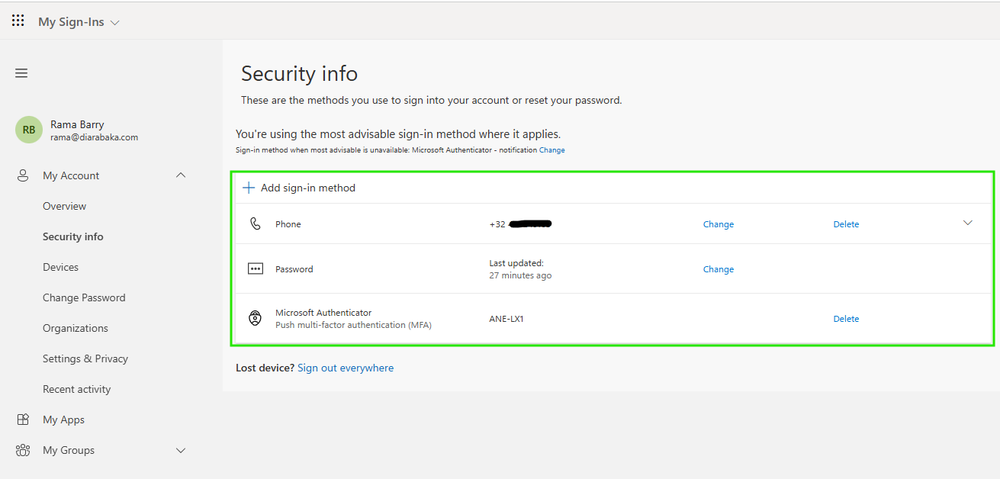
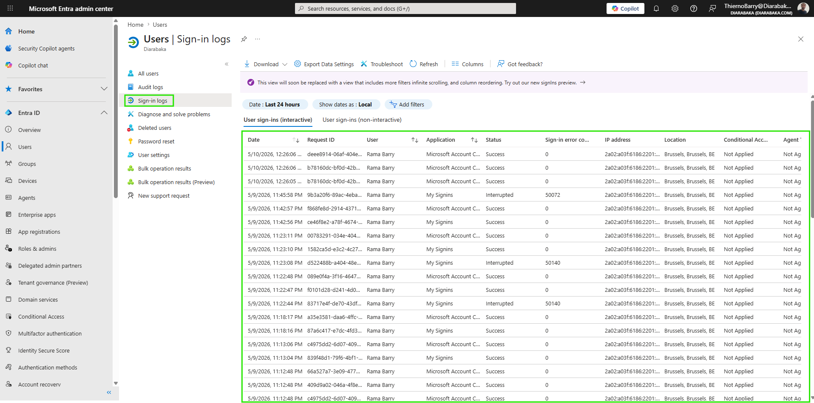

Côté administrateur, **Authentication methods** confirme que le téléphone et Microsoft Authenticator sont utilisables. La méthode MFA préférée par le système est **PhoneAppNotification**, la notification de Microsoft Authenticator.

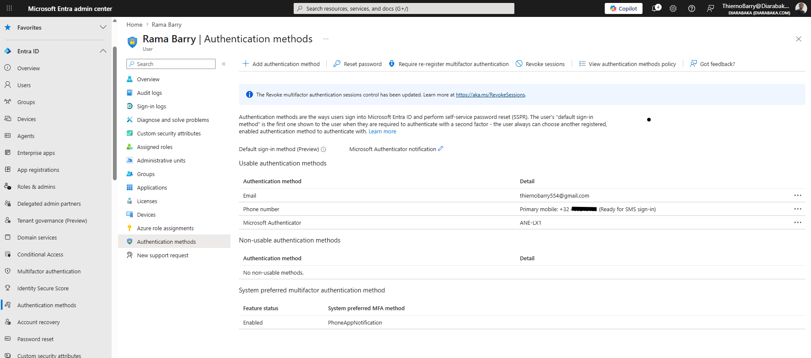
