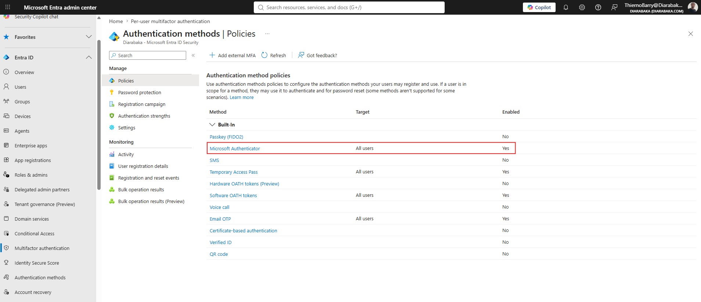
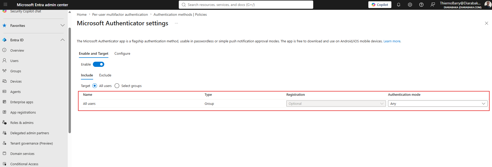
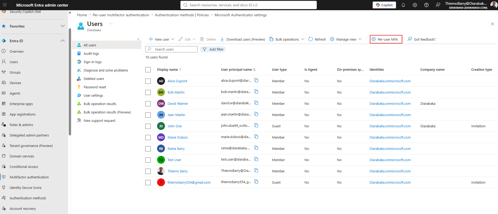
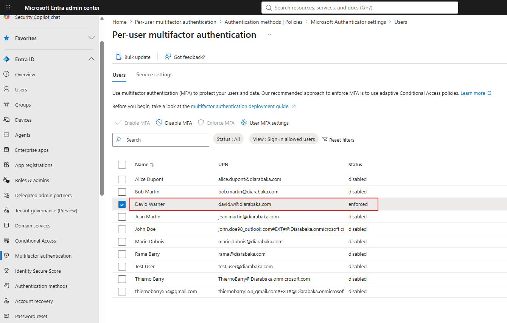

# Autoriser la connexion sans mot de passe avec Microsoft Authenticator

Dans le tenant de lab **Diarabaka**, je vérifie que la stratégie **Microsoft Authenticator** autorise la connexion sans mot de passe.

## 1. Vérifier la stratégie Microsoft Authenticator

Dans **Entra ID → Authentication methods → Policies**, je vérifie que **Microsoft Authenticator** est activé pour **All users**.

Dans **Enable and Target**, le mode **Any** autorise à la fois la connexion sans mot de passe avec le téléphone et les notifications MFA classiques.

## 2. Vérifier l’état du MFA par utilisateur

Dans **Entra ID → Users → All users**, j’ouvre **Per-user MFA**.

Le compte **David Warner** affiche le statut **Enforced** dans la colonne **Status**.

