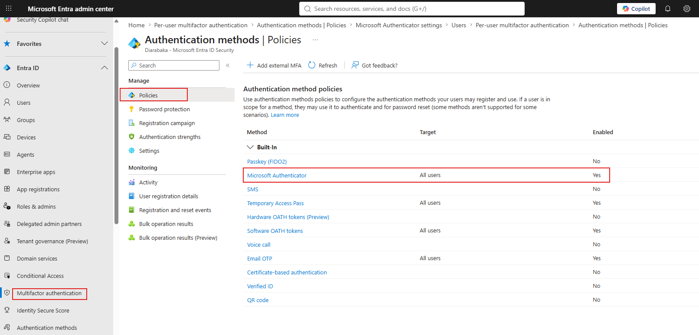
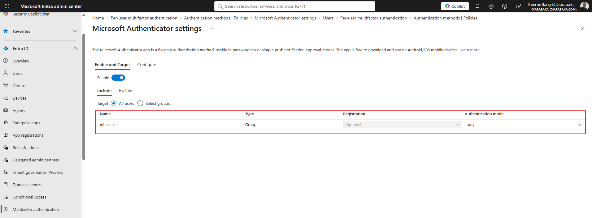
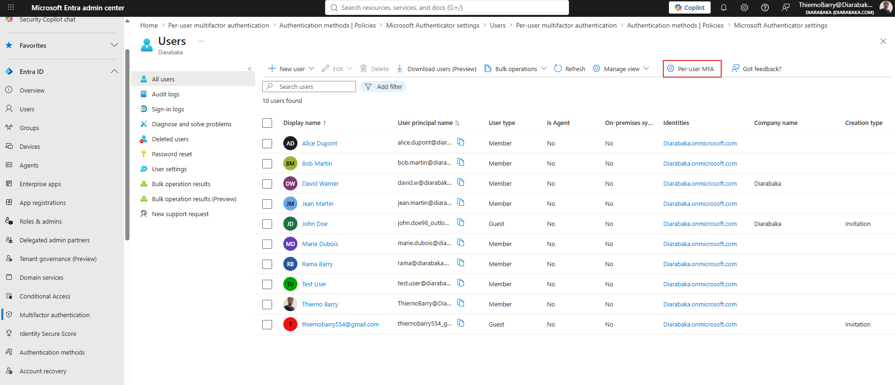
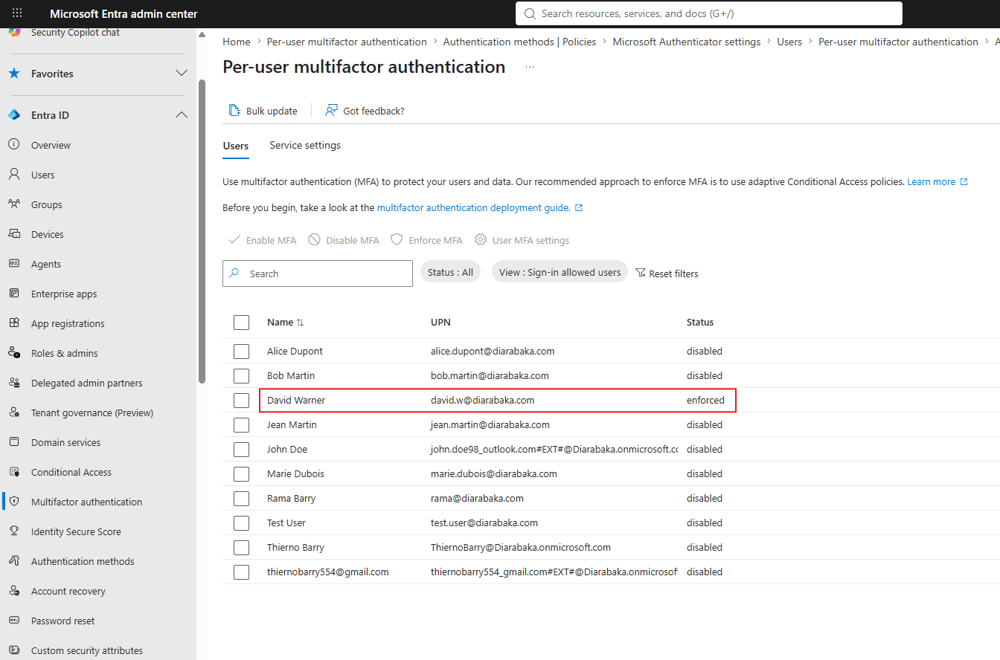
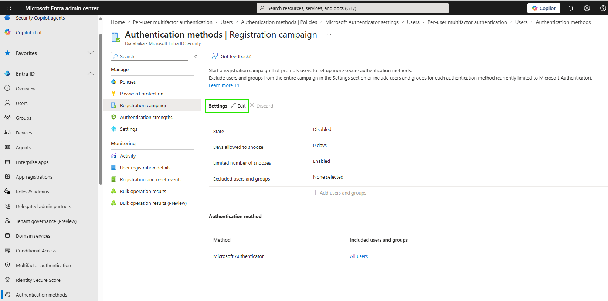
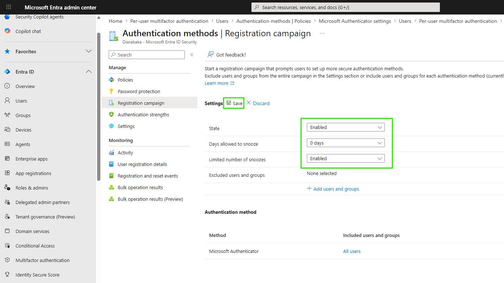
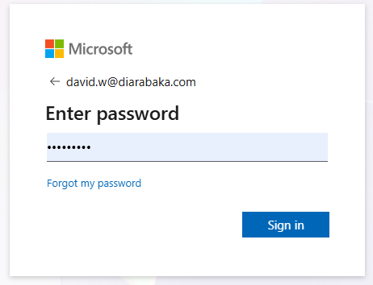
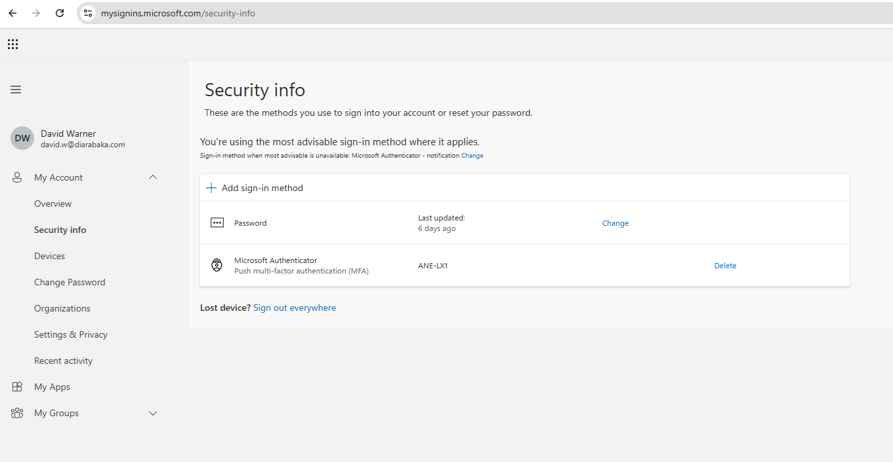
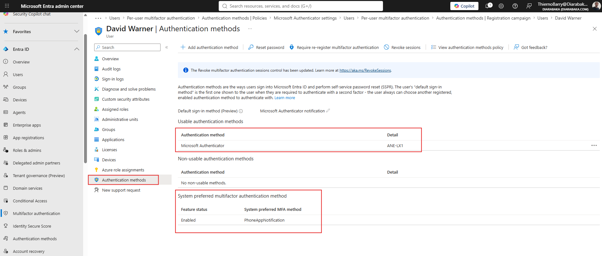
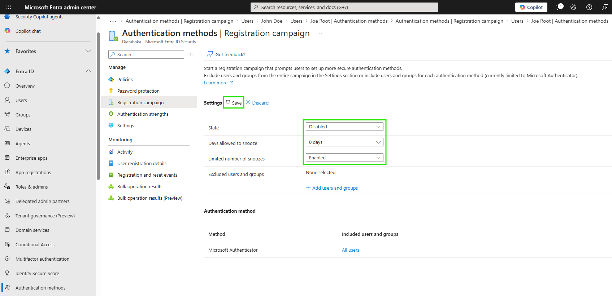

# Configurer une campagne d’inscription à Microsoft Authenticator

Dans le tenant de lab **Diarabaka**, j’active une campagne d’inscription à **Microsoft Authenticator** et je vérifie les méthodes enregistrées pour **David Warner**.

## 1. Vérifier la stratégie d’authentification

Dans **Entra ID → Authentication methods → Policies**, je vérifie que **Microsoft Authenticator** est activé pour **All users** avec le mode **Any**.

Dans **Users → All users → Per-user MFA**, je relève que David Warner affiche le statut **Enforced** pour le MFA par utilisateur.

## 2. Activer la campagne

Dans **Authentication methods → Registration campaign**, je clique sur **Edit**. Je passe **State** de **Disabled** à **Enabled**, avec un délai de report de **0 jour** et un nombre de reports limité. La campagne cible **All users**, sans exclusion. Je clique sur **Save**.

## 3. Vérifier la méthode enregistrée

Je me connecte avec le compte de David Warner. Dans **Security info**, je retrouve **Microsoft Authenticator** comme méthode MFA par notification.

Côté administrateur, **Users → David Warner → Authentication methods** affiche **Microsoft Authenticator** parmi les méthodes utilisables et **PhoneAppNotification** comme méthode MFA préférée par le système.

## 4. Désactiver la campagne après le test

Dans **Registration campaign**, je remets **State** sur **Disabled**, puis je clique sur **Save**.

