# Créer et gérer une unité administrative dans Microsoft Entra ID

Dans le tenant **Diarabaka**, je crée l’unité administrative **ITSystemAdmin**, je teste l’ajout manuel puis l’appartenance dynamique, et je délègue un rôle limité à cette unité.

## 1. Créer l’unité administrative

Dans **Entra ID → Roles and administrators → Admin units**, je clique sur **Add**. Je saisis le nom **ITSystemAdmin** et sa description, puis je laisse **Restricted management administrative unit** sur **No**.

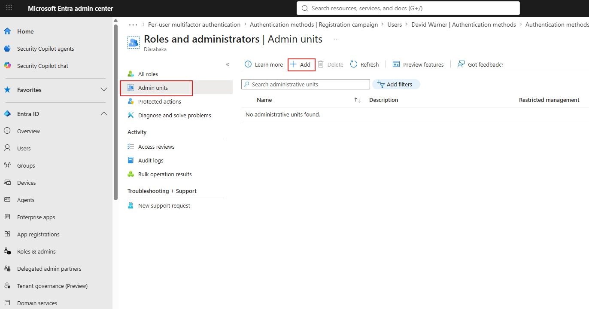
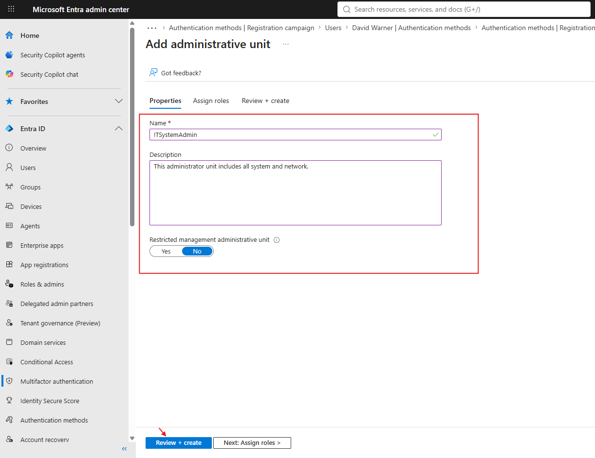

Dans **Review + create**, je clique sur **Create**. La liste confirme la création de l’unité avec le type d’appartenance **Assigned**.

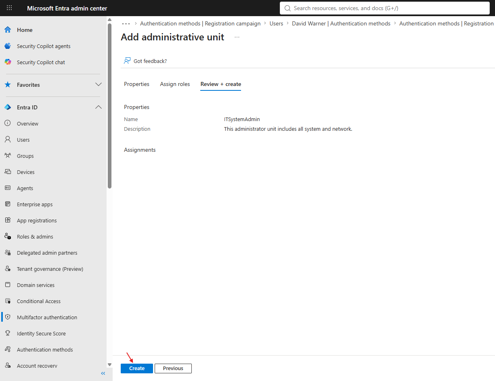
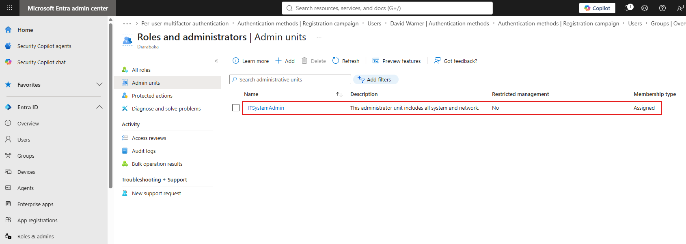

## 2. Ajouter des membres manuellement

Depuis **ITSystemAdmin**, j’ajoute **David Warner** dans **Users** et **SG-IT-Admins** dans **Groups**.

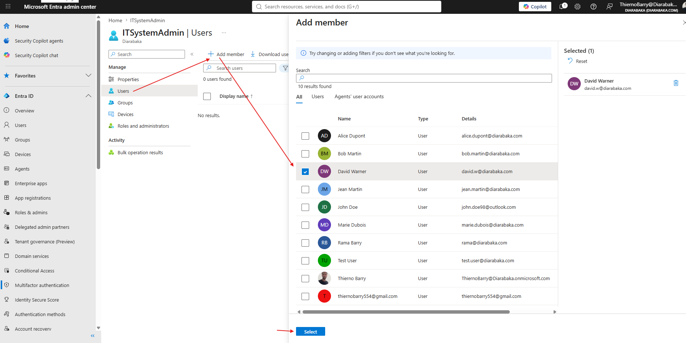
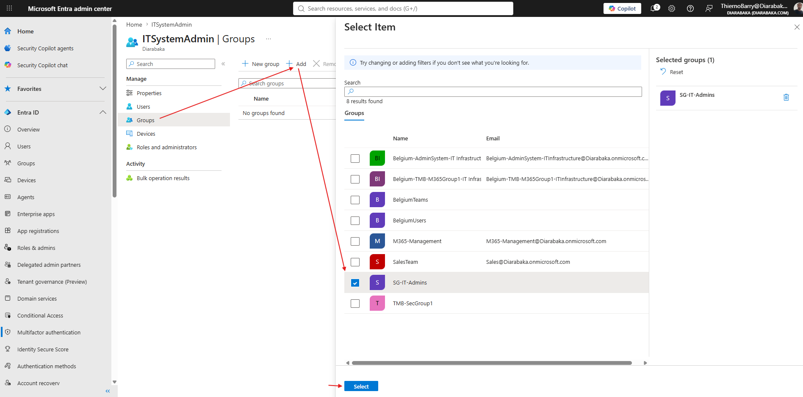

Les deux captures suivantes illustrent la sélection d’un appareil depuis **Devices → Add device** dans l’unité **CricketAustralia**, sur un autre tenant.

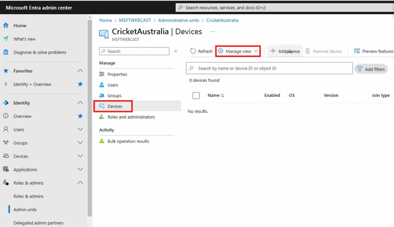
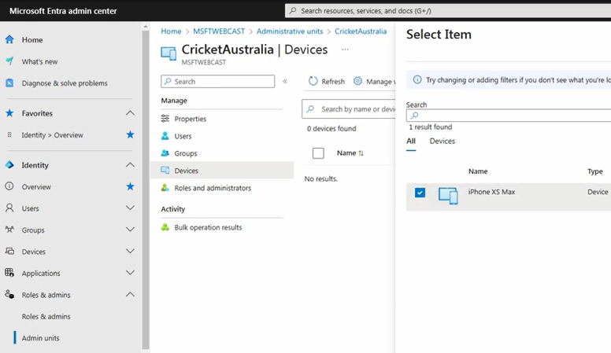

Dans **Diarabaka**, j’ajoute aussi **Rama Barry** depuis sa fiche utilisateur, via **Administrative units → Assign to administrative unit**.

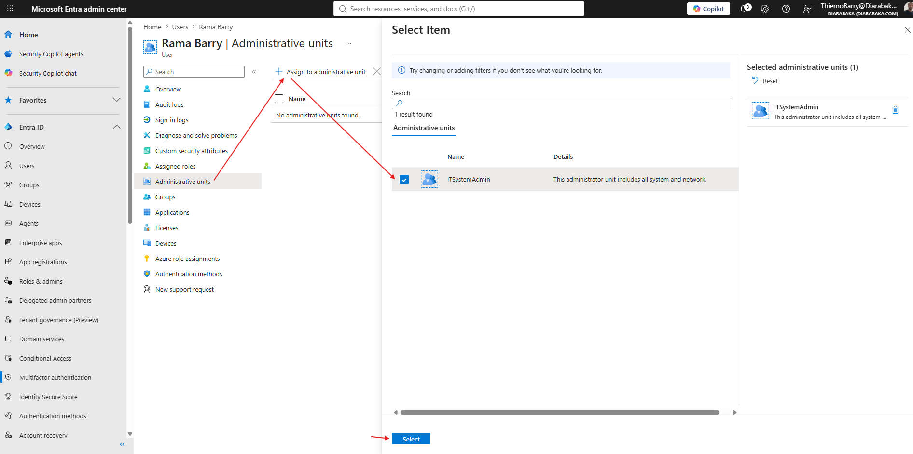

## 3. Configurer l’appartenance dynamique

Dans **ITSystemAdmin → Properties**, je sélectionne **Dynamic User**, puis **Add dynamic query**. J’enregistre la règle `(user.country -eq "Belgium")` pour cibler les utilisateurs dont le champ **Country** vaut `Belgium`.

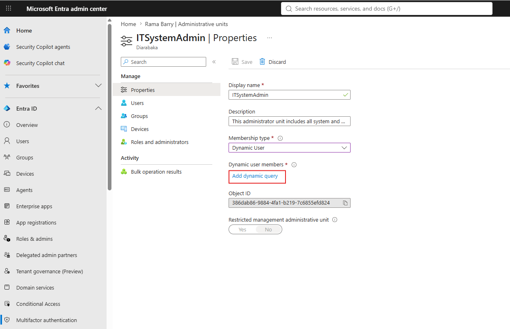
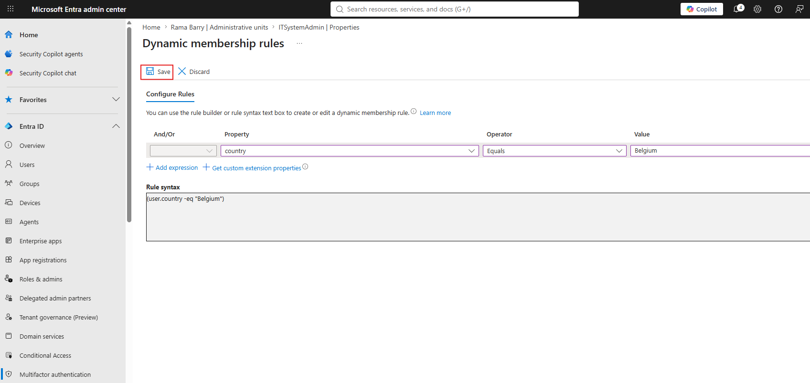
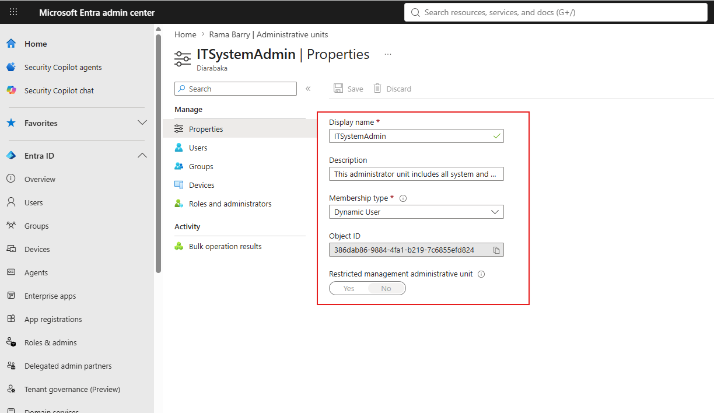

## 4. Déléguer un rôle à l’échelle de l’unité

Dans **ITSystemAdmin → Roles and administrators**, j’ouvre le rôle **User Administrator**. La liste **Assignments** affiche **Rama Barry** avec la portée **This resource**, ce qui confirme que l’attribution est limitée à **ITSystemAdmin**.

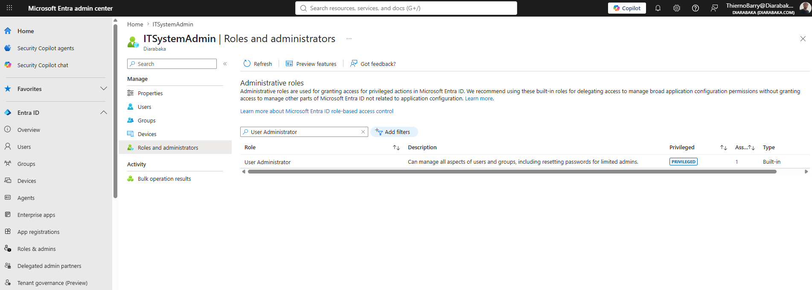
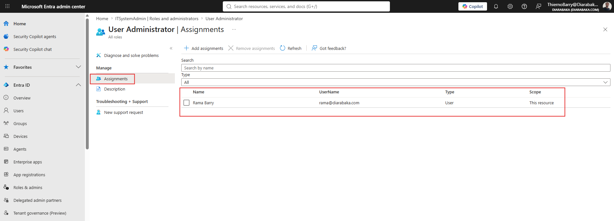
