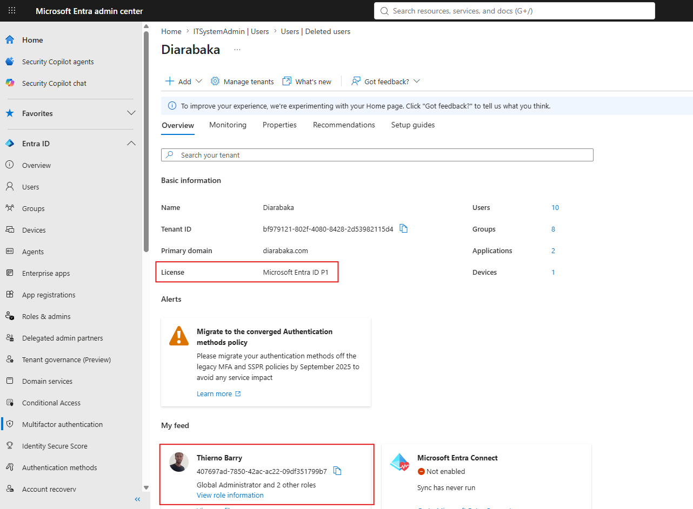
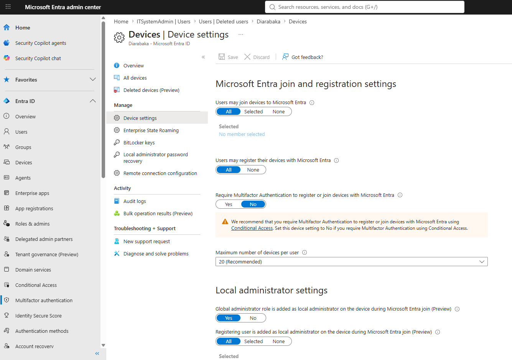
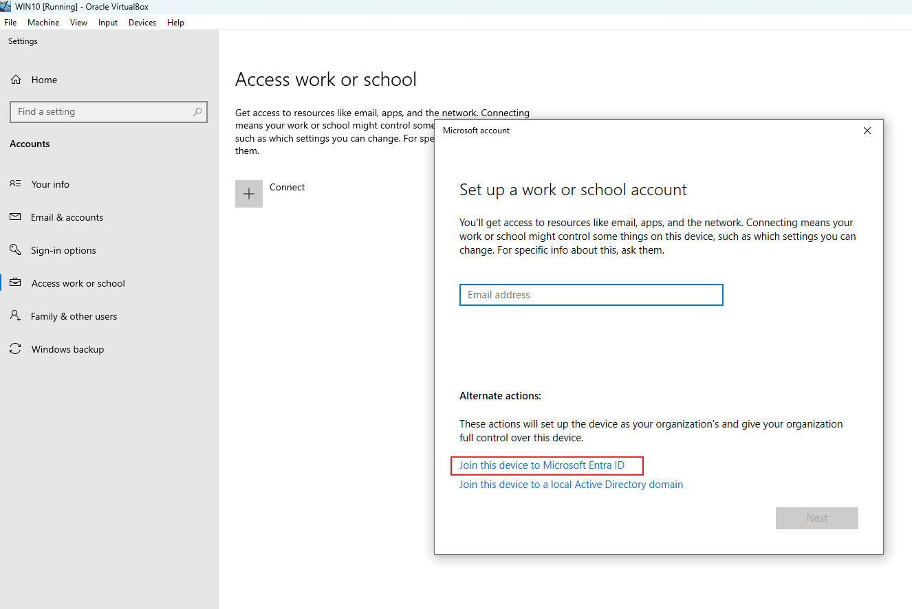
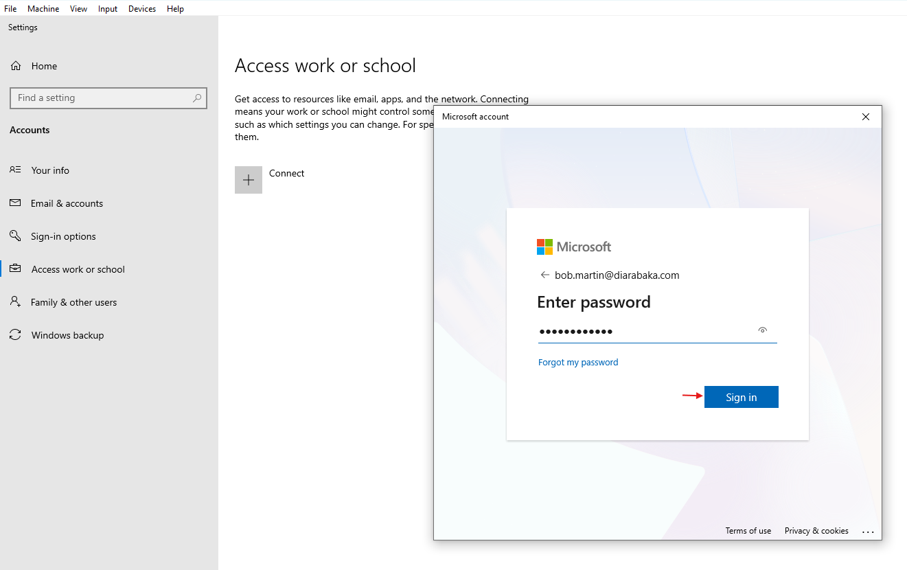
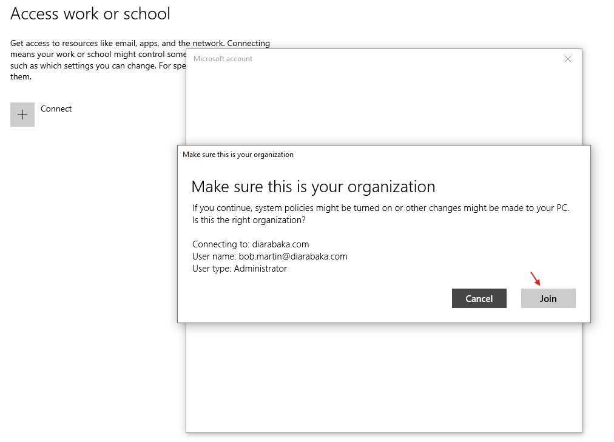
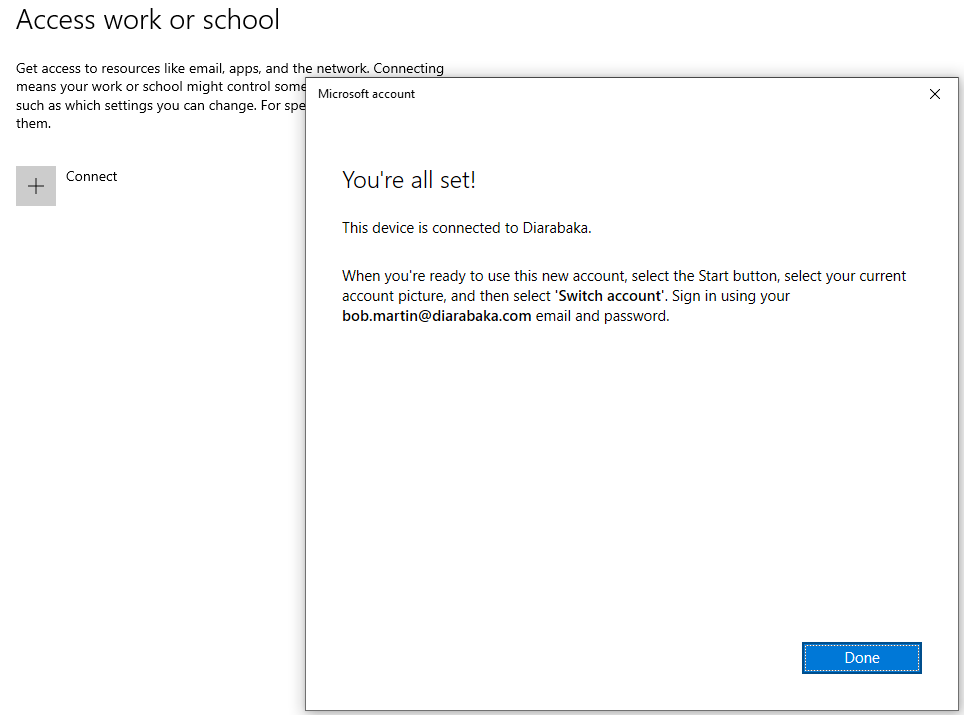
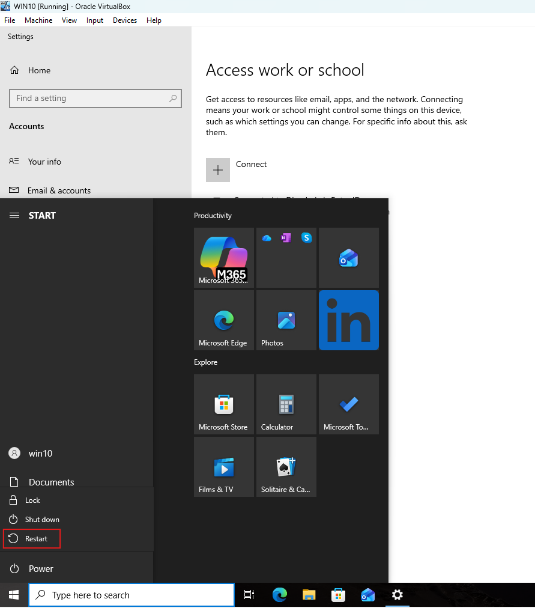
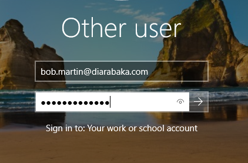
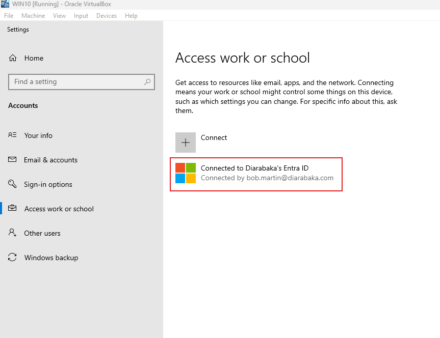
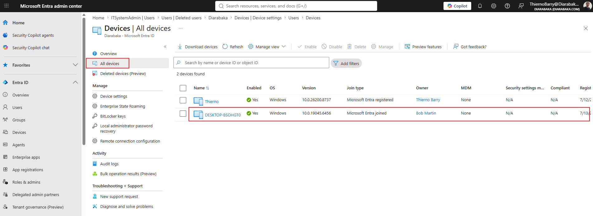

# Appareil joint ou enregistré dans Microsoft Entra ID

Dans ce lab, je joins une VM **Windows 10** au tenant **Diarabaka**, puis je compare son type de jointure à celui d’un appareil déjà enregistré.

| Type affiché dans Entra        | Usage sous Windows                                                                                                                                                                           |
| ------------------------------ | -------------------------------------------------------------------------------------------------------------------------------------------------------------------------------------------- |
| **Microsoft Entra joined**     | L’appareil est joint à l’organisation. L’utilisateur peut ouvrir sa session Windows avec son compte professionnel.                                                                           |
| **Microsoft Entra registered** | Le compte professionnel est ajouté à une session Windows existante pour accéder aux ressources de l’organisation. L’utilisateur conserve son compte habituel pour ouvrir sa session Windows. |

## 1. Vérifier les paramètres du tenant

Depuis le tenant **Diarabaka**, j’ouvre **Entra ID → Devices → Device settings**. La jointure et l’enregistrement des appareils sont autorisés pour **All**.

## 2. Joindre la VM Windows 10

Dans **Settings → Accounts → Access work or school → Connect**, je sélectionne **Join this device to Microsoft Entra ID**. Je m’authentifie avec `bob.martin@diarabaka.com`.

Je vérifie que l’organisation affichée est `diarabaka.com`, puis je clique sur **Join**. Le message **You're all set!** confirme que l’appareil est connecté à **Diarabaka**.

## 3. Vérifier la jointure

Je redémarre la VM, puis je me connecte à Windows avec le compte professionnel de Bob Martin. Dans **Access work or school**, Windows affiche **Connected to Diarabaka’s Entra ID**.

Dans **Entra ID → Devices → All devices**, la colonne **Join type** confirme que la VM de **Bob Martin** est **Microsoft Entra joined**. L’autre appareil, **Thierno**, apparaît comme **Microsoft Entra registered**.

