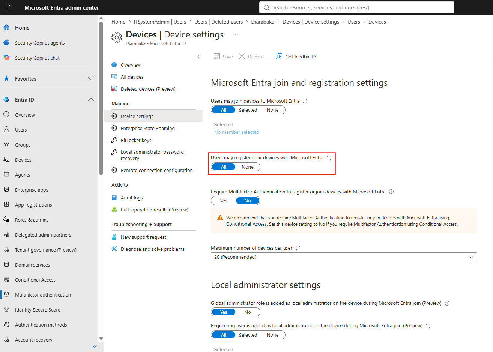
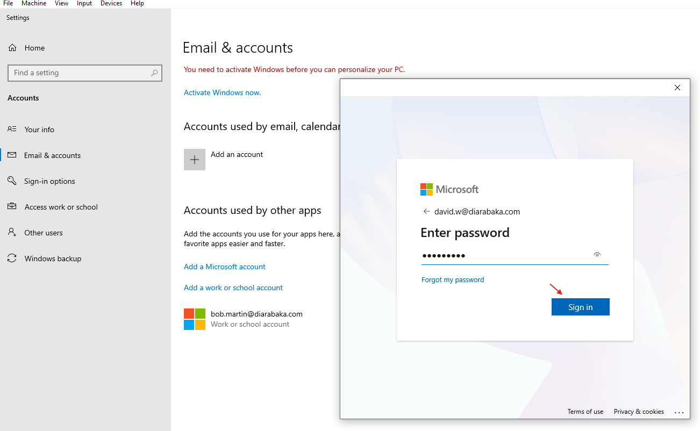
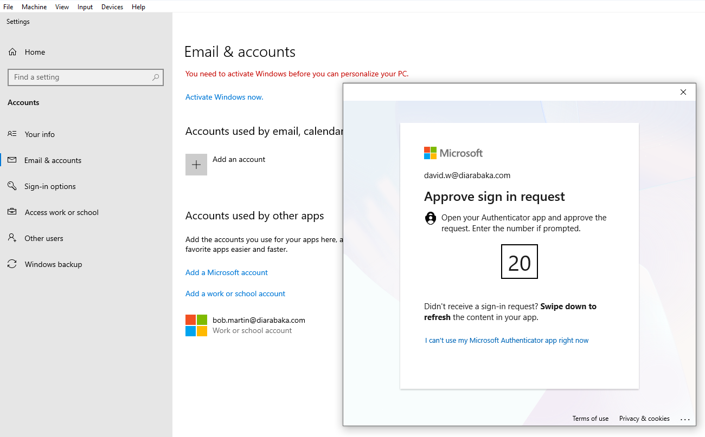
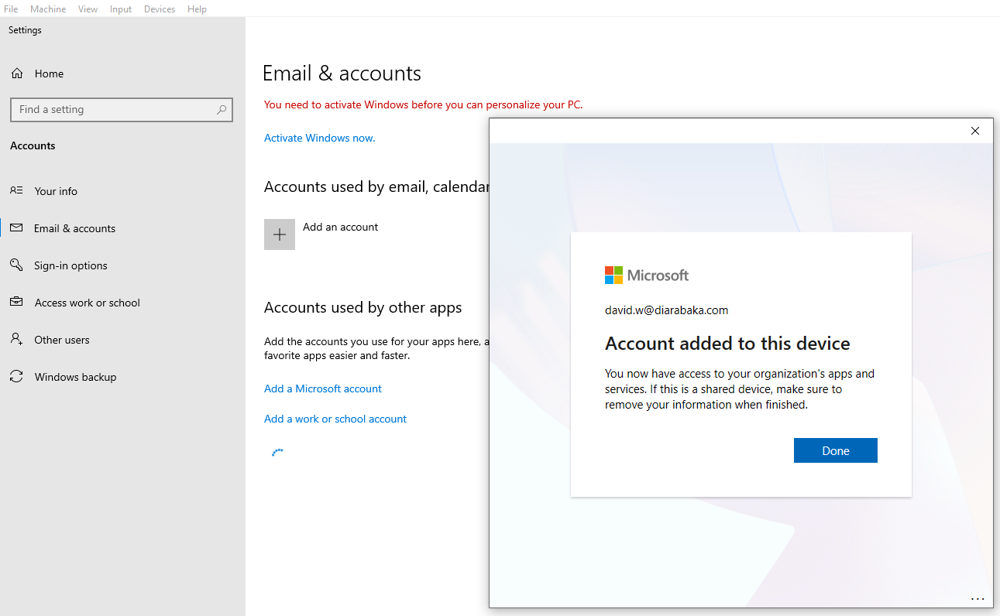
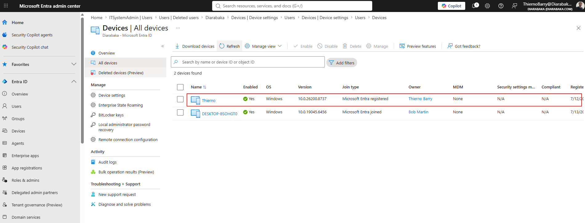

# Enregistrer un appareil Windows 11 dans Microsoft Entra ID

Dans ce lab, je vérifie que le tenant **Diarabaka** autorise l’enregistrement des appareils, puis je contrôle le type affiché dans l’inventaire Entra.

## 1. Vérifier les paramètres d’enregistrement

Dans **Entra ID → Devices → Device settings**, je vérifie que **Users may register their devices with Microsoft Entra** est réglé sur **All**.

## 2. Ajouter un compte professionnel dans Windows

Dans **Settings → Accounts → Email & accounts**, je sélectionne **Add a work or school account** et je me connecte avec `david.w@diarabaka.com`.

J’approuve la demande dans **Microsoft Authenticator** avec le numéro affiché à l’écran. Windows confirme l’ajout du compte avec le message **Account added to this device**.

## 3. Vérifier le type d’appareil dans Entra ID

Dans **Entra ID → Devices → All devices**, l’appareil **Thierno**, dont le propriétaire affiché est **Thierno Barry**, porte le type **Microsoft Entra registered**. L’appareil de **Bob Martin** porte le type **Microsoft Entra joined**.

