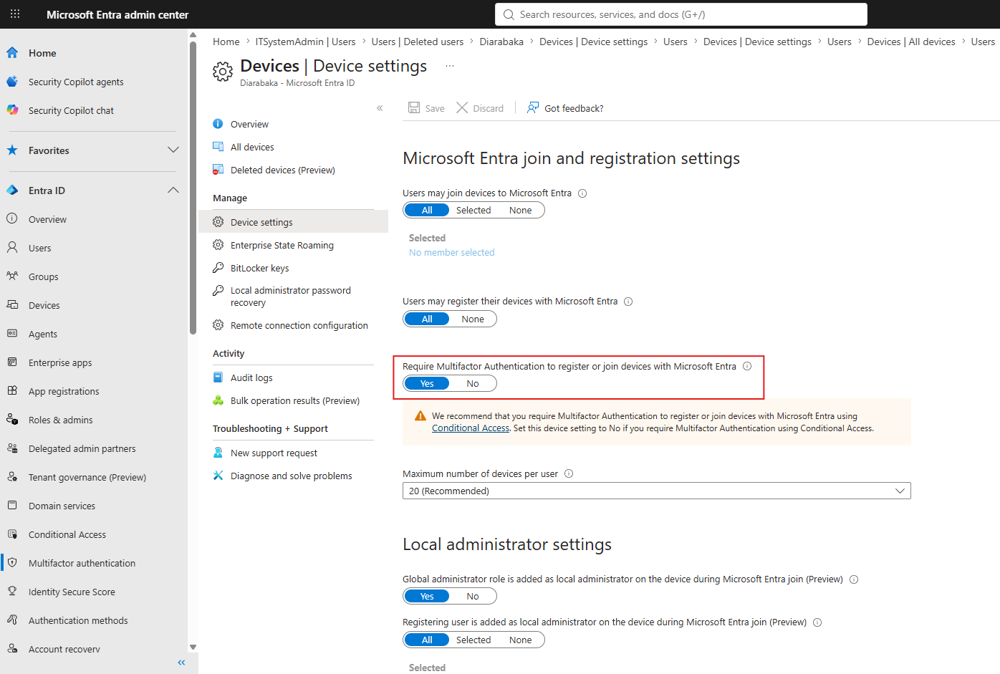

# Exiger le MFA pour joindre ou enregistrer un appareil dans Microsoft Entra ID

Dans le tenant de lab **Diarabaka**, je configure Microsoft Entra ID pour exiger une authentification multifacteur (MFA) lors de la jointure ou de l’enregistrement d’un appareil.

## Configuration

Dans **Entra ID → Devices → Device settings**, je règle **Require Multifactor Authentication to register or join devices with Microsoft Entra** sur **Yes**.

La jointure et l’enregistrement sont autorisés pour tous les utilisateurs (**All**). Le MFA est exigé lors de ces opérations.

Le portail recommande d’utiliser **Conditional Access** pour gérer cette exigence. Si une stratégie d’accès conditionnel impose déjà le MFA pour cette opération, le portail indique de régler cette option sur **No**.
