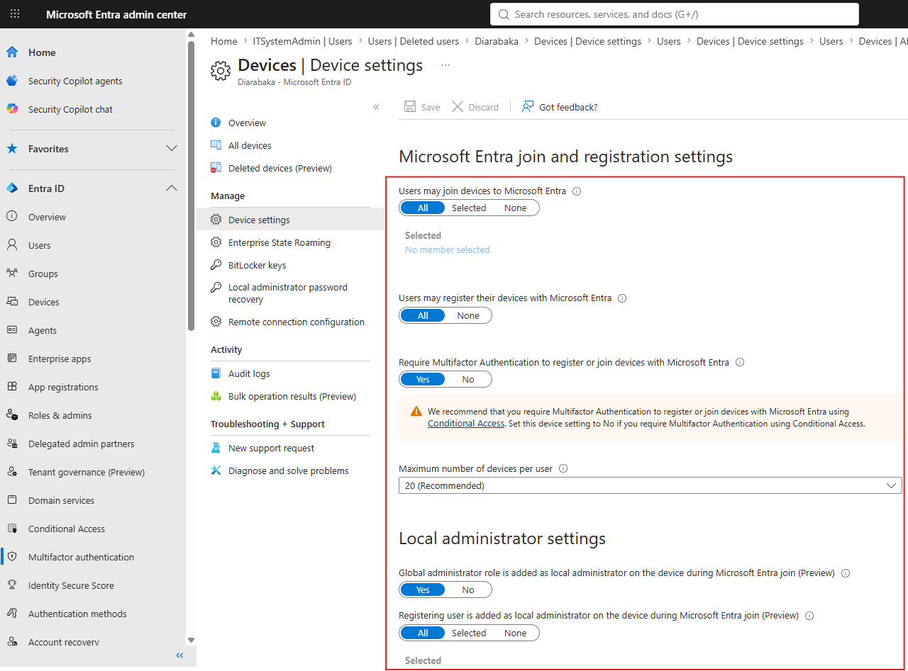
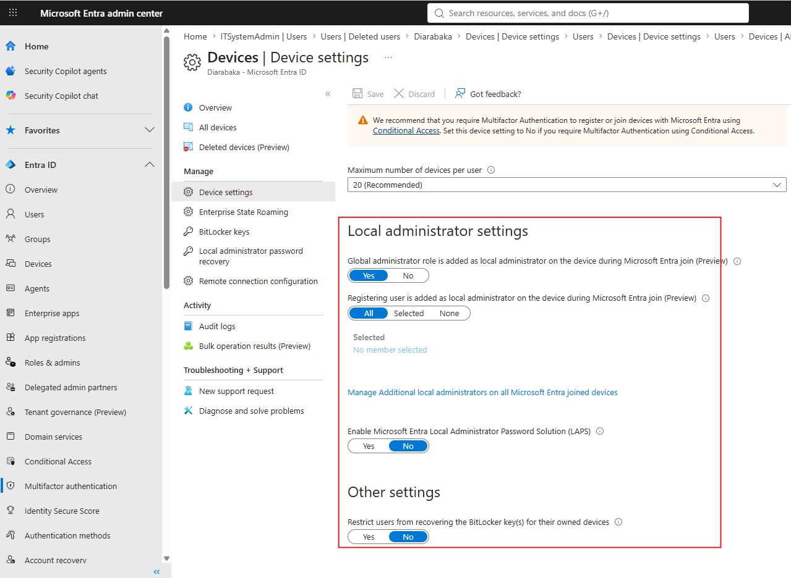

# Gérer les paramètres des appareils dans Microsoft Entra ID

Dans le tenant de lab **Diarabaka**, j’ouvre **Entra ID → Devices → Device settings** pour vérifier les règles de jointure, d’enregistrement et d’administration locale.

## 1. Jointure et enregistrement

| Paramètre                                                        | Valeur affichée |
| ---------------------------------------------------------------- | --------------- |
| Utilisateurs autorisés à joindre des appareils à Microsoft Entra | **All**         |
| Utilisateurs autorisés à enregistrer leurs appareils             | **All**         |
| Exiger le MFA pour joindre ou enregistrer un appareil            | **Yes**         |
| Nombre maximal d’appareils par utilisateur                       | **20**          |

## 2. Administration locale, LAPS et BitLocker

| Paramètre                                                                                         | Valeur affichée |
| ------------------------------------------------------------------------------------------------- | --------------- |
| Ajouter le rôle **Global Administrator** au groupe des administrateurs locaux lors de la jointure | **Yes**         |
| Ajouter l’utilisateur qui effectue la jointure comme administrateur local                         | **All**         |
| Activer Microsoft Entra LAPS                                                                      | **No**          |
| Restreindre la récupération des clés BitLocker par les propriétaires de leurs appareils           | **No**          |

