# Sécuriser l’accès administrateur local sur les appareils joints à Microsoft Entra ID

Dans le tenant de lab **Diarabaka**, je limite l’ajout automatique d’administrateurs locaux lors de la jointure et je vérifie les droits de plusieurs comptes sur un poste Windows déjà joint.

## 1. Limiter les droits accordés lors de la jointure

Sur le poste Windows, je relève la composition du groupe local **Administrators**. **Bob Martin** y figure déjà.

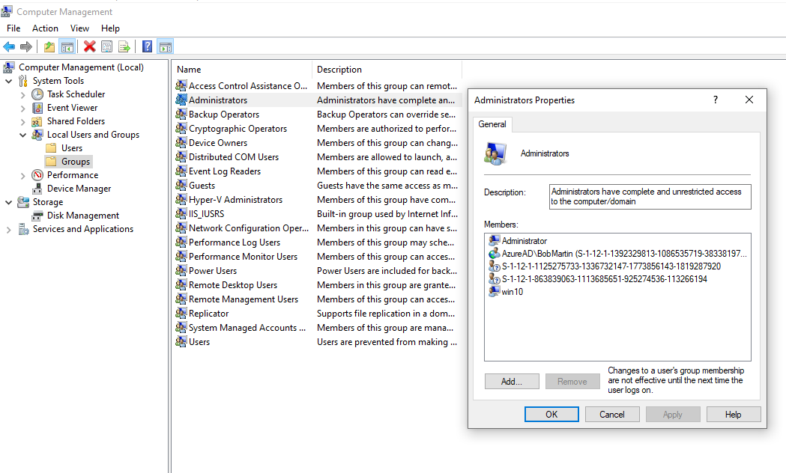

Dans **Entra ID → Devices → Device settings → Local administrator settings**, je règle l’ajout du rôle **Global Administrator** sur **No**. Pour l’utilisateur qui effectue la jointure, je choisis **Selected** et je sélectionne **David Warner**.

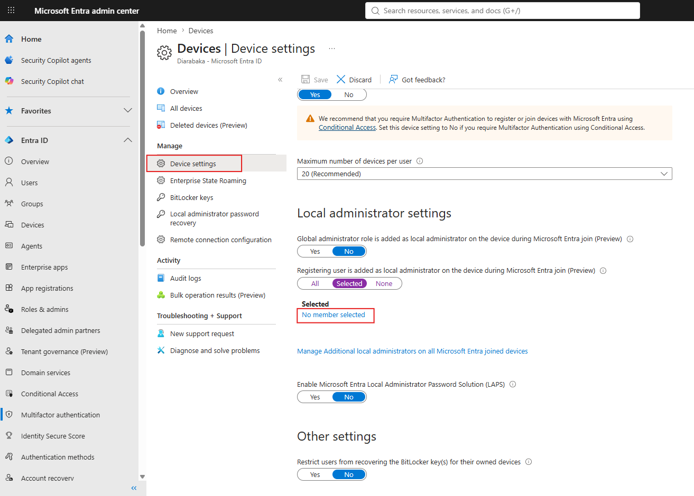
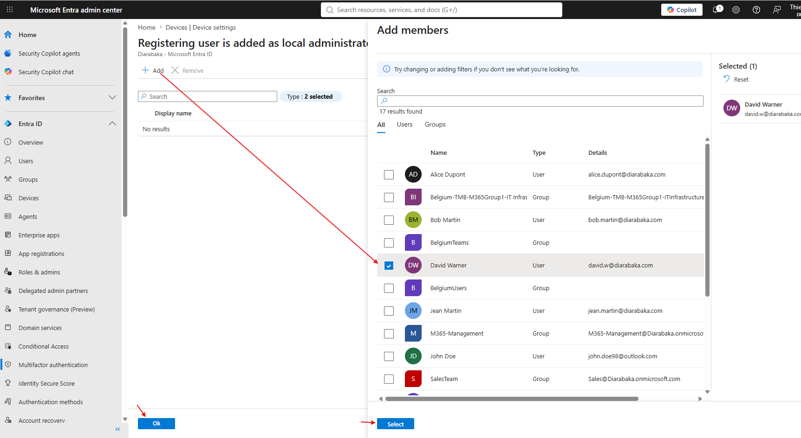
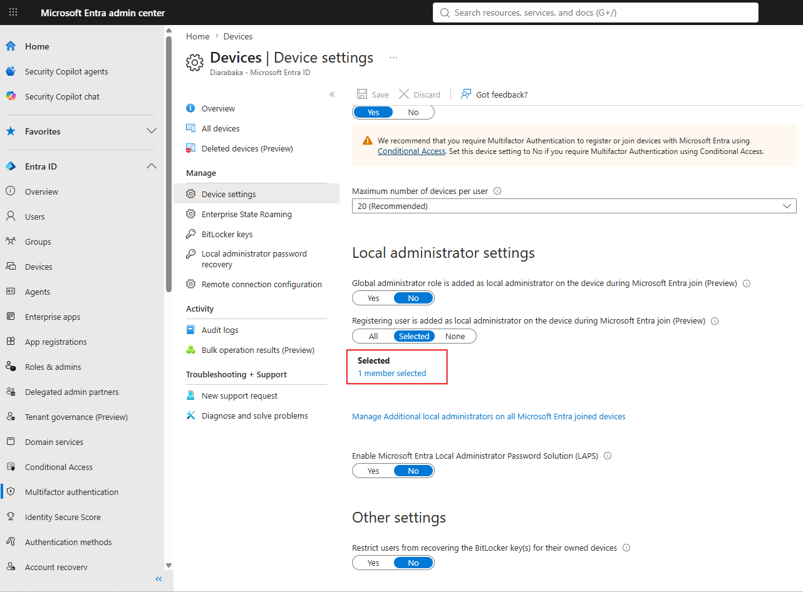

## 2. Vérifier l’accès avec Marie Dubois

J’ajoute le compte professionnel de **Marie Dubois** dans **Email & accounts**, puis je redémarre le poste et j’ouvre une session Windows avec son compte.

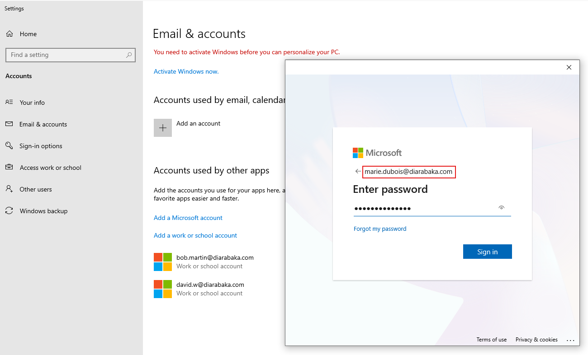
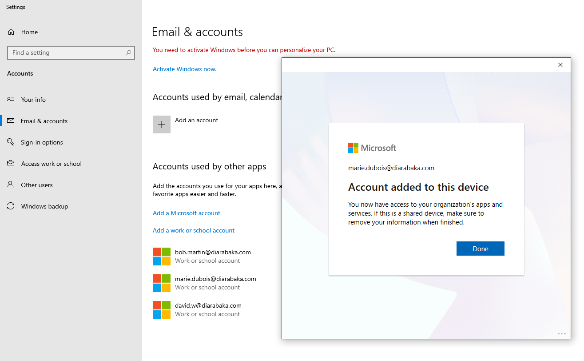
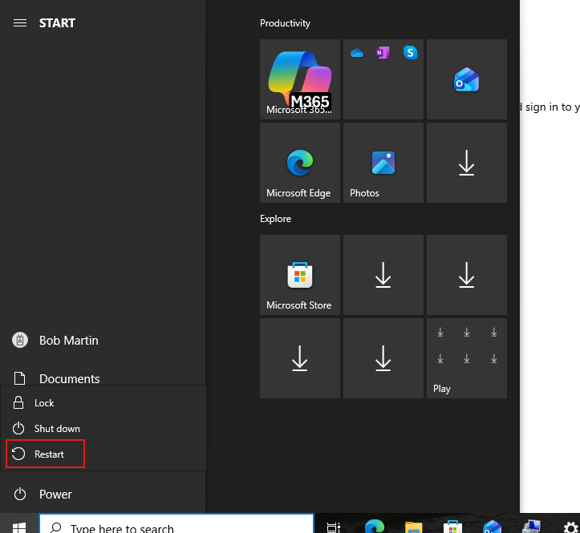
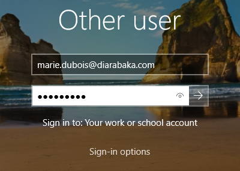

Le groupe local **Administrators** affiche les mêmes entrées qu’au début du test. Dans la session de Marie, **Access work or school** demande un compte administrateur pour modifier les paramètres de gestion de l’appareil.

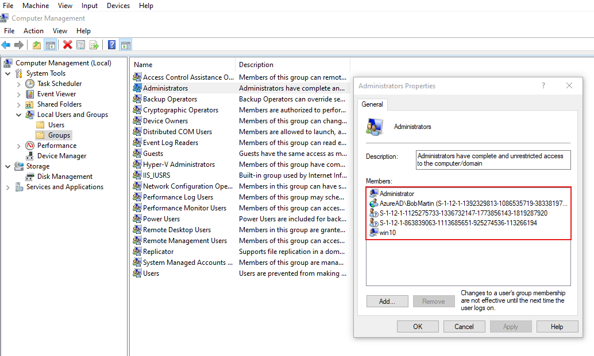
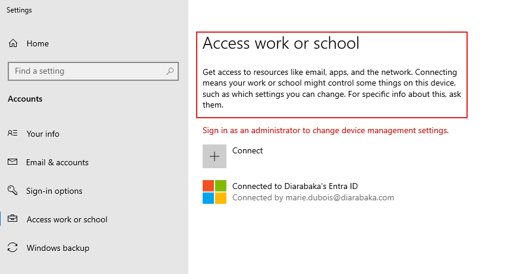

## 3. Attribuer le rôle d’administrateur local à Test User

Depuis **Device settings**, j’ouvre **Manage Additional local administrators on all Microsoft Entra joined devices**. Dans **Device Administrators → Add assignments**, j’ajoute **Test User**. L’attribution apparaît avec la portée **Directory**.

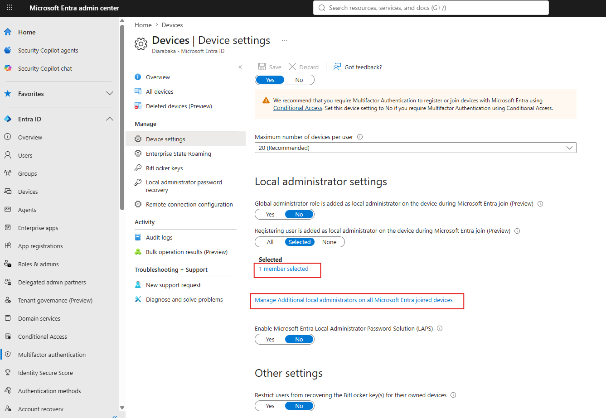
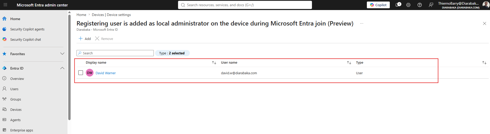
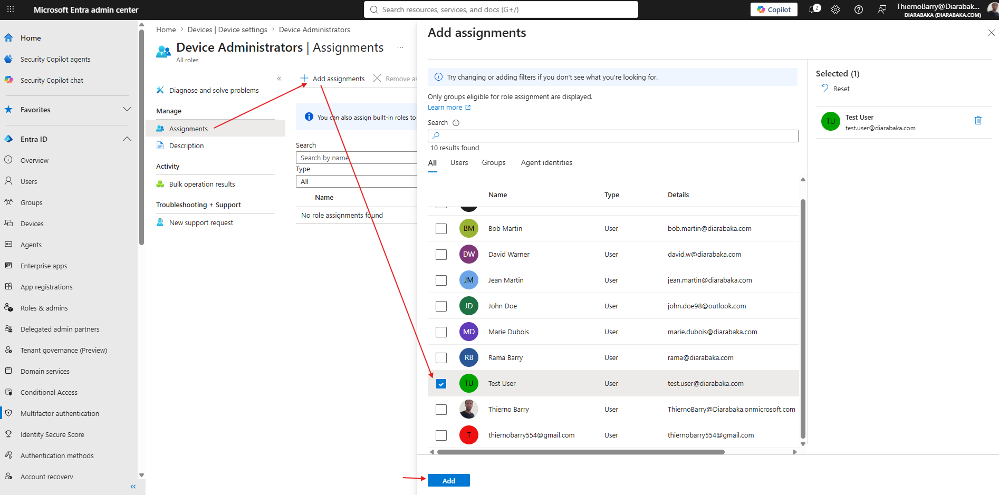
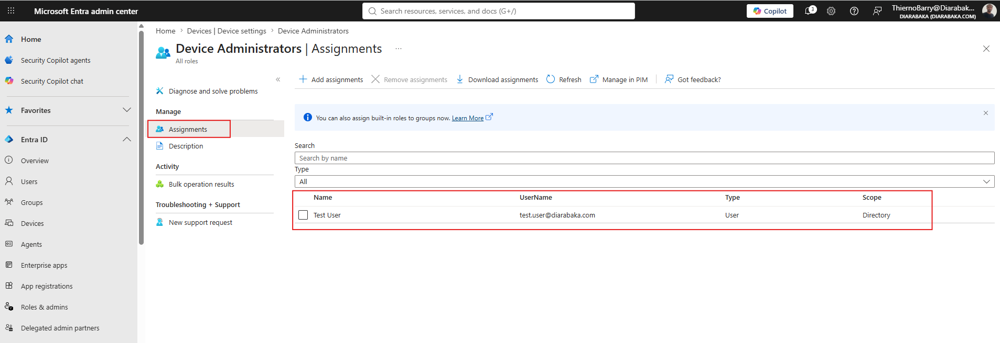

## 4. Comparer les droits dans Windows

J’ajoute le compte professionnel de **David Warner**, puis j’ouvre une session avec ce compte sur le poste déjà joint. Son nom n’apparaît pas dans le groupe local **Administrators** et son profil Windows n’affiche pas la mention **Administrator**.

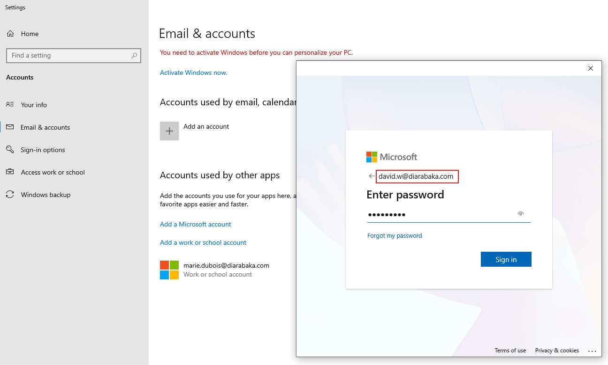
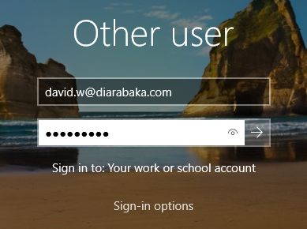
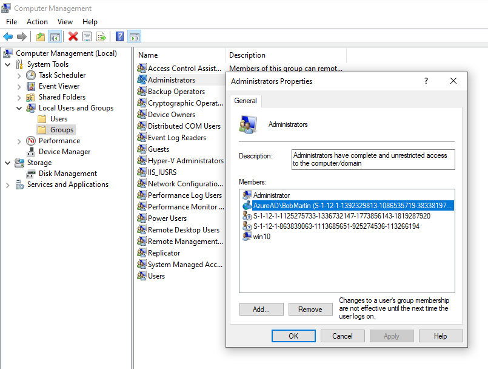
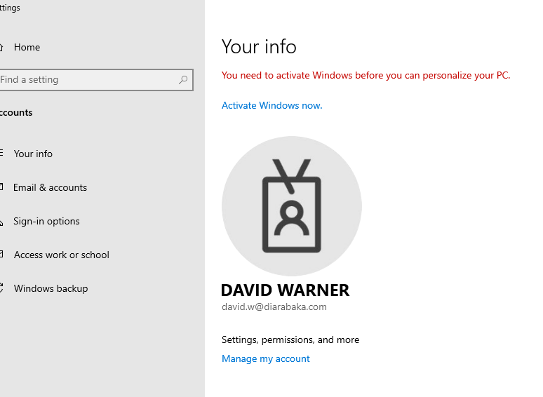

Le profil Windows de **Test User** affiche **Administrator**. Le portail Entra confirme son attribution au rôle **Device Administrators** à l’échelle de l’annuaire.

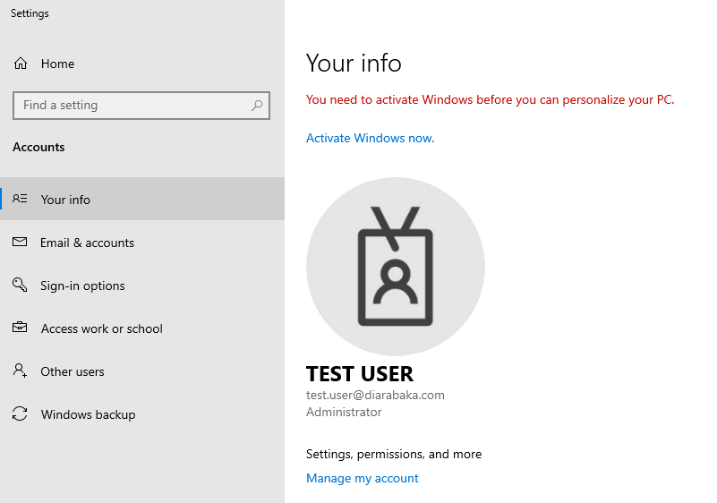
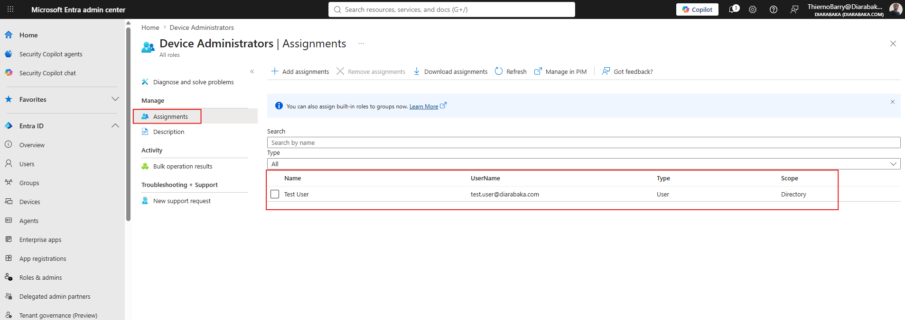
