# Gérer le rôle d’administrateur local des appareils joints à Microsoft Entra ID

Dans le tenant de lab **Diarabaka**, je vérifie les paramètres d’administration locale, puis je compare les sessions Windows de **John Doe** et de **Virat Kohli**.

## 1. Vérifier les droits accordés à la jointure

Dans **Entra ID → Devices → Device settings → Local administrator settings**, l’ajout automatique du rôle **Global Administrator** est réglé sur **No**. L’ajout de l’utilisateur qui effectue la jointure est réglé sur **Selected**, avec **John Doe** dans la liste. Ce réglage s’applique au moment de la jointure.

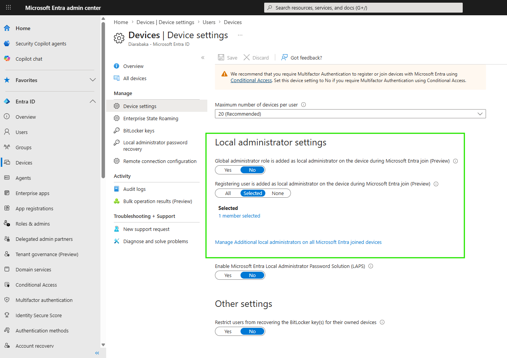
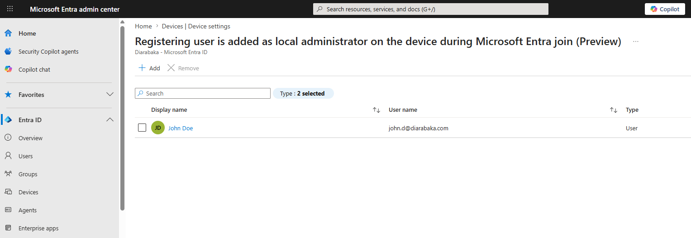

## 2. Attribuer le rôle à Virat Kohli

Depuis **Manage Additional local administrators on all Microsoft Entra joined devices**, j’ouvre **Device Administrators → Add assignments** et je sélectionne **Virat Kohli**. La liste confirme l’attribution avec la portée **Directory**.

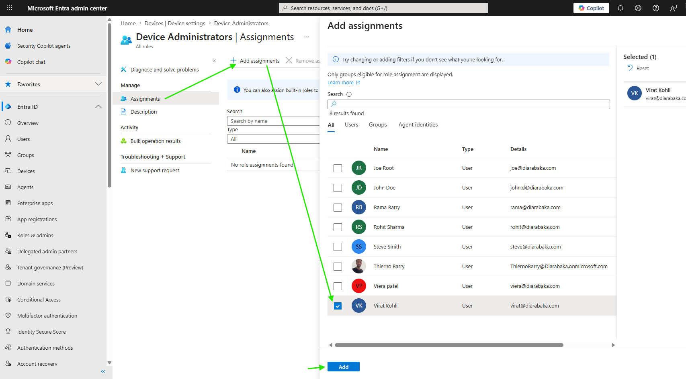
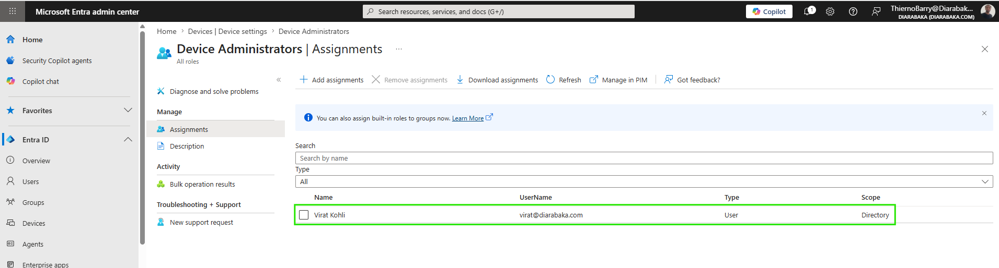

## 3. Vérifier la session Windows de John Doe

Sur le poste Windows, j’ajoute le compte professionnel `john.d@diarabaka.com` et je valide la demande dans **Microsoft Authenticator**.

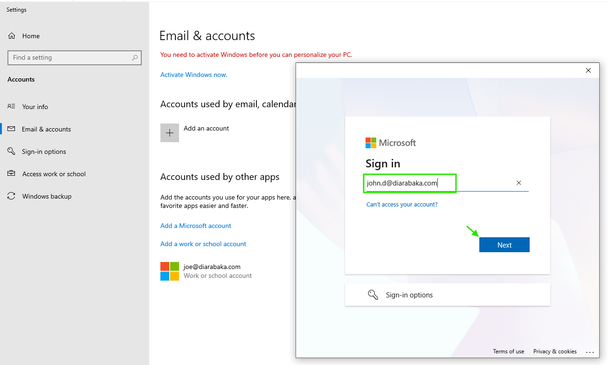
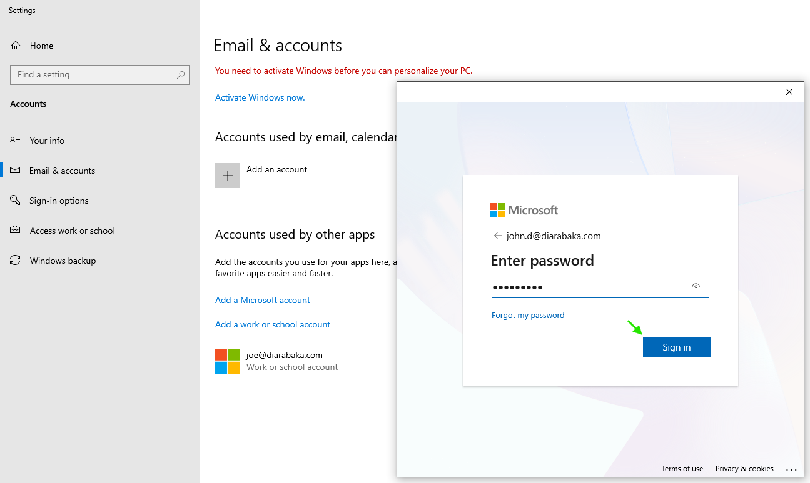
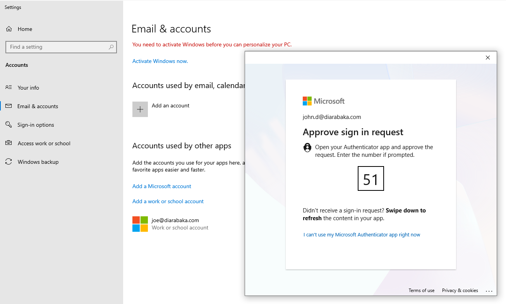
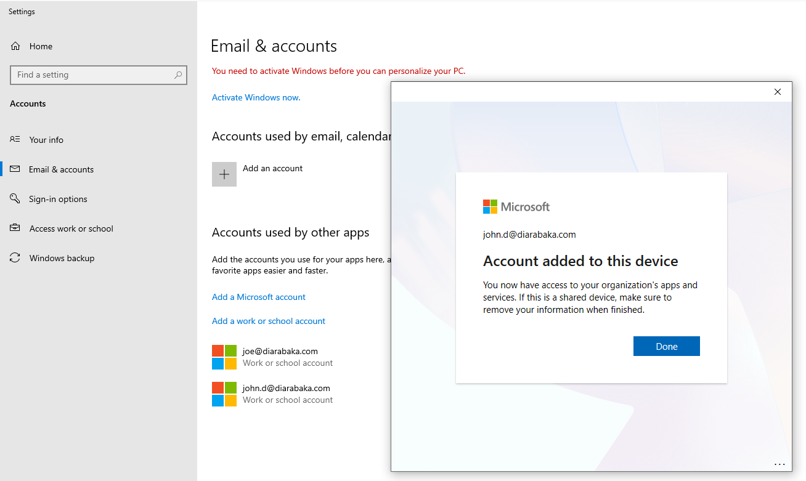

J’ouvre ensuite une session Windows avec John et je configure son code PIN. Je consulte le groupe local **Administrators** et la page **Accounts → Your info**, où son profil s’affiche sans la mention **Administrator**.

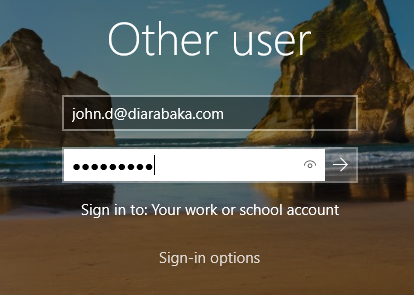
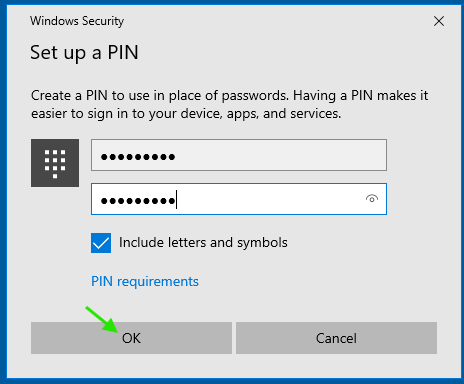
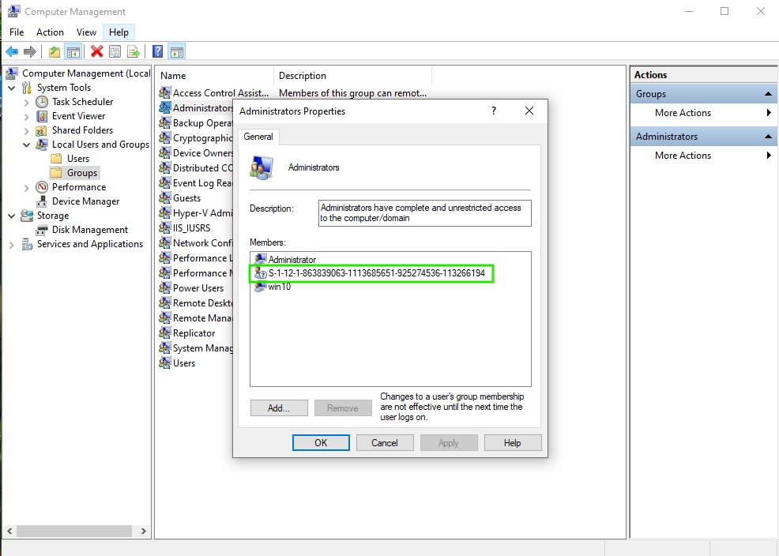
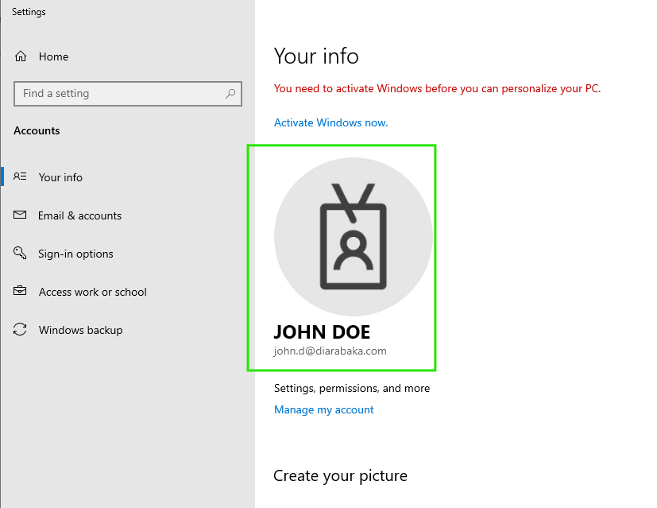

## 4. Confirmer les droits de Virat Kohli

J’ouvre une session avec `virat@diarabaka.com`. Dans **Accounts → Your info**, Windows affiche la mention **Administrator**, ce qui confirme ses droits d’administrateur local sur le poste testé.

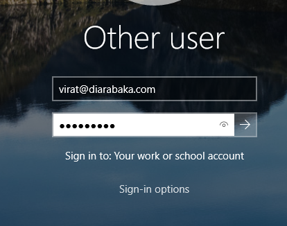
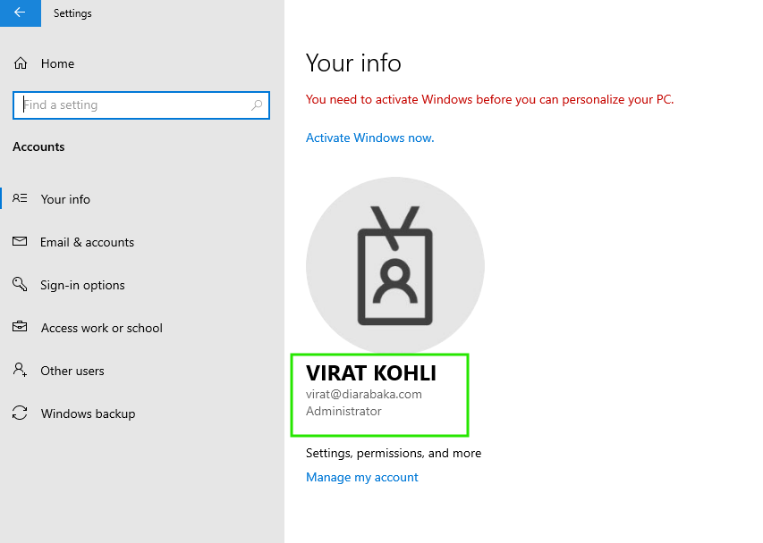
