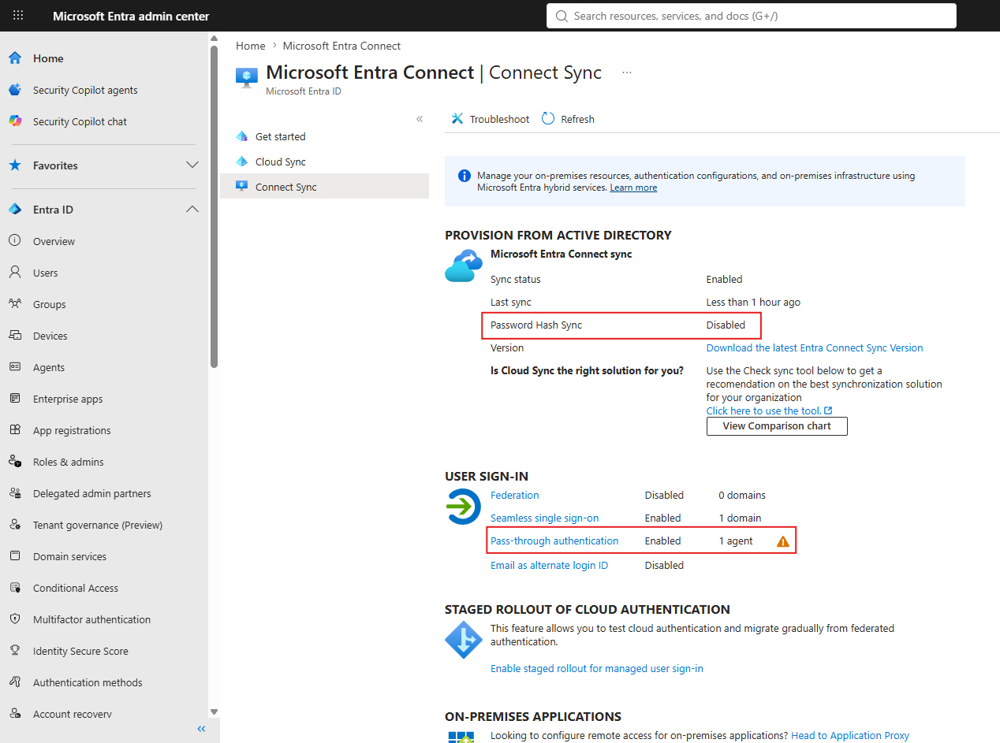
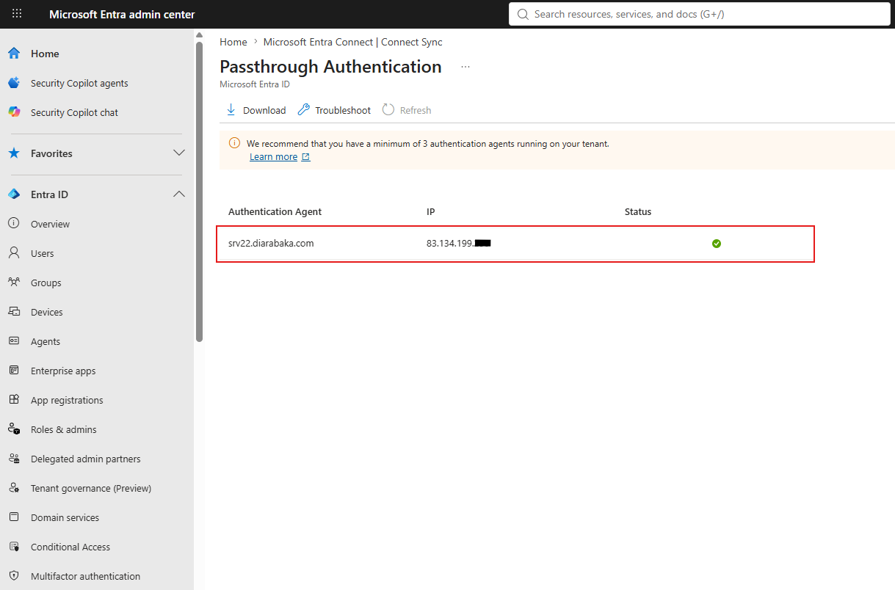
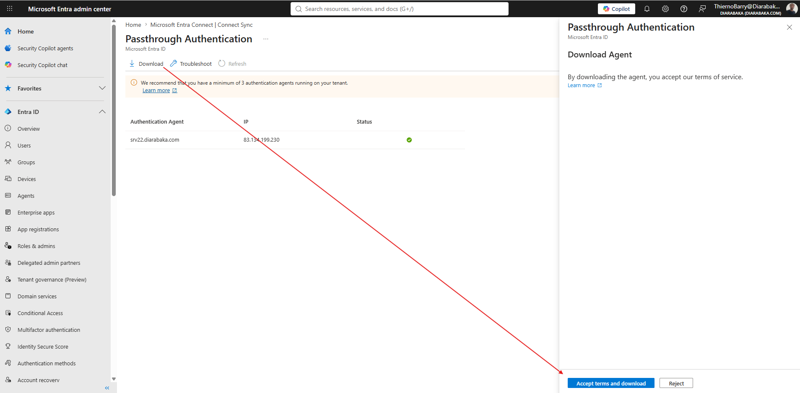
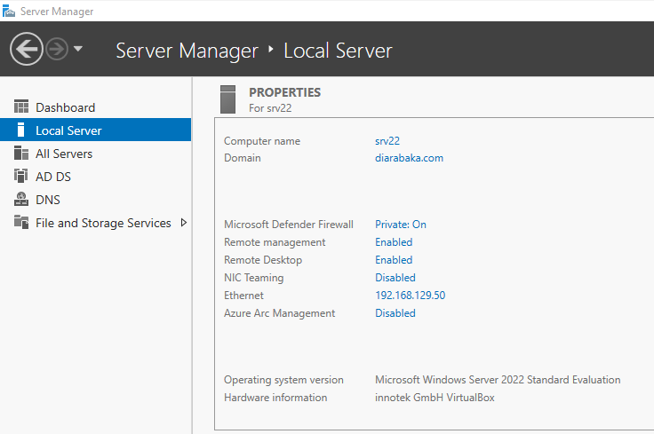
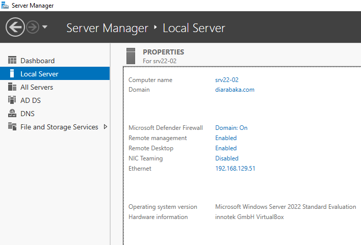
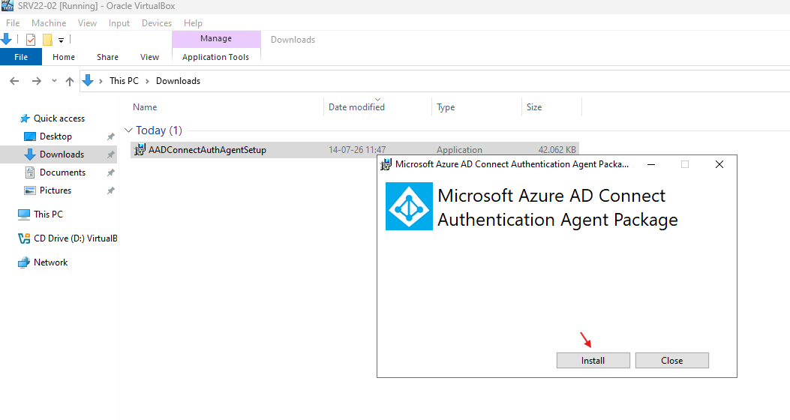
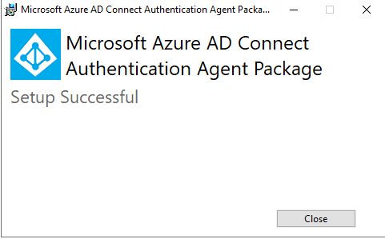
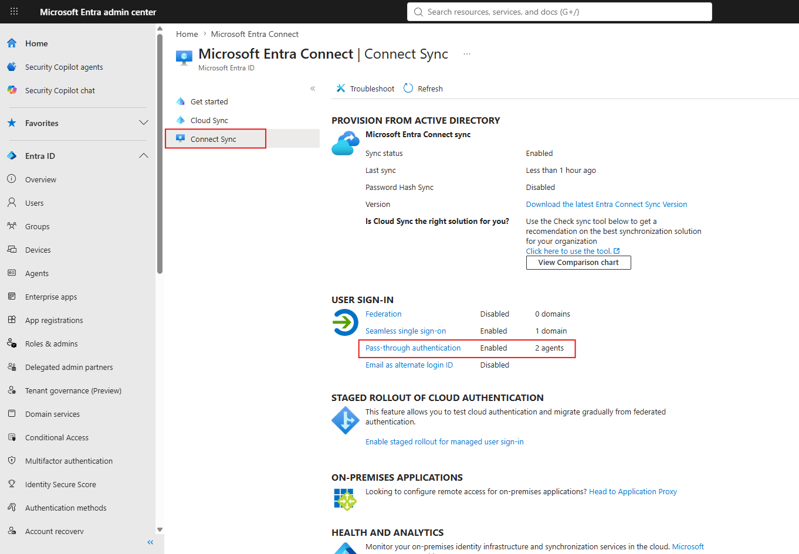
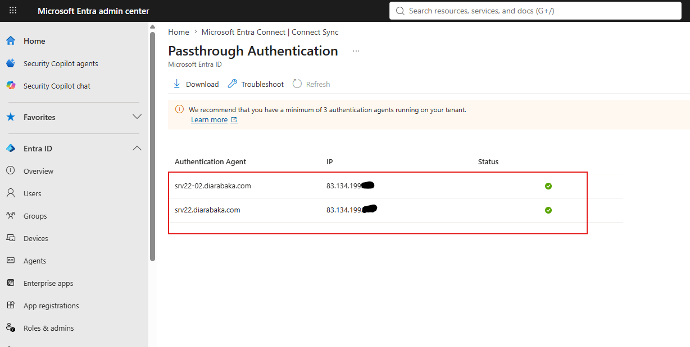

# Ajouter un second agent PTA dans Microsoft Entra ID

Dans le tenant de lab **Diarabaka**, j’ajoute un second agent **Pass-Through Authentication (PTA)** sur **SRV22-02** pour que l’authentification puisse continuer si l’un des agents devient indisponible.

## 1. Vérifier l’agent existant

Dans **Microsoft Entra Connect → Connect Sync**, je vérifie que PTA est activée avec **1 agent**. La page **Passthrough Authentication** affiche `srv22.diarabaka.com` avec un indicateur vert.

## 2. Installer le second agent

Depuis la page **Passthrough Authentication**, je télécharge le programme d’installation de l’agent. **SRV22** héberge déjà le premier agent. J’installe le second sur **SRV22-02**, un autre serveur Windows Server 2022 joint au domaine `diarabaka.com`.

## 3. Vérifier la redondance

Dans **Connect Sync**, PTA affiche désormais **2 agents**. Les serveurs `srv22.diarabaka.com` et `srv22-02.diarabaka.com` apparaissent tous les deux avec un indicateur vert.

**Résultat** — Les deux agents sont actifs dans le lab. Le test de continuité avec un agent arrêté reste à documenter. Le portail recommande au moins **trois agents** par tenant.
