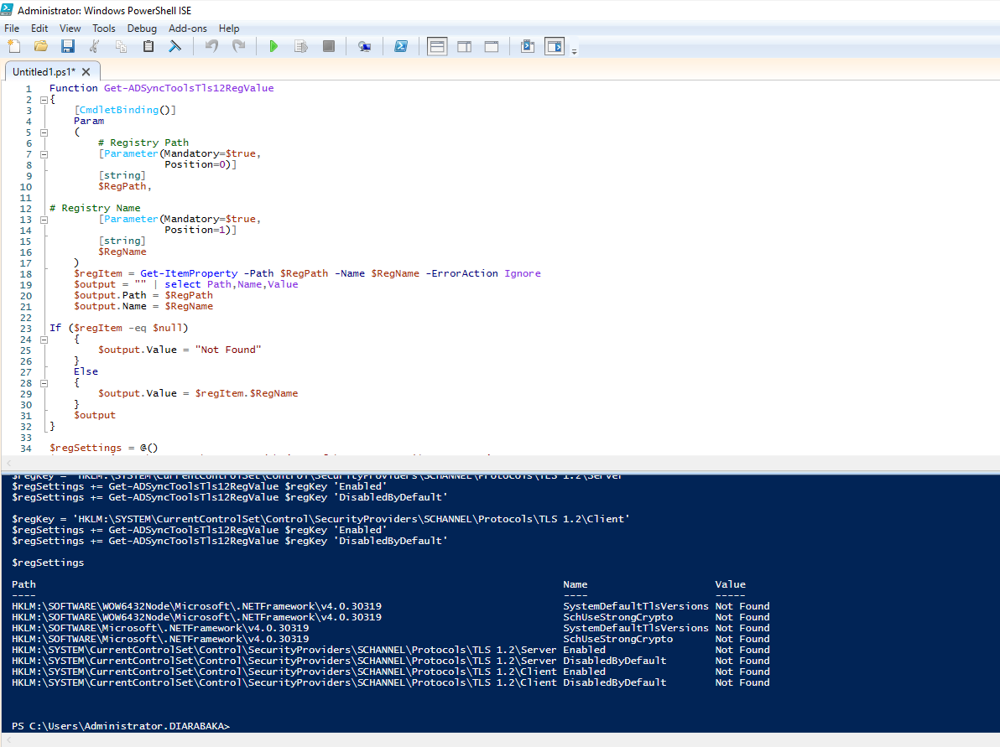
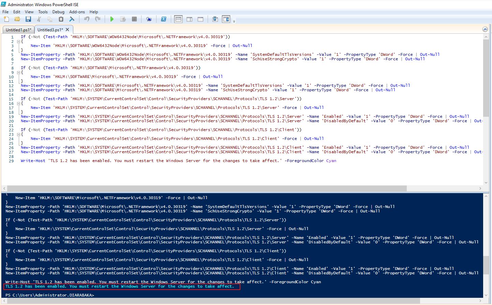
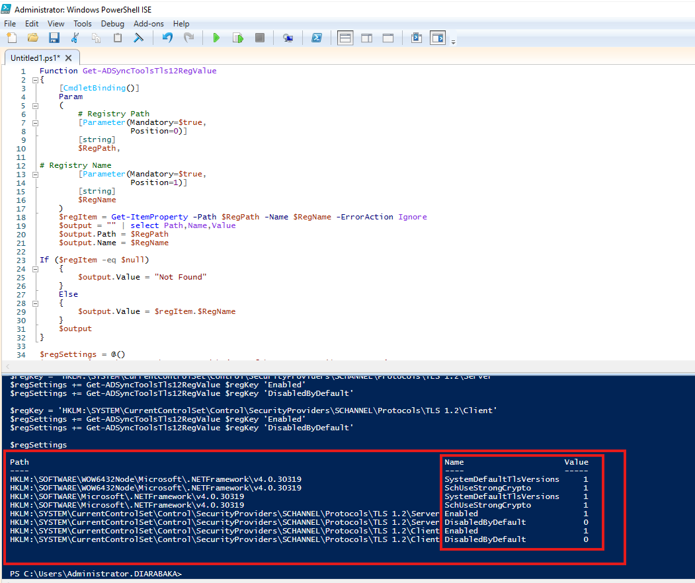
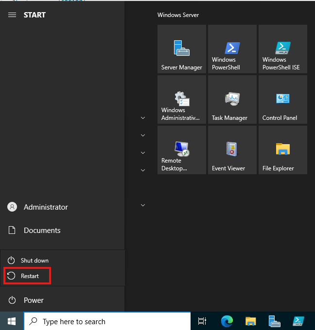

# Activer TLS 1.2 pour Microsoft Entra Connect

Dans ce lab, je configure explicitement **TLS 1.2** sur le serveur Windows qui héberge **Microsoft Entra Connect Sync**.

## 1. Vérifier les valeurs existantes

Dans **Windows PowerShell ISE**, je lis les valeurs du registre pour **.NET Framework** et **Schannel**. Le résultat **Not Found** indique que les valeurs recherchées ne sont pas définies explicitement dans le registre.

## 2. Configurer TLS 1.2

J’exécute le script PowerShell de Microsoft en tant qu’administrateur. Il applique les valeurs suivantes.

| Composant                                   | Valeurs configurées                                        |
| ------------------------------------------- | ---------------------------------------------------------- |
| .NET Framework 4.x, clés 32 bits et 64 bits | `SystemDefaultTlsVersions = 1` et `SchUseStrongCrypto = 1` |
| Schannel TLS 1.2, clés `Client` et `Server` | `Enabled = 1` et `DisabledByDefault = 0`                   |

## 3. Vérifier le registre et redémarrer

Je relance le script de vérification et je retrouve les valeurs attendues. Je redémarre ensuite le serveur pour appliquer les modifications.

[Documentation Microsoft et scripts PowerShell TLS 1.2](https://learn.microsoft.com/en-us/entra/identity/hybrid/connect/reference-connect-tls-enforcement)
