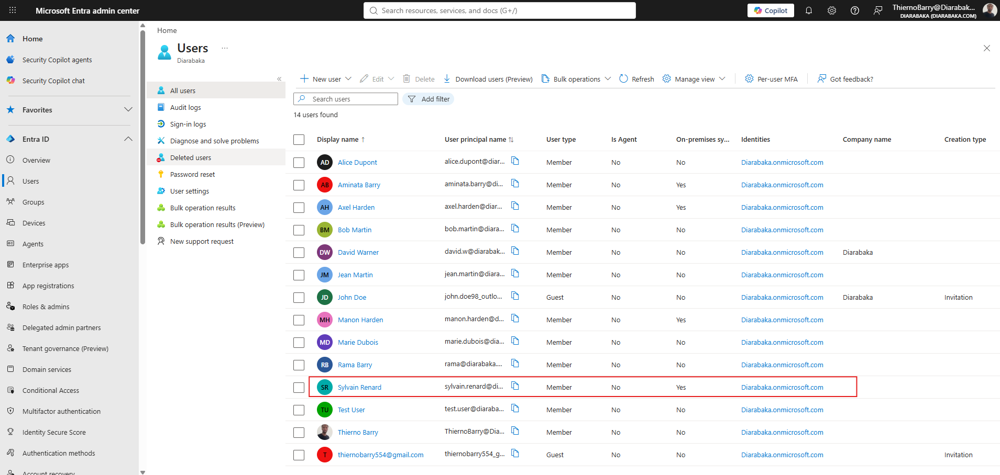
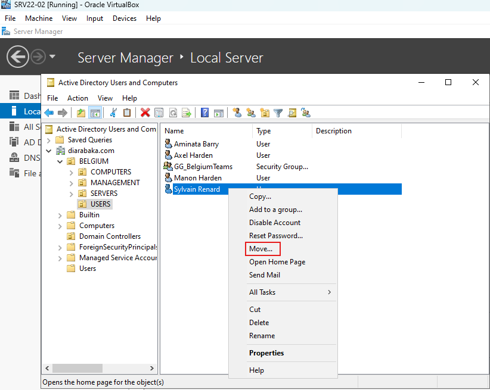
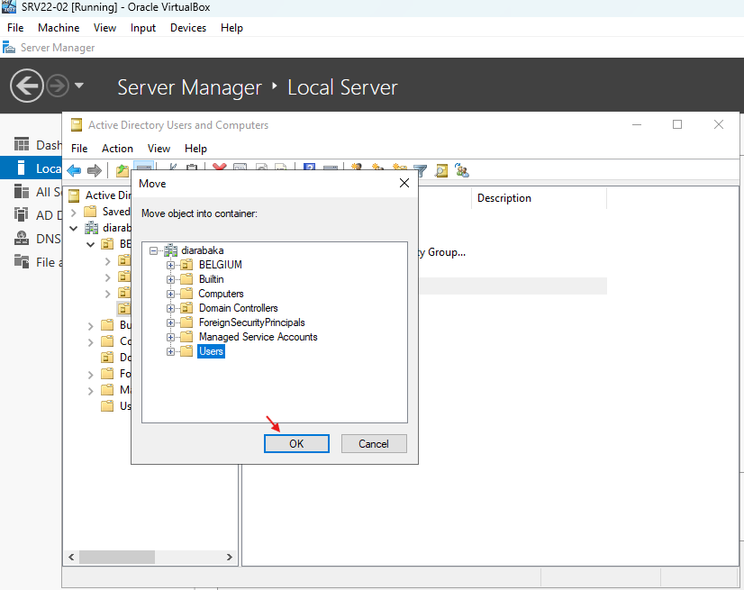
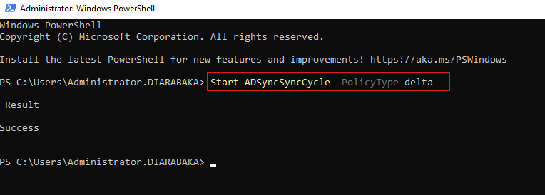
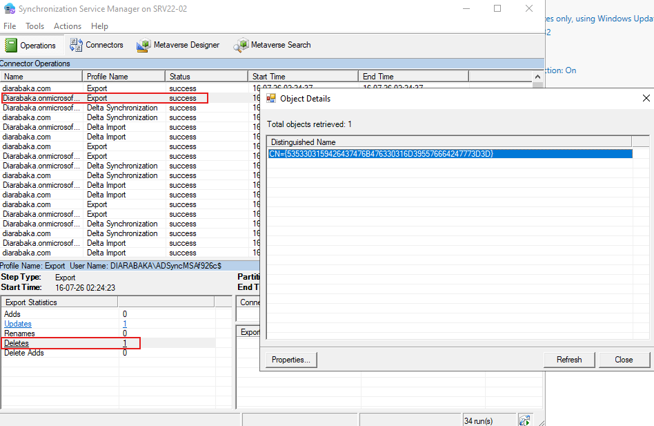
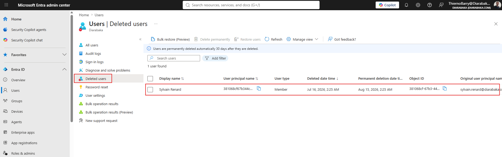

# Retirer un utilisateur du périmètre de synchronisation Microsoft Entra ID

Dans ce lab, je déplace le compte **Sylvain Renard** hors du périmètre d’Entra Connect Sync et je vérifie le résultat dans Microsoft Entra ID.

## 1. Vérifier l’état initial

Dans **Entra ID → Users → All users**, le compte **Sylvain Renard** affiche **Yes** dans la colonne **On-premises sync enabled**.

## 2. Déplacer le compte hors du périmètre

Dans **Active Directory Users and Computers**, je déplace le compte de l’OU `BELGIUM → USERS` vers le conteneur `Users` à la racine du domaine `diarabaka.com`. Ce conteneur est exclu du périmètre de synchronisation du lab.

## 3. Lancer la synchronisation Delta

Sur **SRV22-02**, je lance un cycle **Delta** avec `Start-ADSyncSyncCycle -PolicyType Delta`. Dans **Synchronization Service Manager**, l’export vers Microsoft Entra affiche **Success** et **1 suppression**.

## Résultat

Dans **Entra ID → Users → Deleted users**, **Sylvain Renard** apparaît parmi les utilisateurs supprimés. La suppression temporaire côté Entra est confirmée. La conversion en compte **cloud-only** reste à valider après restauration.

