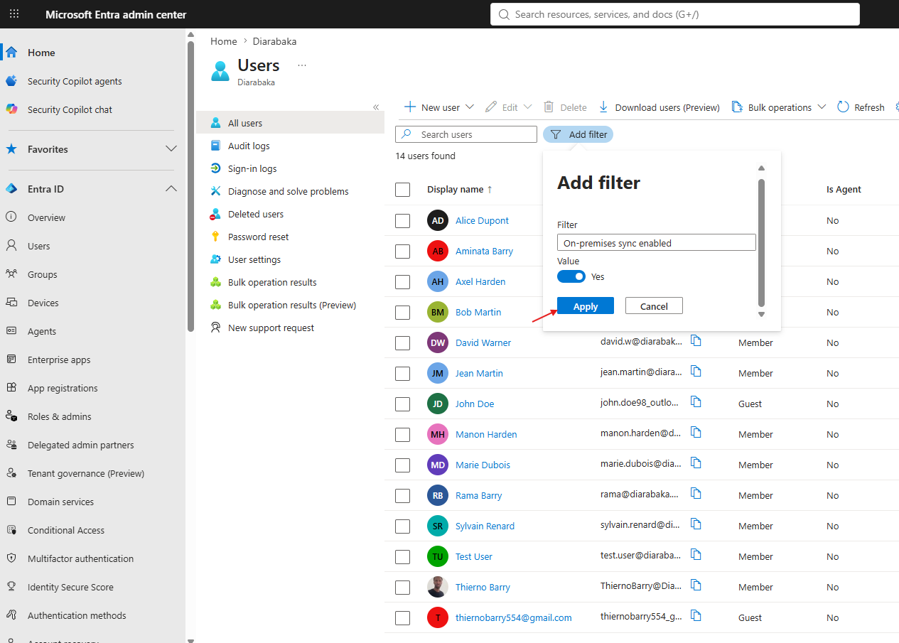
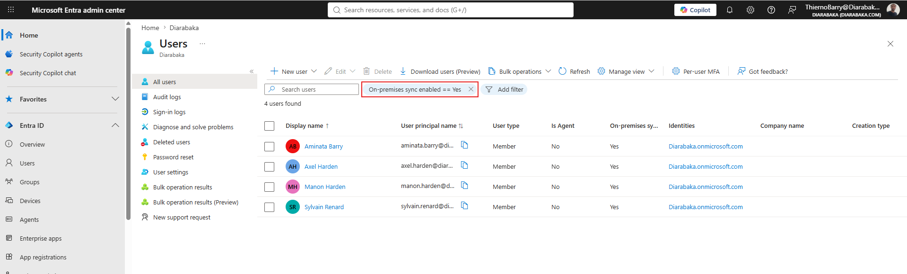
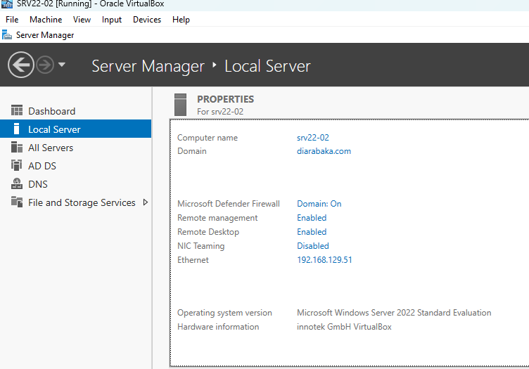
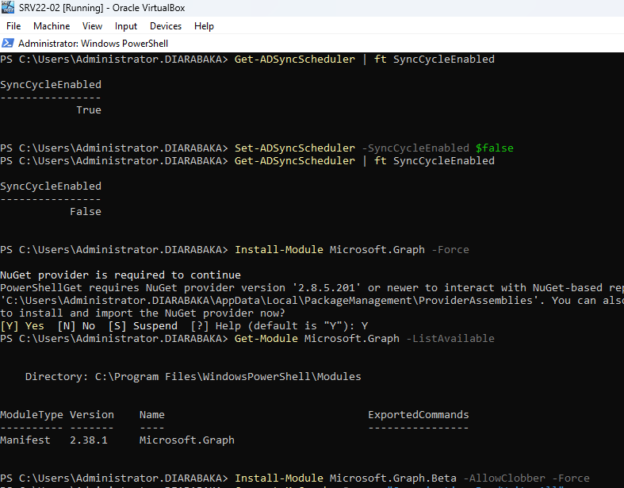
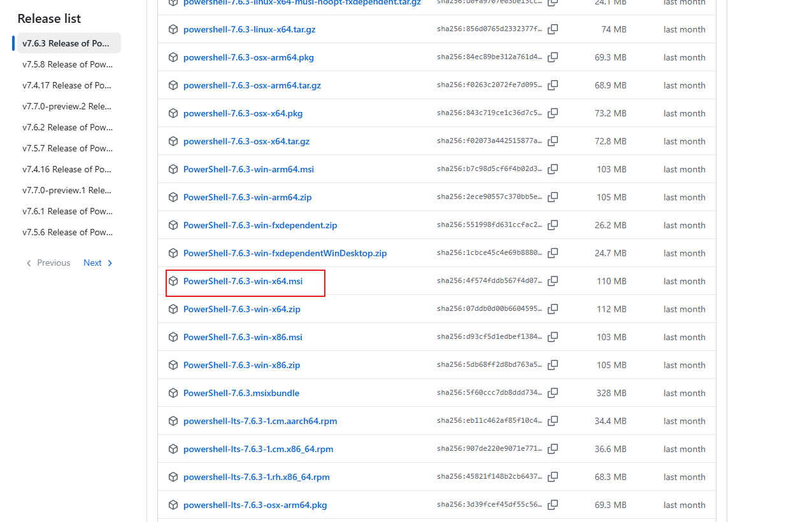
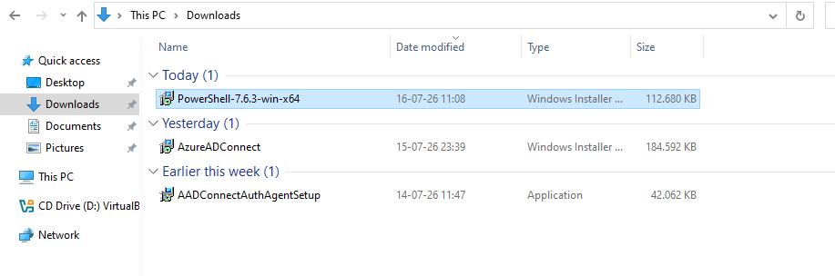
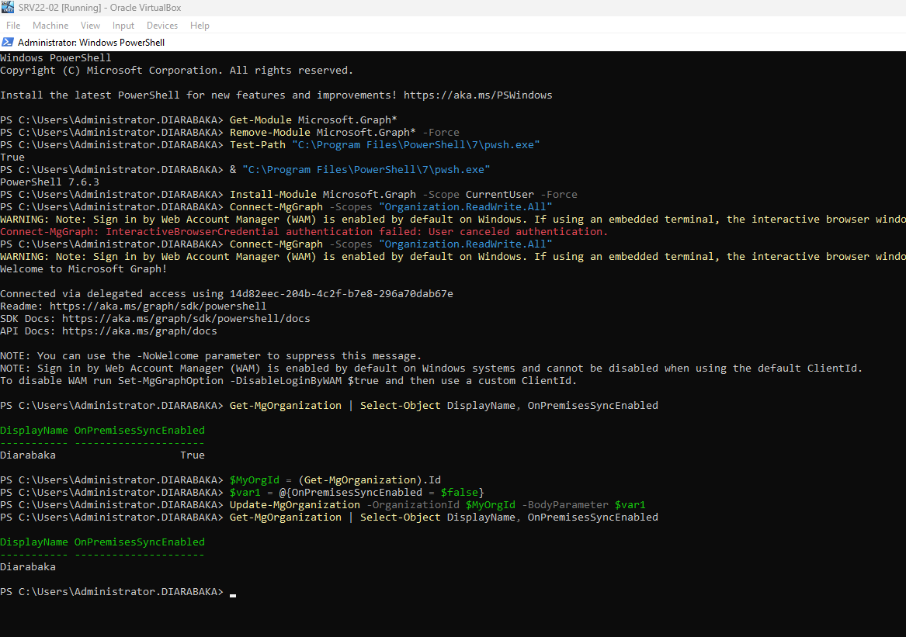
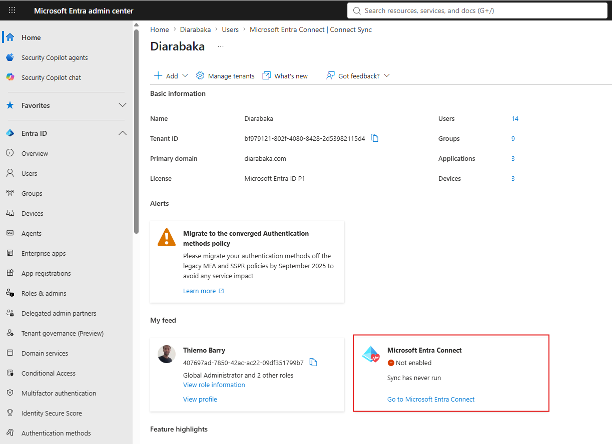
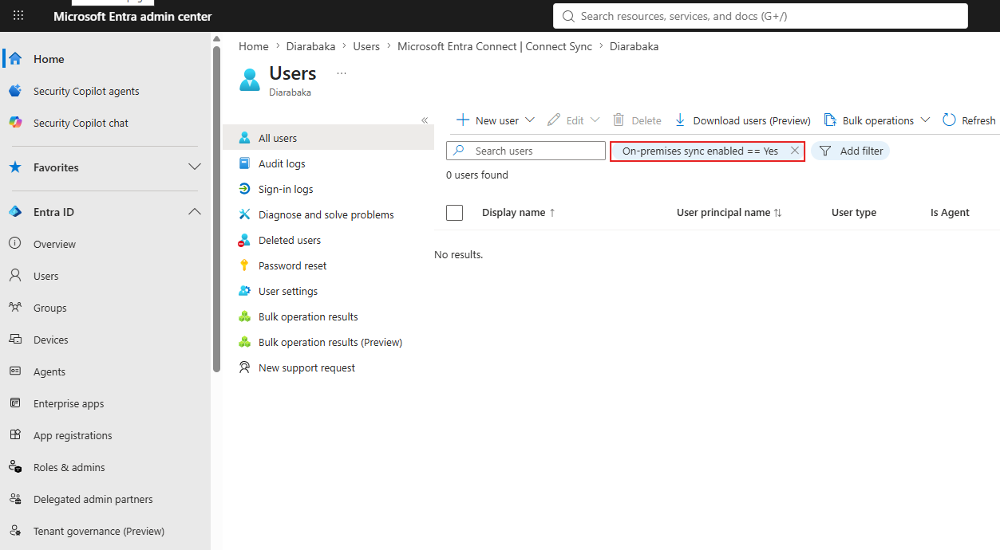

# Désactiver la synchronisation d’annuaire dans Microsoft Entra ID

Dans le tenant de lab **Diarabaka**, je désactive les cycles automatiques sur **SRV22-02**, puis je désactive la synchronisation d’annuaire à l’échelle du tenant avec **Microsoft Graph PowerShell**.

## 1. Identifier les comptes synchronisés

Dans **Entra ID → Users → All users**, j’applique le filtre **On-premises sync enabled = Yes**. Le portail affiche **4 utilisateurs synchronisés** depuis Active Directory.




## 2. Désactiver les cycles automatiques sur SRV22-02

Sur **SRV22-02**, je désactive le planificateur d’Entra Connect Sync et je vérifie que `SyncCycleEnabled` affiche `False`.

```powershell
Set-ADSyncScheduler -SyncCycleEnabled $false
Get-ADSyncScheduler | Select-Object SyncCycleEnabled
```




## 3. Désactiver la synchronisation du tenant

J’installe **PowerShell 7.6.3 x64** et j’utilise le module **Microsoft.Graph**. Après connexion au tenant, je vérifie que `OnPremisesSyncEnabled` affiche `True`, puis je définis cette propriété sur `$false` avec `Update-MgOrganization`.





## 4. Vérifier le résultat dans Entra ID

La vue d’ensemble affiche **Microsoft Entra Connect — Not enabled**. Dans **All users**, le filtre **On-premises sync enabled = Yes** passe de **4 utilisateurs à 0**.




[v7.6.3 Release of PowerShell](https://github.com/PowerShell/PowerShell/releases)
