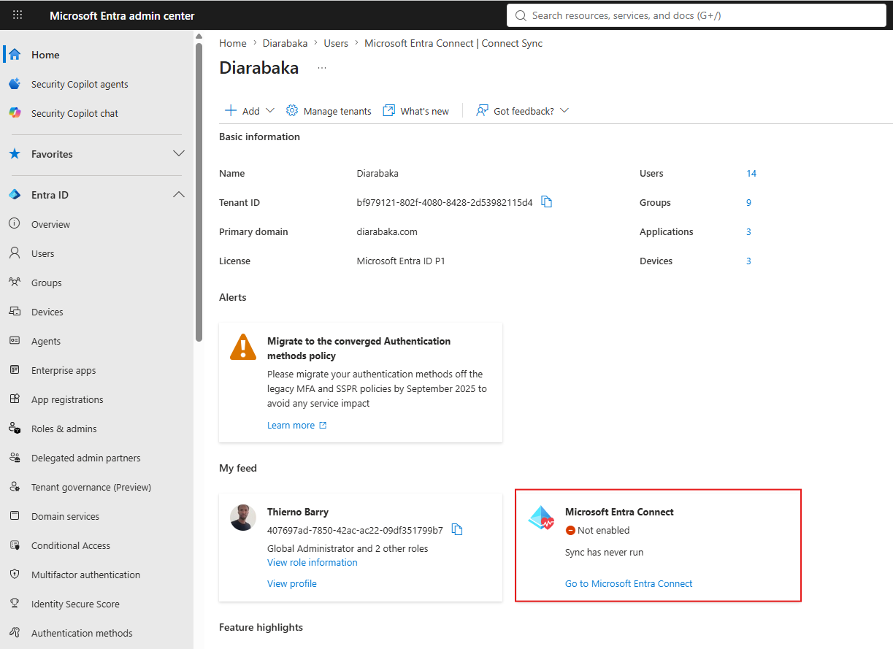
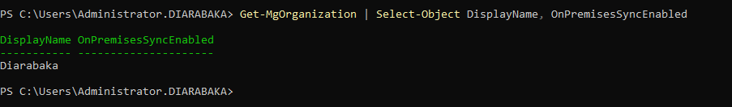
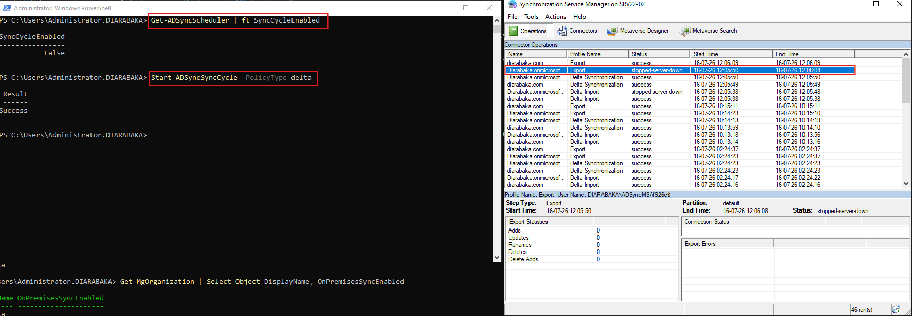
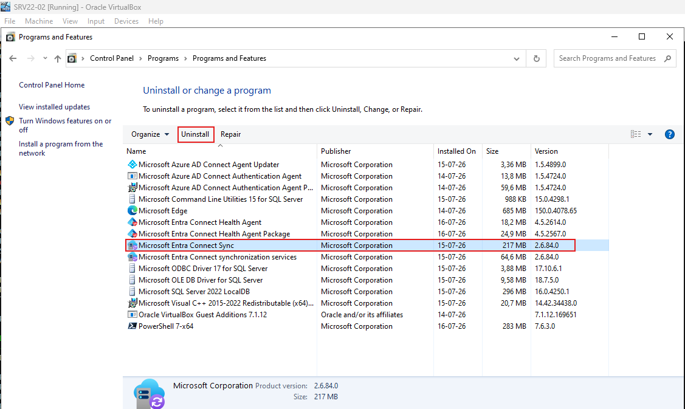
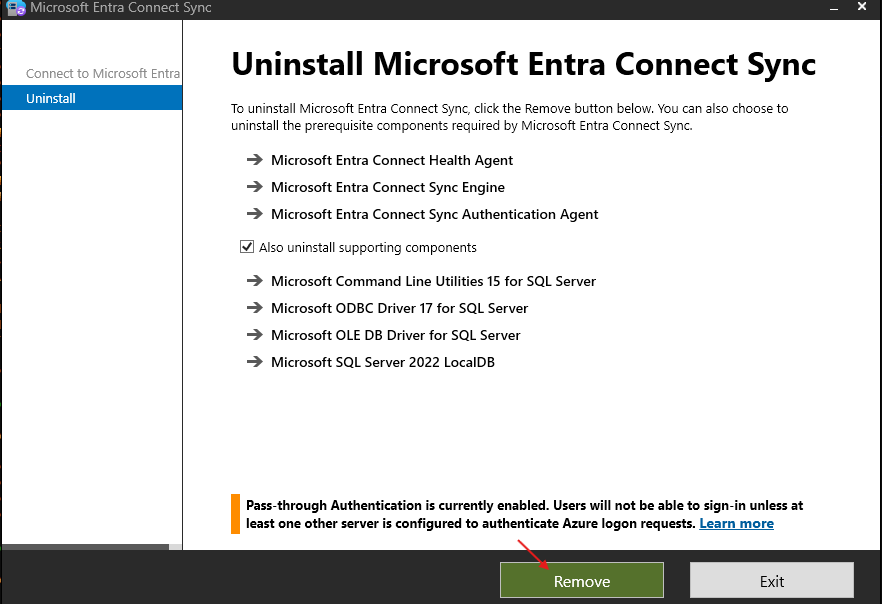
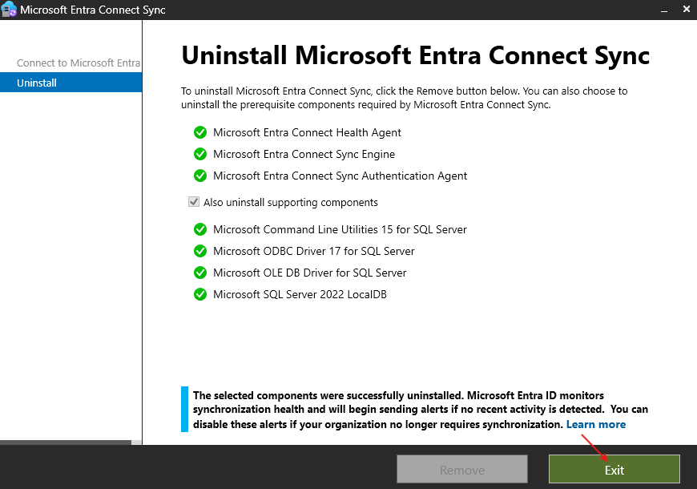
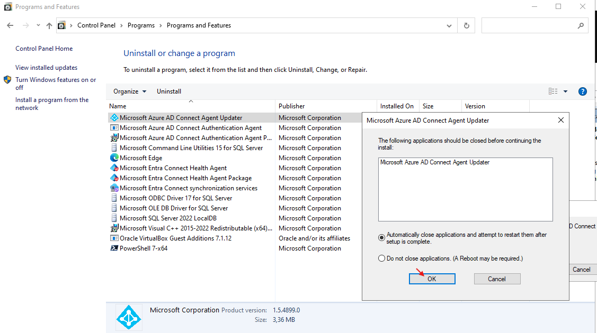
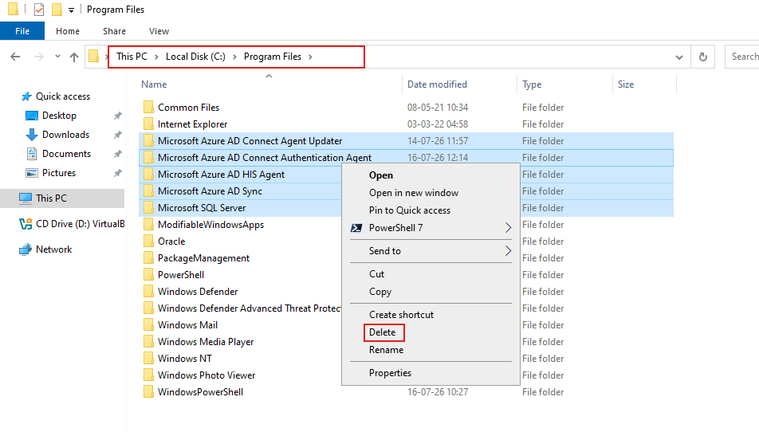

# Désinstaller Microsoft Entra Connect Sync

Dans le tenant de lab **Diarabaka**, je vérifie que la synchronisation d’annuaire est désactivée, puis je désinstalle **Microsoft Entra Connect Sync** de **SRV22-02**.

## 1. Vérifier l’état de la synchronisation

Dans le portail Entra, la tuile **Microsoft Entra Connect** affiche **Not enabled**. Dans PowerShell, `Get-MgOrganization` affiche un champ `OnPremisesSyncEnabled` vide pour le tenant.

Sur **SRV22-02**, `SyncCycleEnabled` affiche `False`. Le cycle Delta lancé manuellement démarre, mais l’export vers Entra affiche **stopped-server-down** dans **Synchronization Service Manager**.

## 2. Désinstaller Entra Connect Sync

Dans **Control Panel → Programs and Features**, je sélectionne **Microsoft Entra Connect Sync**, puis **Uninstall**.

L’assistant indique que **Pass-through Authentication (PTA)** est encore activée. Avant de retirer un agent PTA, je vérifie qu’un autre agent peut prendre en charge les connexions si le tenant utilise encore cette méthode.

Dans ce lab, je coche **Also uninstall supporting components**, puis je clique sur **Remove**. L’assistant confirme la désinstallation du moteur de synchronisation, des agents affichés et des composants SQL sélectionnés.

## 3. Contrôler les éléments restants

Dans **Programs and Features**, je lance la désinstallation de **Microsoft Azure AD Connect Agent Updater**. Je repère ensuite les dossiers résiduels dans `C:\Program Files` pour vérifier à quels composants ils appartiennent.

**Résultat** — L’assistant confirme la désinstallation des composants sélectionnés sur **SRV22-02**. Le contrôle des connexions utilisateur après le retrait de l’agent PTA reste à documenter.
