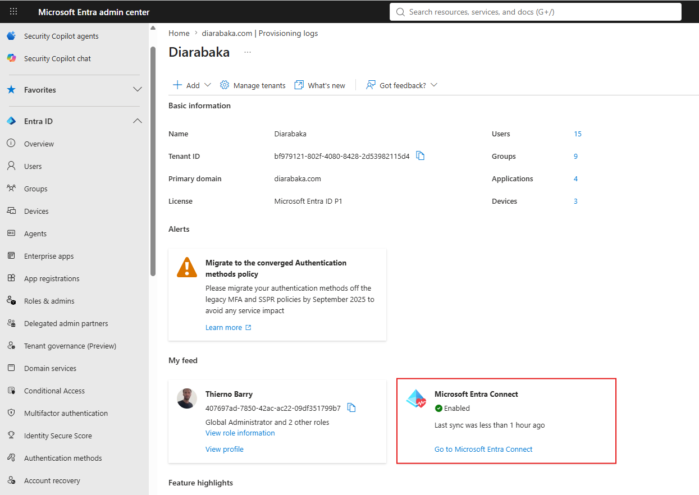
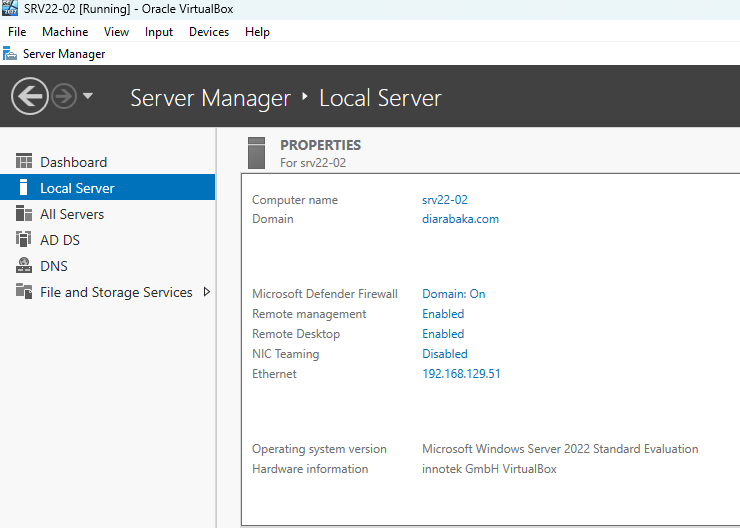
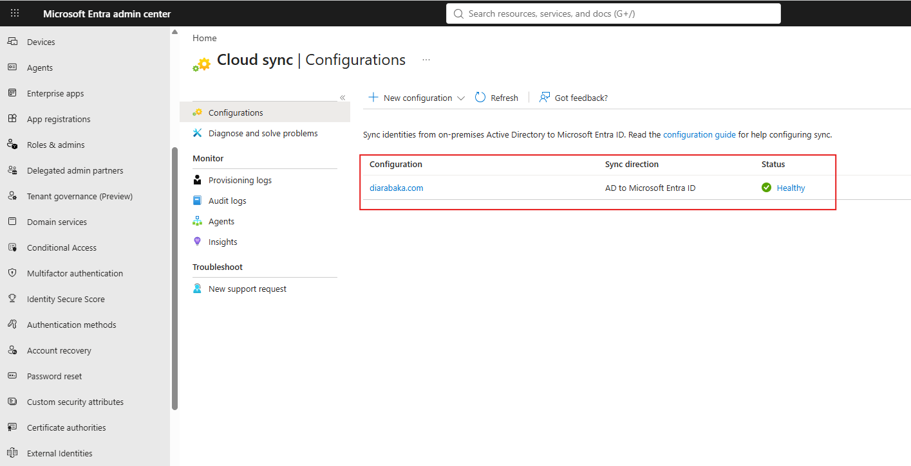
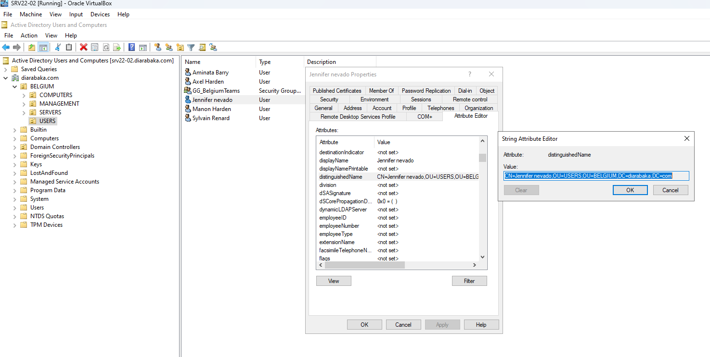
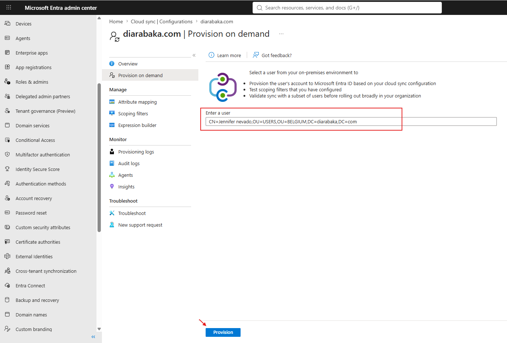
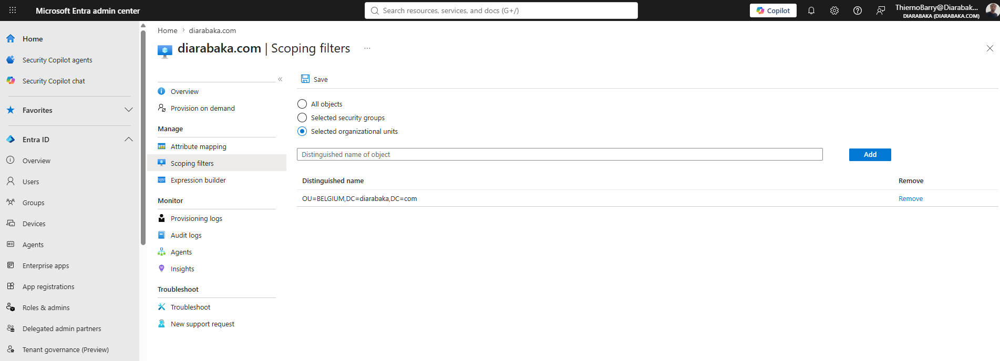

# Tester le provisionnement à la demande avec Microsoft Entra Cloud Sync

Dans ce lab, je lance un test de provisionnement ciblé pour **Jennifer Nevado**, un compte de l’Active Directory local `diarabaka.com`.

## 1. Vérifier la configuration Cloud Sync

Le portail Entra indique que la synchronisation est activée dans le tenant **Diarabaka**. Sur **SRV22-02**, je vérifie que le serveur est joint au domaine `diarabaka.com`.

Dans **Microsoft Entra Connect → Cloud Sync → Configurations**, la configuration `diarabaka.com` affiche **Healthy** et la direction **AD to Microsoft Entra ID**.

## 2. Lancer le provisionnement à la demande

Dans **Active Directory Users and Computers**, j’ouvre le compte **Jennifer Nevado** dans `BELGIUM → USERS`. Dans **Attribute Editor**, je copie son attribut `distinguishedName`.

Dans **Cloud Sync → diarabaka.com → Provision on demand**, je colle le nom distinctif du compte, puis je clique sur **Provision**.

## 3. Vérifier le périmètre et le résultat

Dans **Scoping filters**, je vérifie que la configuration cible l’OU `OU=BELGIUM,DC=diarabaka,DC=com`, qui contient le compte de test.

Le lancement du test est documenté. Le résultat pour **Jennifer Nevado** reste à confirmer dans **Provisioning logs**.
