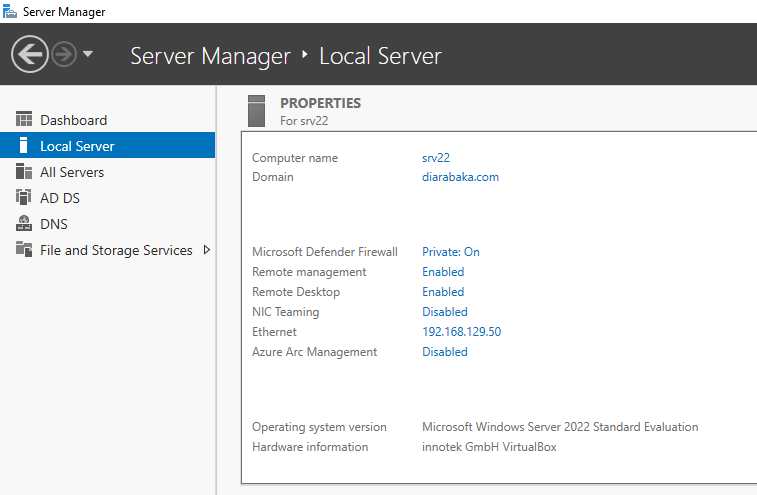
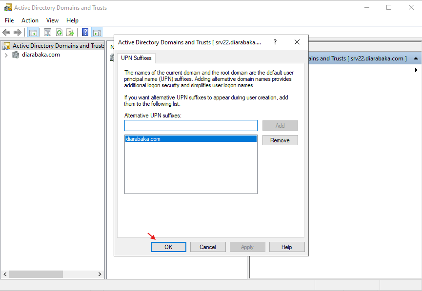
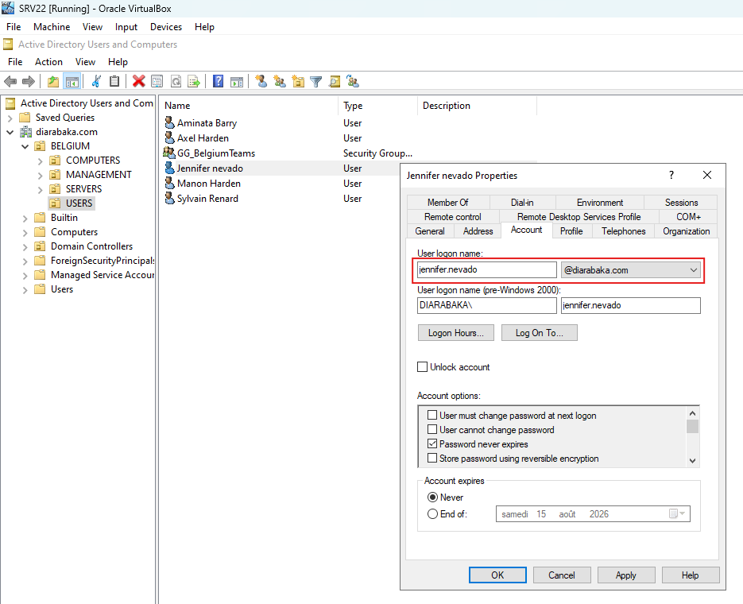
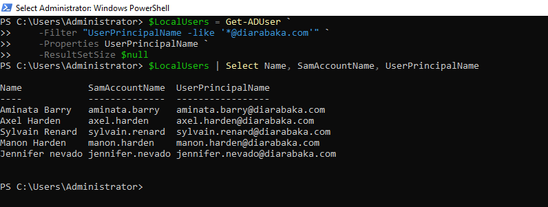

# Préparer les suffixes UPN pour la synchronisation avec Microsoft Entra ID

Lorsqu’un domaine Active Directory utilise un suffixe UPN interne comme `.lan`, on peut attribuer aux utilisateurs un suffixe correspondant à un domaine vérifié dans Microsoft Entra ID.

Dans ce lab, le domaine AD s’appelle déjà `diarabaka.com`. Les captures montrent la configuration et la vérification du suffixe UPN `@diarabaka.com`.

## 1. Vérifier le suffixe UPN dans Active Directory

Sur **SRV22** (Windows Server 2022), j’ouvre **Active Directory Domains and Trusts → Properties → UPN Suffixes**. Je vérifie que `diarabaka.com` figure dans la liste des suffixes UPN alternatifs.




## 2. Contrôler l’identifiant de connexion

Dans **Active Directory Users and Computers**, j’ouvre **Jennifer Nevado → Properties → Account**. Le champ **User logon name** affiche `jennifer.nevado@diarabaka.com`.



## 3. Vérifier les comptes avec PowerShell

```powershell
Get-ADUser -Filter "UserPrincipalName -like '*@diarabaka.com'" |
    Select-Object Name, SamAccountName, UserPrincipalName
```

La commande affiche **cinq comptes** dont l’UPN se termine par `@diarabaka.com`. Cette vérification s’effectue côté Active Directory, avant le contrôle de la synchronisation dans Entra ID.


