# Configurer le filtrage par OU dans Microsoft Entra Connect Sync

Dans le lab **Diarabaka**, je limite le périmètre de synchronisation à l’OU `BELGIUM` et à ses sous-OU. J’applique la configuration sur **SRV22** en mode staging, avec les cycles automatiques désactivés.

## 1. Vérifier les OU et suspendre les cycles automatiques

Dans **Active Directory Users and Computers**, je vérifie la structure de l’OU `BELGIUM`. Sur **SRV22**, je désactive les cycles automatiques avant de modifier le filtre.

```powershell
Set-ADSyncScheduler -SyncCycleEnabled $false
```

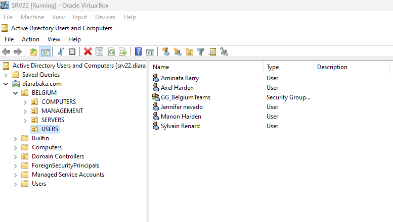
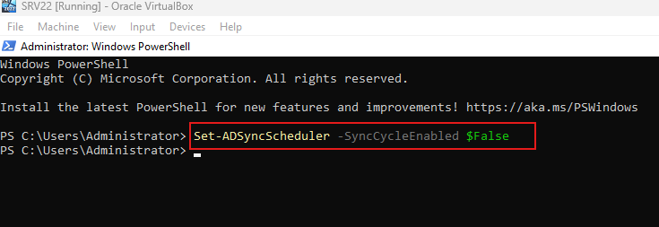

## 2. Sélectionner les OU à synchroniser

Dans **Microsoft Entra Connect Sync → Configure → Customize synchronization options**, je me connecte au tenant et je vérifie que la forêt `diarabaka.com` est configurée.

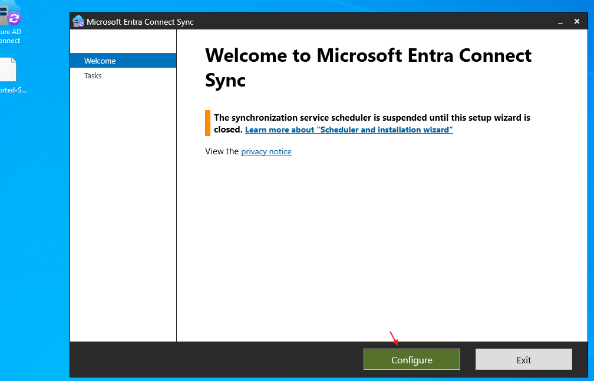
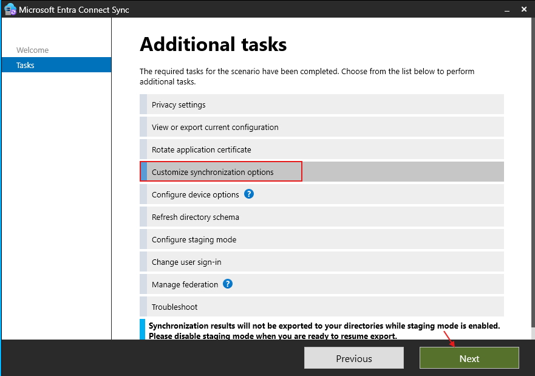
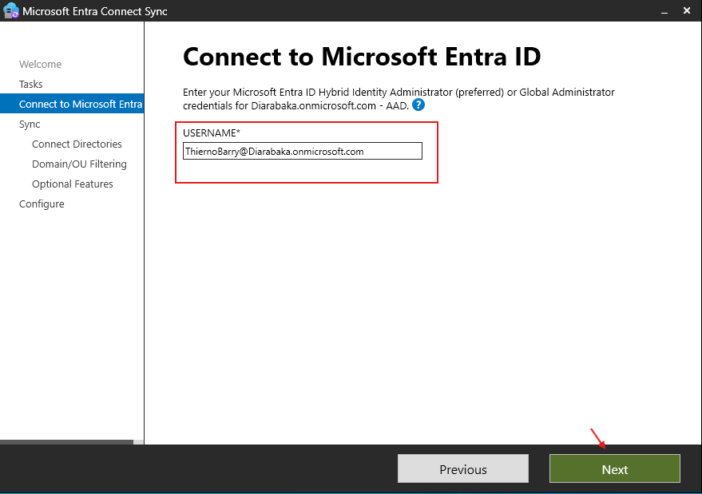
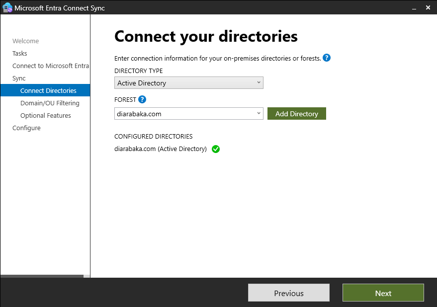

Dans **Domain and OU filtering**, je choisis **Sync selected domains and OUs** et je coche `BELGIUM` ainsi que ses sous-OU `COMPUTERS`, `MANAGEMENT`, `SERVERS` et `USERS`. Le conteneur `Users` à la racine du domaine est exclu du périmètre.

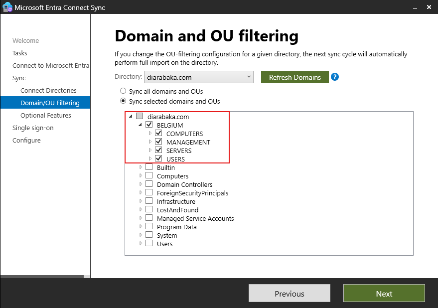

## 3. Appliquer la configuration en mode staging

Je laisse **Password hash synchronization** cochée dans **Optional features** et je vérifie l’étape **Seamless SSO**. Dans le récapitulatif, le **mode staging** est actif et l’option de démarrage automatique de la synchronisation est décochée. Je clique sur **Configure**.

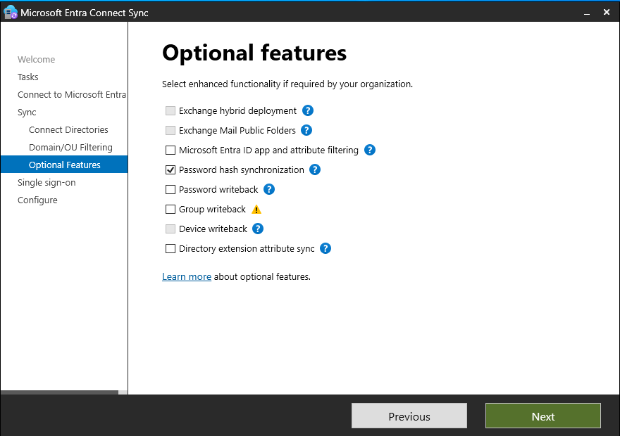
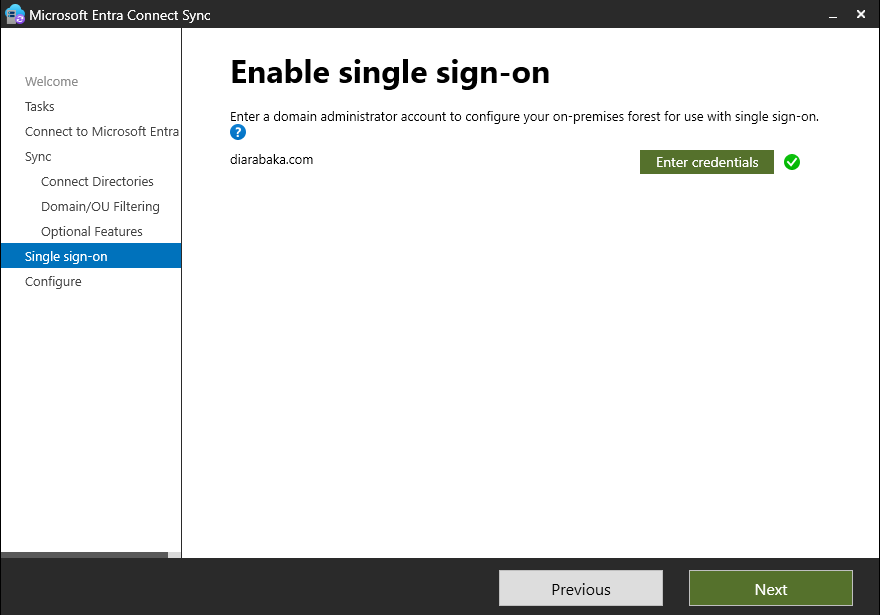
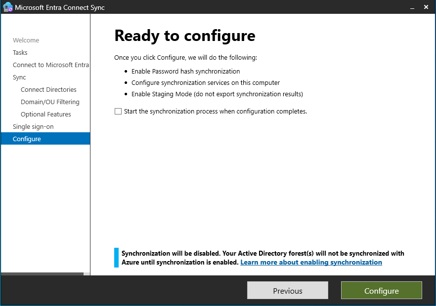

L’assistant affiche **Configuration complete**. Le filtre est configuré sur **SRV22**. La validation des objets inclus et exclus après un cycle de synchronisation reste à documenter.

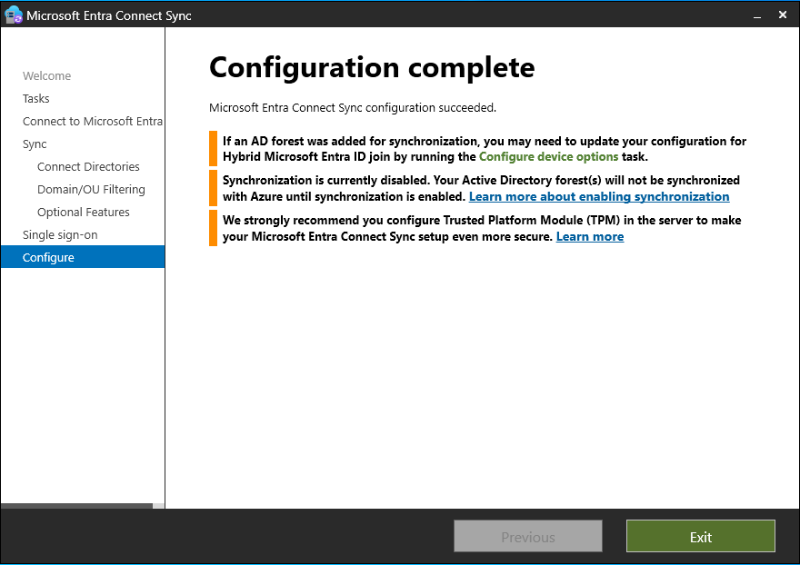
