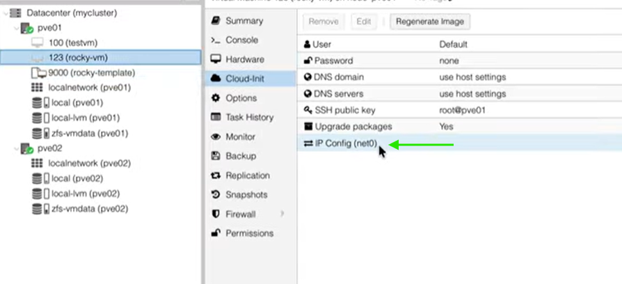
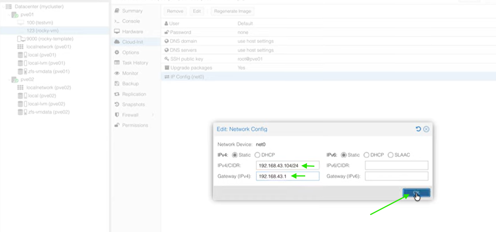
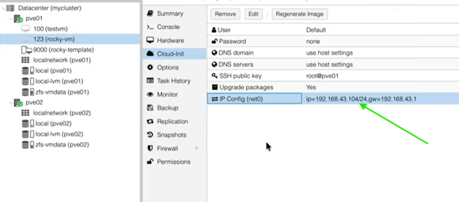
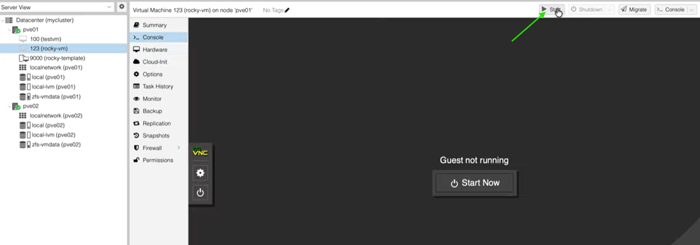
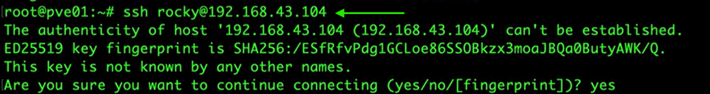

# Clones and VM Templates

```sh
# Rocky Linux
qm create 9000 --name rocky-template --memory 2048 \
--net0 virtio,bridge=vmbr0 \
--scsihw virtio-scsi-pci \
--agent 1 --ostype l26 --cpu x86-64-v2

qm importdisk 9000 /rpool/data/9000/Rocky-9-GenericCloud-Base.latest.x86_64.qcow2 zfs-vmdata

qm set 9000 --scsi0 zfs-vmdata:vm-9000-disk-0
qm set 9000 --boot order=scsi0
qm set 9000 --ide2 zfs-vmdata:cloudinit
qm set 9000 --serial0 socket --vga serial0
qm template 9000


qm clone 9000 123 --name rocky-vm
qm set 123 --sshkey ~/.ssh/id_rsa.pub
qm start 123

ssh rocky@IP_DE_LA_VM

---

# Ubuntu Server
qm create 9100 --name ubuntu-template --memory 2048 \
--net0 virtio,bridge=vmbr0 \
--scsihw virtio-scsi-pci \
--agent 1 --ostype l26 --cpu x86-64-v2

qm importdisk 9100 /rpool/data/9100/jammy-server-cloudimg-amd64.img zfs-vmdata

qm set 9100 --scsi0 zfs-vmdata:vm-9100-disk-0
qm set 9100 --boot order=scsi0
qm set 9100 --ide2 zfs-vmdata:cloudinit
qm set 9100 --serial0 socket --vga serial0
qm template 9100

qm clone 9100 124 --name ubuntu-vm
qm set 124 --sshkey ~/.ssh/id_rsa.pub
qm start 124

ssh ubuntu@IP_DE_LA_VM

---

# Agrandir le disque après le clone (très recommandé)
qm resize 123 scsi0 +20G
qm resize 124 scsi0 +20G

---

# Console série (évite les écrans noirs)
qm set 9000 --serial0 socket --vga serial0
qm set 9100 --serial0 socket --vga serial0

---

qm destroy 9000 --purge
qm destroy 9100 --purge
```






