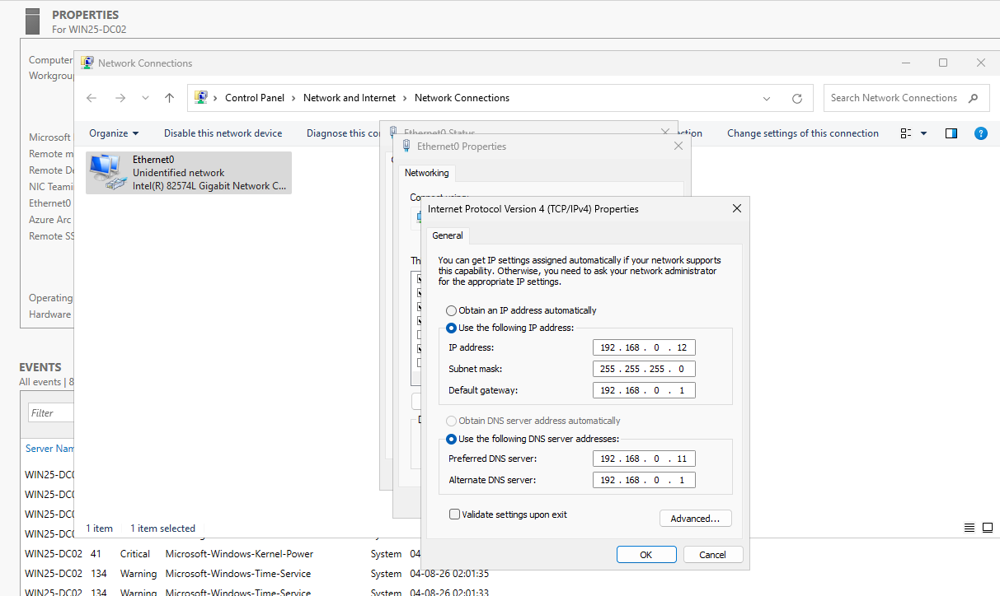
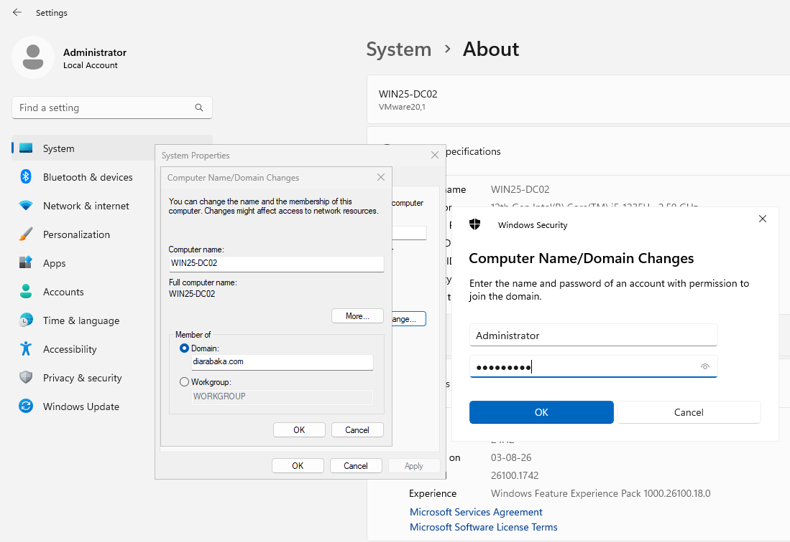
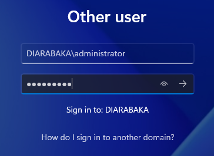
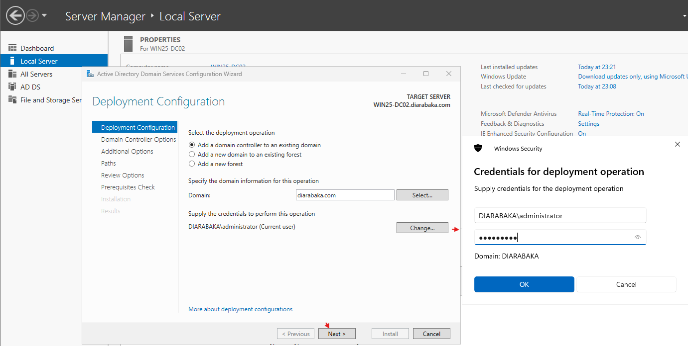
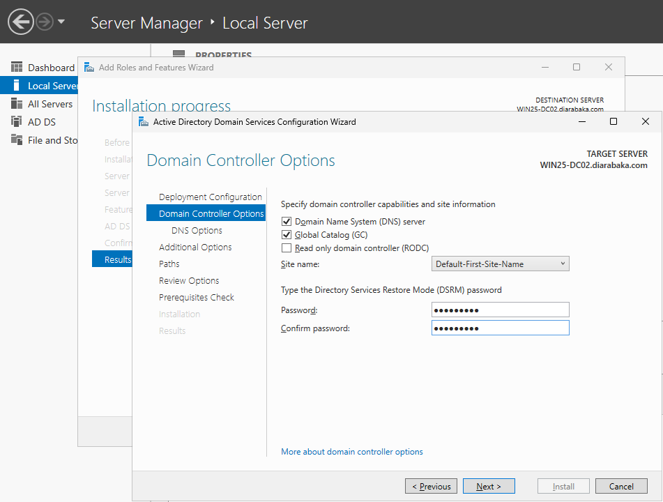
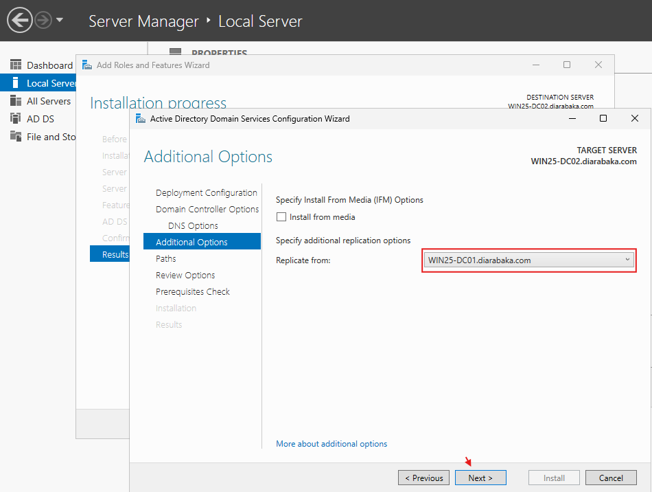
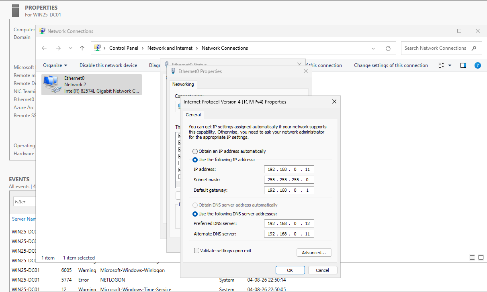
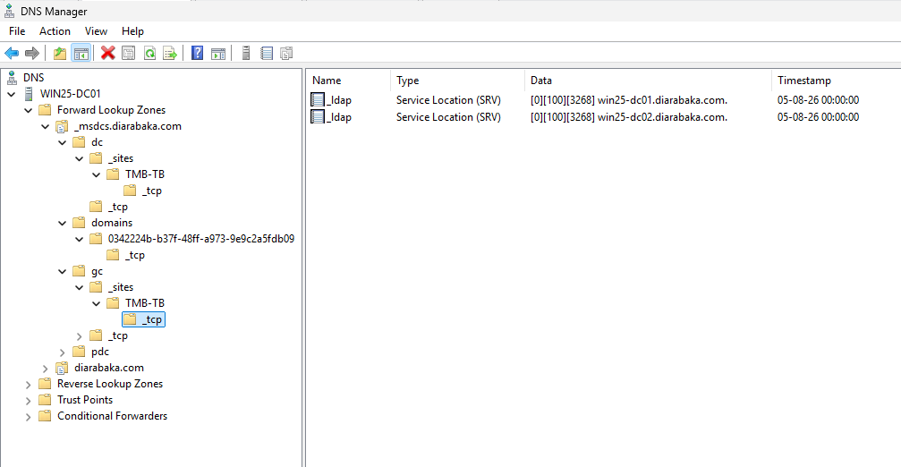
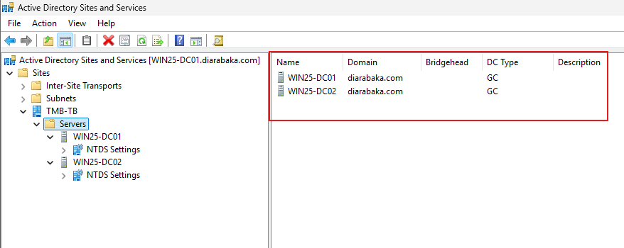
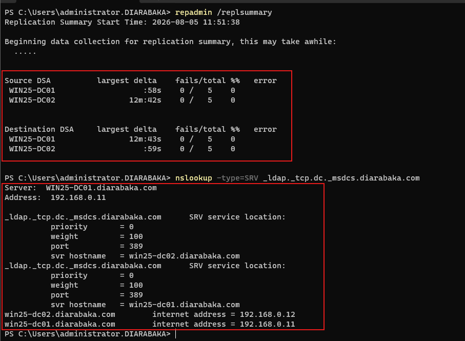

# Additional Domain Controller

## 3. Corriger la configuration DNS des contrôleurs de domaine

### Sur WIN25-DC01

```PowerShell
Set-DnsClientServerAddress -InterfaceAlias "Ethernet0" -ServerAddresses ("192.168.0.11","192.168.0.12")
```

### Sur WIN25-DC02

```PowerShell
Set-DnsClientServerAddress -InterfaceAlias "Ethernet0" -ServerAddresses ("192.168.0.12","192.168.0.11")
```

## 4. Réenregistrer les enregistrements DNS

```PowerShell
ipconfig /flushdns
ipconfig /registerdns
```

## 5. Redémarrer le service Netlogon

```PowerShell
net stop netlogon
net start netlogon
```

## 6. Forcer l'enregistrement des enregistrements Active Directory

```PowerShell
nltest /dsregdns
```

## 7. Vérifier le DNS Active Directory

```PowerShell
dcdiag /test:dns
```

## 8. Vérifier la réplication Active Directory

```PowerShell
repadmin /replsummary
```

## 9. Vérifier les enregistrements SRV

```PowerShell
nslookup -type=SRV _ldap._tcp.dc._msdcs.diarabaka.com
```

## 10. Vérification complète de l'état d'un contrôleur de domaine

```PowerShell
dcdiag /v /s:WIN25-DC01
dcdiag /v /s:WIN25-DC02
```










