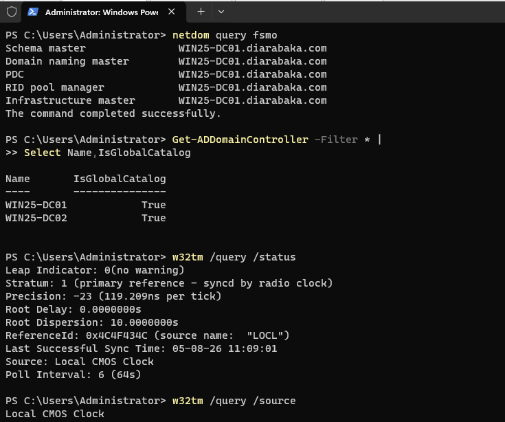
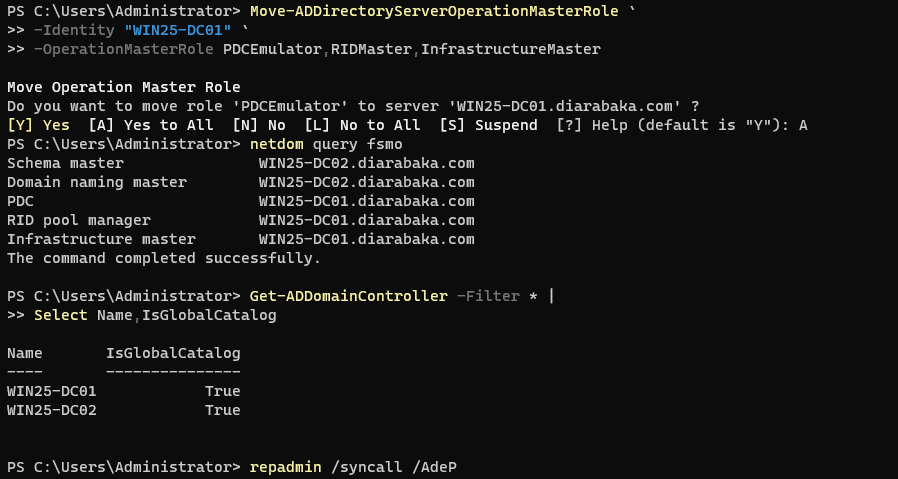
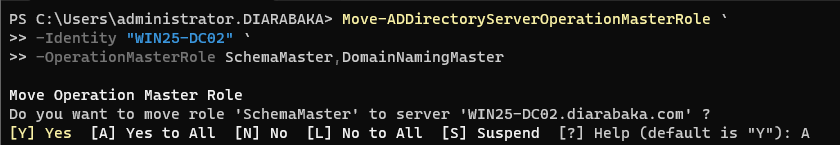
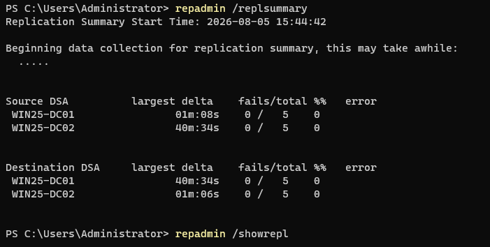
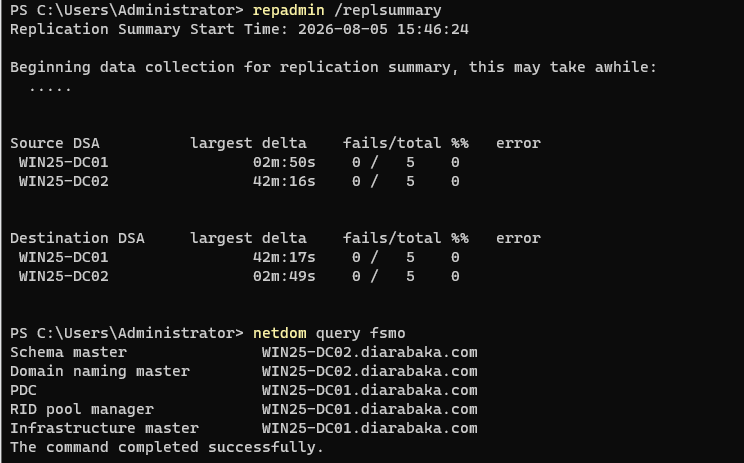

## Phase 1 - Health Check

```PowerShell
dcdiag /v
repadmin /replsummary
repadmin /showrepl
net share
```

Vérifier :

```
0 erreur de réplication
SYSVOL présent
NETLOGON présent
Aucune erreur critique DCDIAG
```

---

## Phase 2 - Vérifier les DC

```PowerShell
Get-ADDomainController -Filter * |
Select Name,IPv4Address,Site,IsGlobalCatalog
```

Pour activer le Global Catalog, utilise généralement Active Directory Sites and Services :

```
Active Directory Sites and Services
└── Sites
    └── Default-First-Site-Name
        └── Servers
            └── WIN25-DC02
                └── NTDS Settings
```

Puis :

```
Properties
☑ Global Catalog
```

Ensuite, attendre/forcer la réplication.

Puis :

```PowerShell
Test-NetConnection WIN25-DC01 -Port 135
Test-NetConnection WIN25-DC02 -Port 135
```

---

## Phase 3 - Vérifier les FSMO actuels

```PowerShell
netdom query fsmo
```

Option PowerShell :

```PowerShell
Get-ADDomain |
Select PDCEmulator,RIDMaster,InfrastructureMaster

Get-ADForest |
Select SchemaMaster,DomainNamingMaster
```

---

## Phase 4 - Vérifier DNS, SYSVOL et réplication

```PowerShell
dcdiag /test:dns /v
dfsrdiag replicationstate
repadmin /showrepl
```

---

## Phase 5 - Transfert FSMO

**Vers WIN25-DC01**

```PowerShell
Move-ADDirectoryServerOperationMasterRole `
-Identity "WIN25-DC01" `
-OperationMasterRole PDCEmulator,RIDMaster,InfrastructureMaster
```

**Vers WIN25-DC02**

```PowerShell
Move-ADDirectoryServerOperationMasterRole `
-Identity "WIN25-DC02" `
-OperationMasterRole SchemaMaster,DomainNamingMaster
```

---

## Phase 6 - Vérification immédiate

```PowerShell
netdom query fsmo
```

Résultat cible :

```
Schema master                WIN25-DC02
Domain naming master         WIN25-DC02
PDC                           WIN25-DC01
RID pool manager             WIN25-DC01
Infrastructure master        WIN25-DC01
```

---

## Phase 7 - Synchronisation

```PowerShell
repadmin /syncall /AdeP
repadmin /replsummary
repadmin /showrepl
```

---

## Phase 8 - DNS et SRV

Sur chaque DC :

```PowerShell
ipconfig /flushdns
ipconfig /registerdns

nltest /dsregdns
```

Puis :

```PowerShell
dcdiag /test:dns /v
```

Et :

```PowerShell
nslookup -type=SRV _ldap._tcp.dc._msdcs.diarabaka.com
```

---

## Phase 9 - Vérifier le nouveau PDC Emulator

**Sur WIN25-DC01 :**

```PowerShell
w32tm /query /status
w32tm /query /source
```

---

## Phase 10 - Validation finale

```PowerShell
dcdiag /v
repadmin /replsummary
netdom query fsmo
```

Si tout est propre :

```
DCDIAG        → PASSED
Replication   → 0 failures
FSMO          → Répartition correcte
DNS           → PASSED
SYSVOL        → Disponible
NETLOGON      → Disponible
```

---

## Phase 11 - Sauvegarde System State

Très important après une modification d'infrastructure AD :

```PowerShell
wbadmin start systemstatebackup `
-backupTarget:E: `
-quiet
```

Si `E:` correspond à un volume local, attention : selon la configuration et la politique de sauvegarde, il est préférable d'utiliser une destination conforme à la stratégie de sauvegarde et idéalement distincte du système protégé.

---








