# Install DNS Server & DHCP

```sh
# Vérifier les serveurs DNS de la zone
Get-DnsServerResourceRecord -ZoneName "thierno.lan" -RRType NS

# Tester la résolution de noms
nslookup dc01.thierno.lan
nslookup dc02.thierno.lan

# Vérifier la santé du DNS Active Directory
dcdiag /test:dns
```

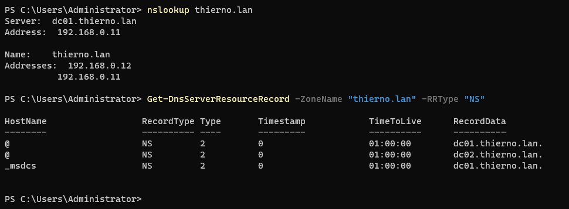
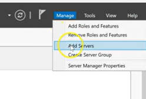
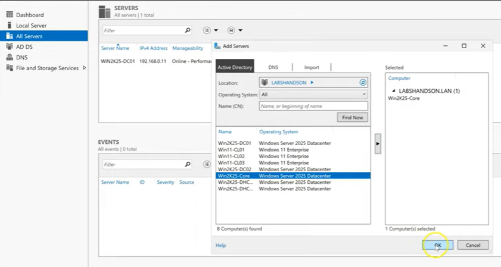
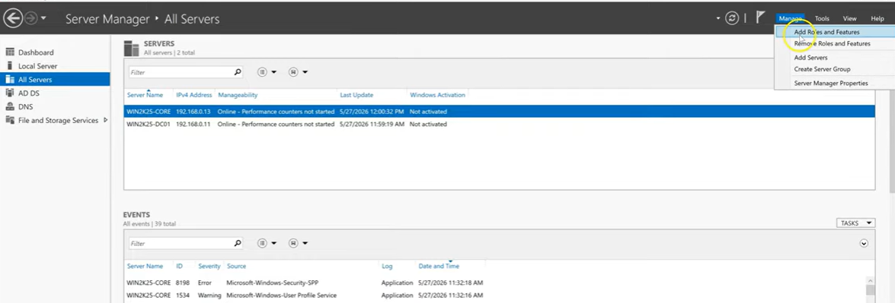
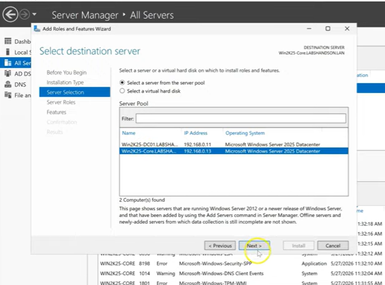
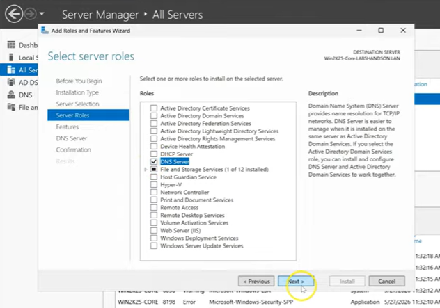
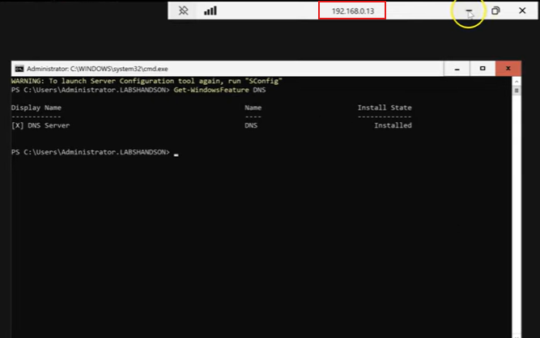
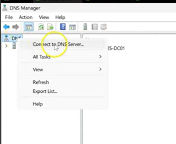
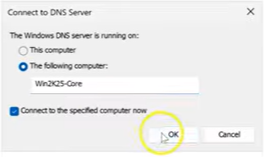
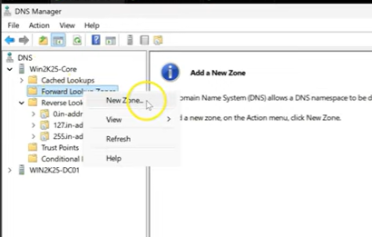
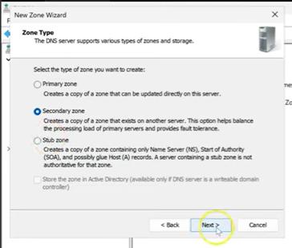
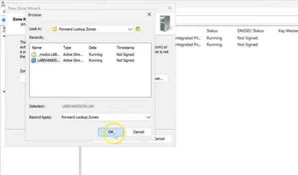
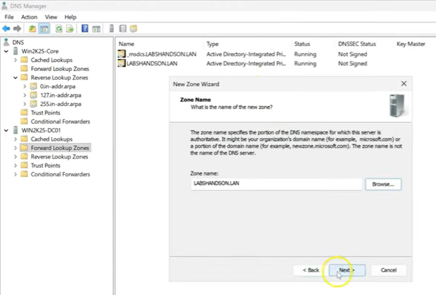
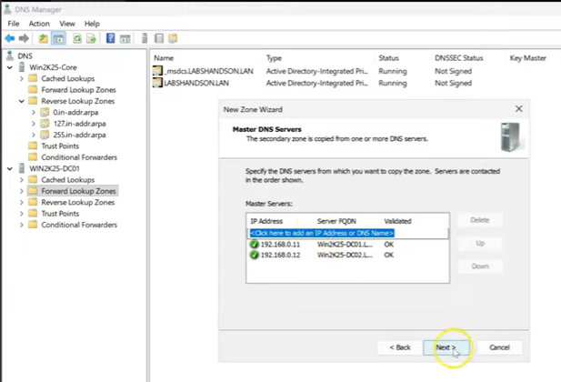
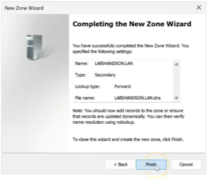
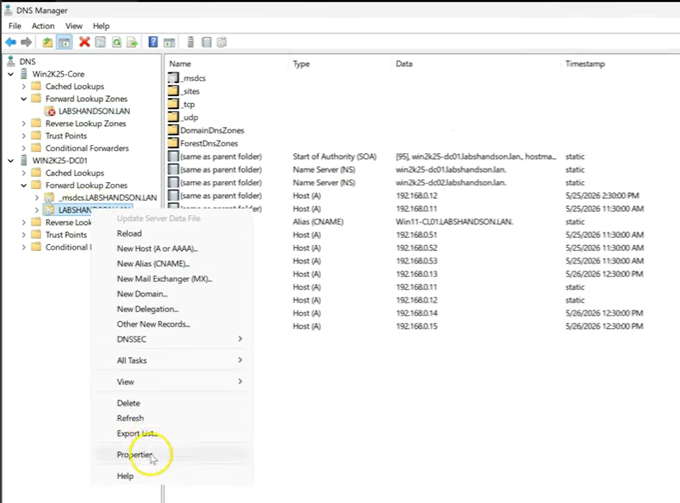
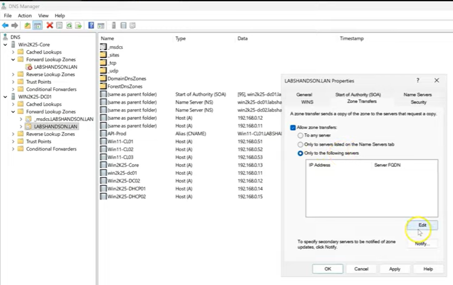
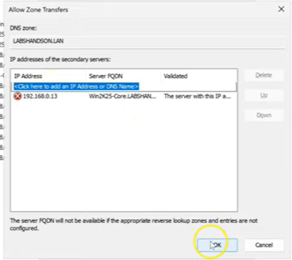
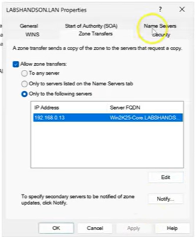
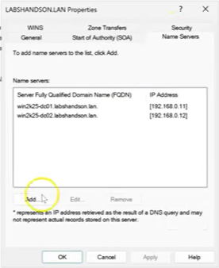
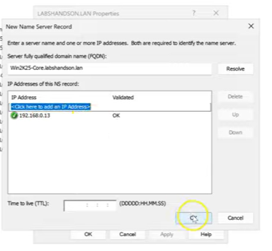
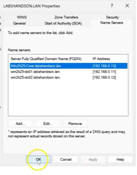
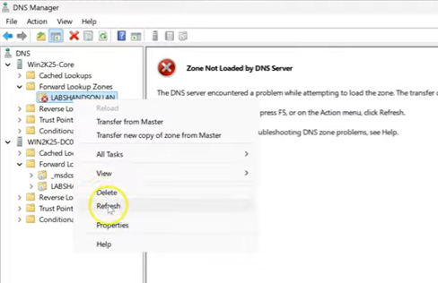
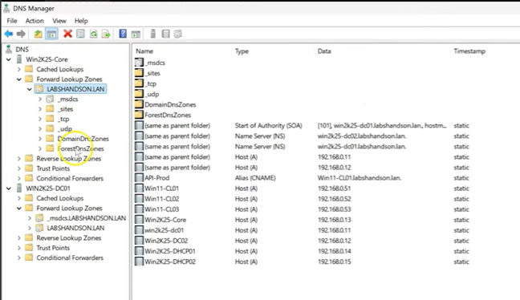
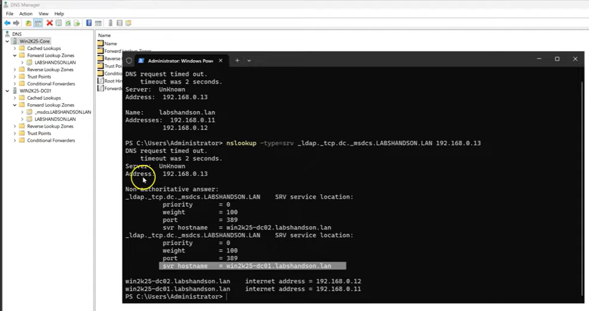
