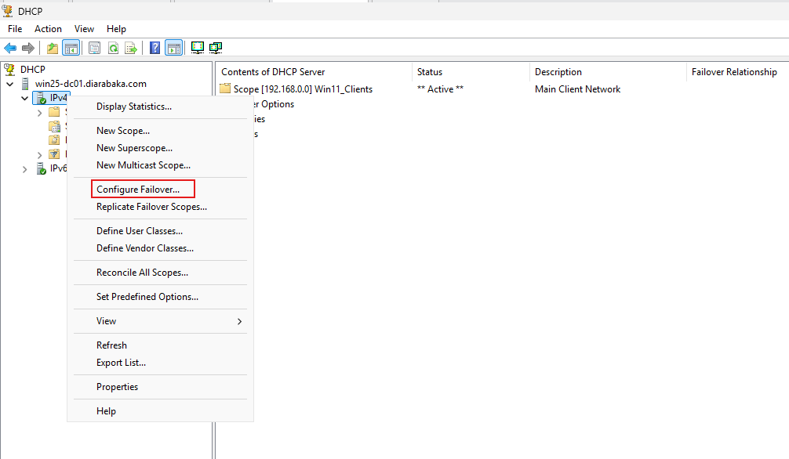
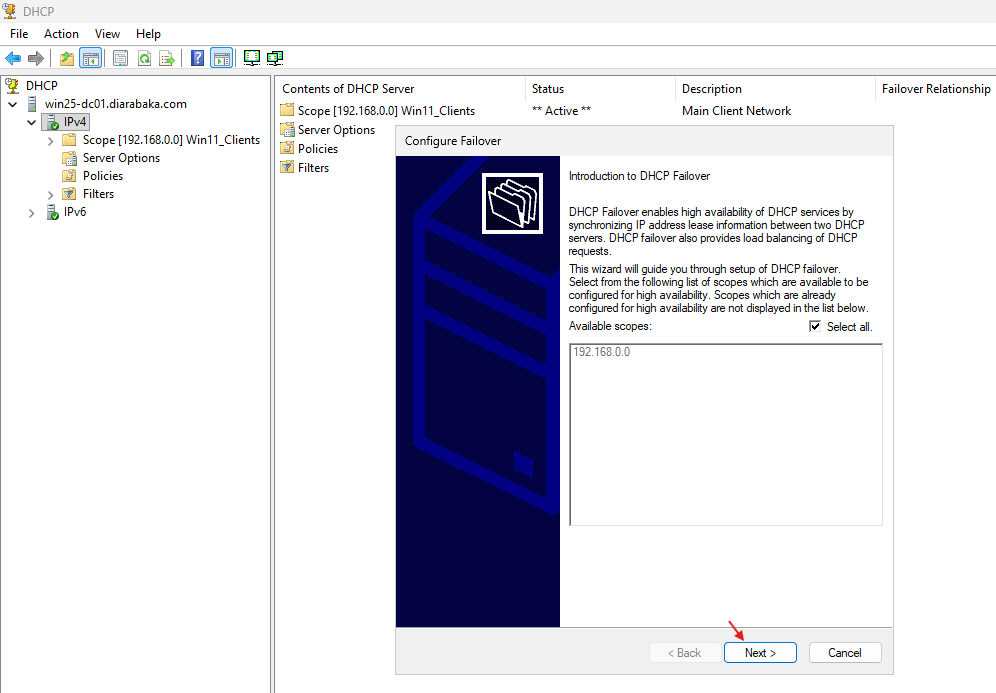
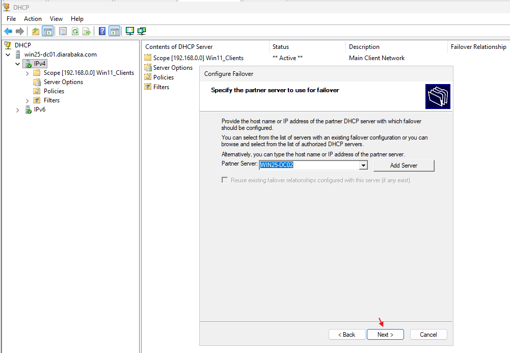
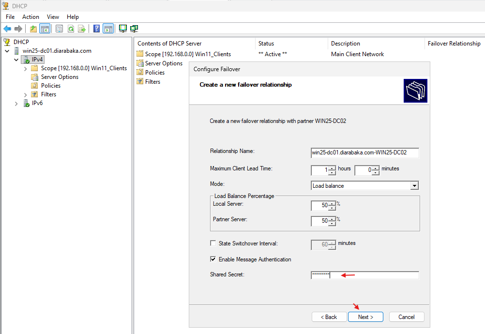
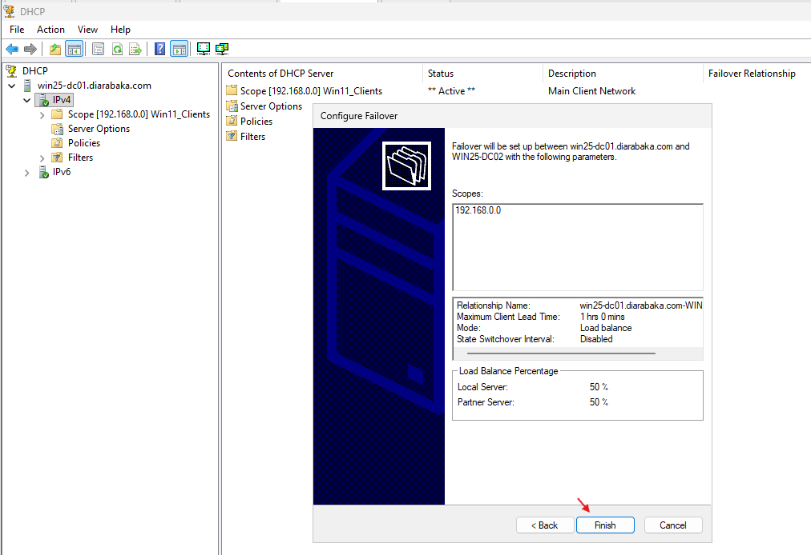
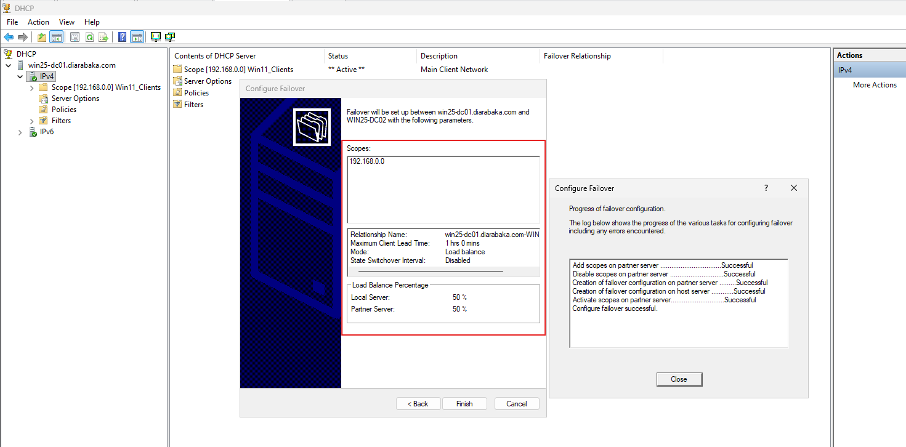
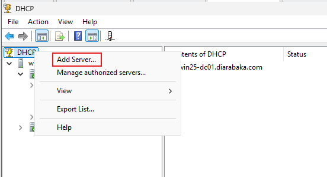
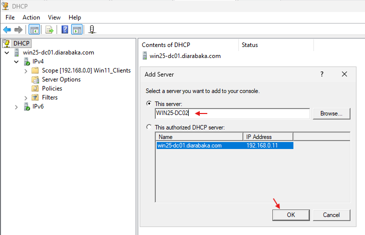
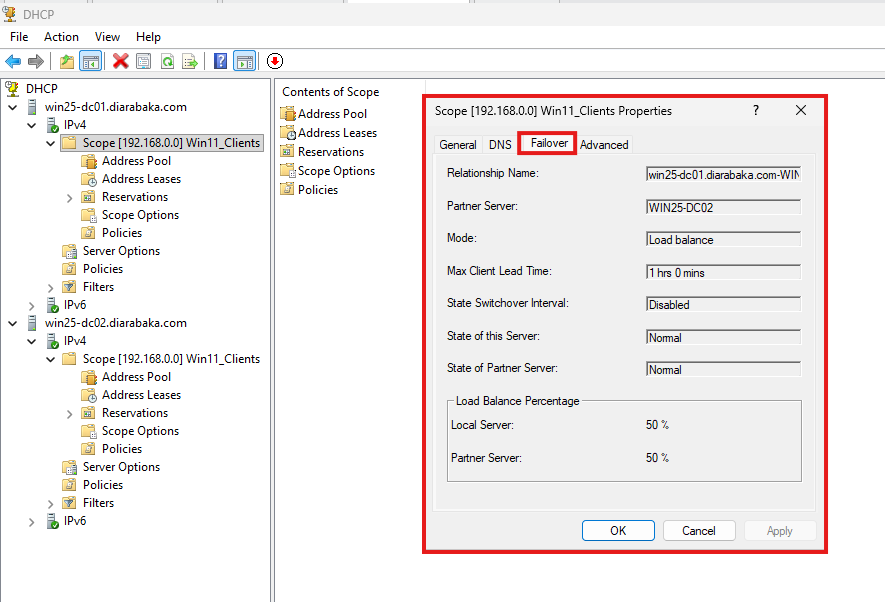
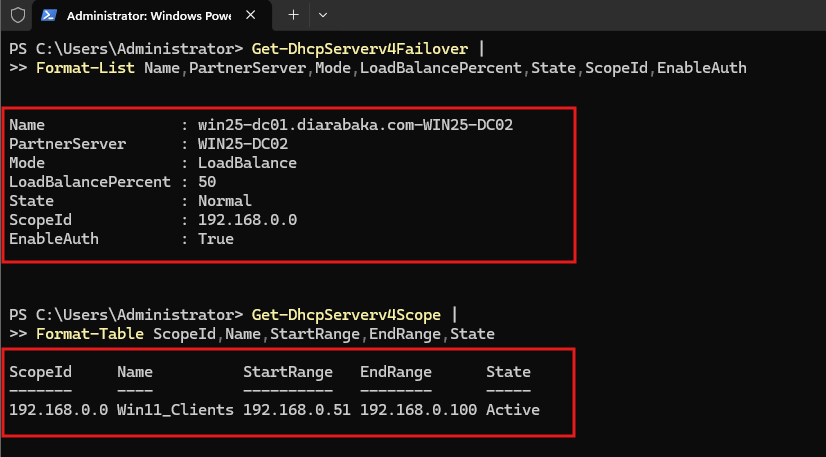

# DHCP Failover












```sh
Get-DhcpServerv4Failover |
Format-List Name,PartnerServer,Mode,LoadBalancePercent,State,ScopeId,EnableAuth


Get-DhcpServerv4Scope |
Format-Table ScopeId,Name,StartRange,EndRange,State
```
