# GPO

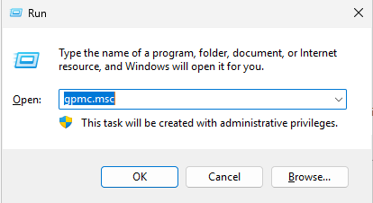
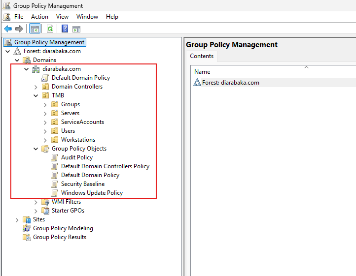
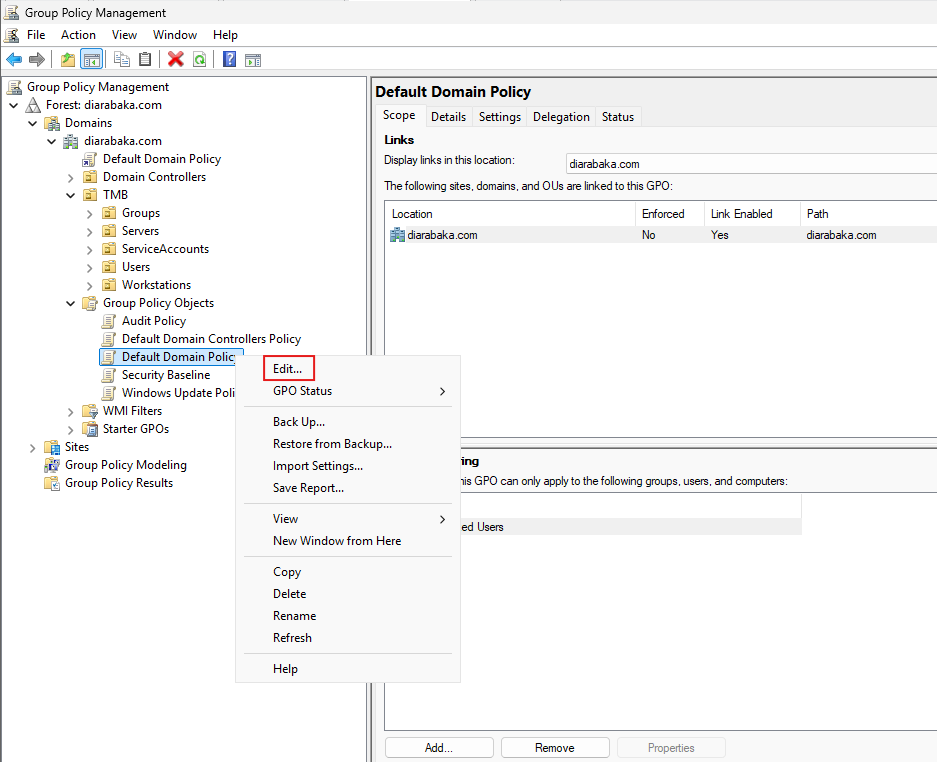
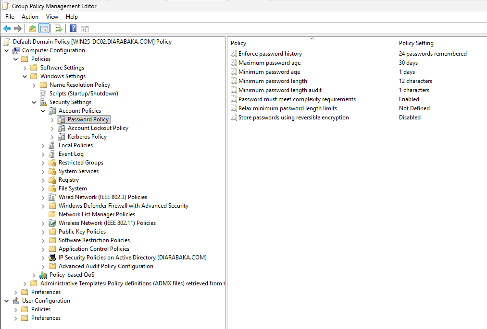
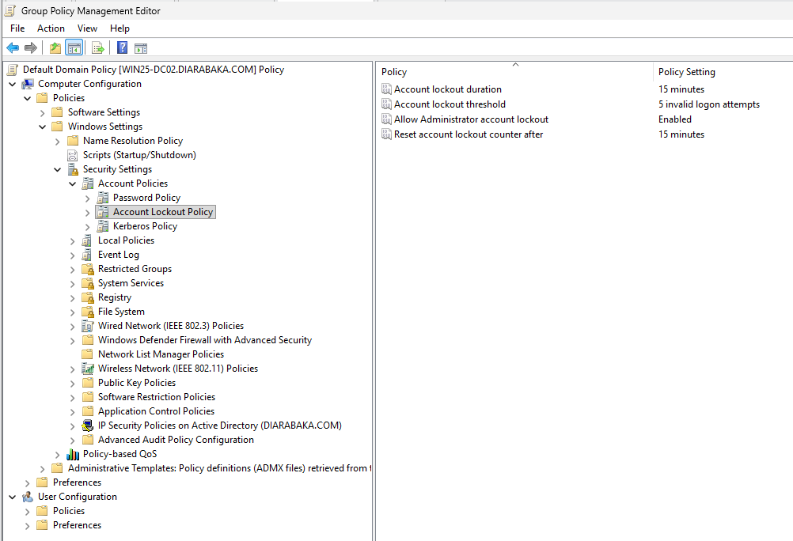
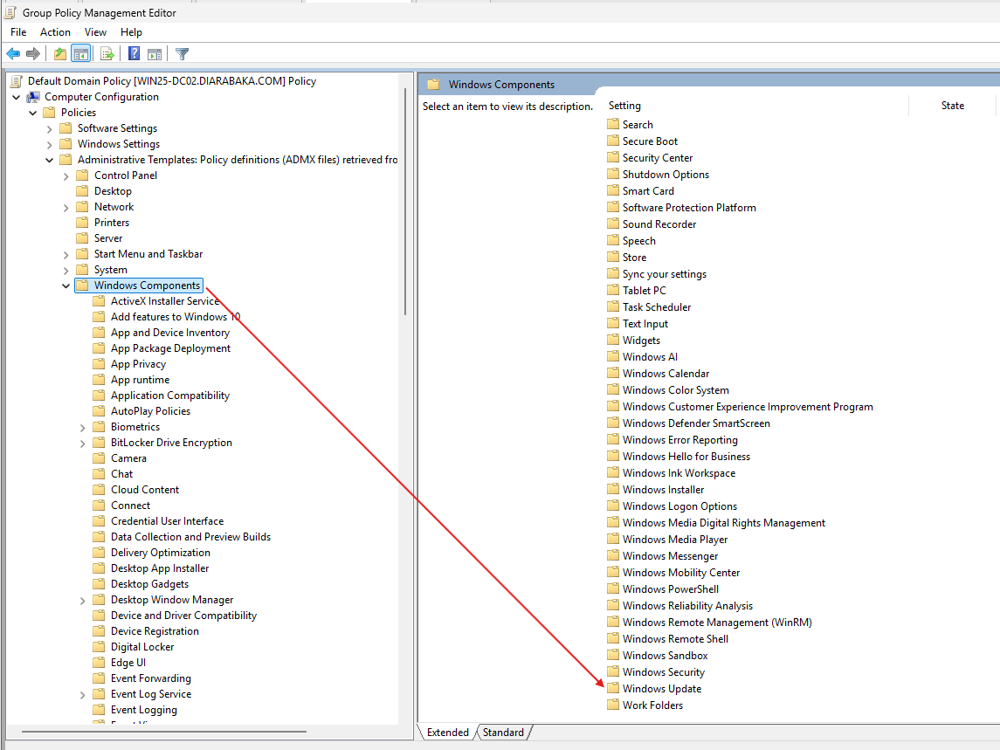
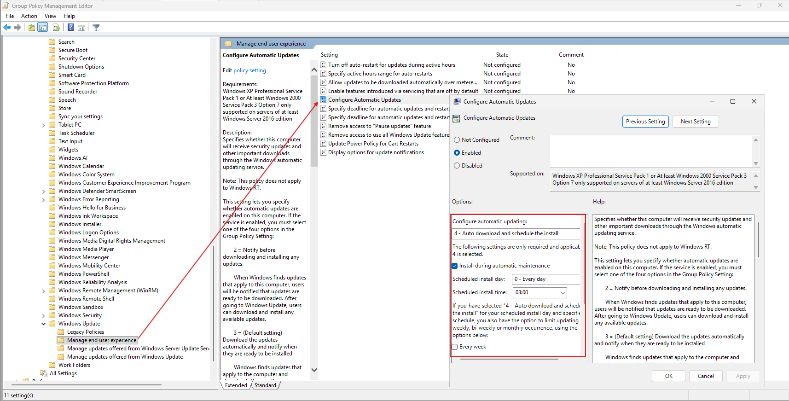
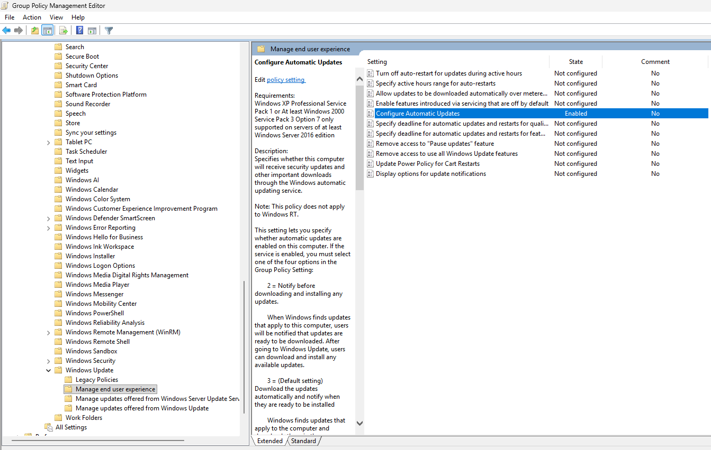
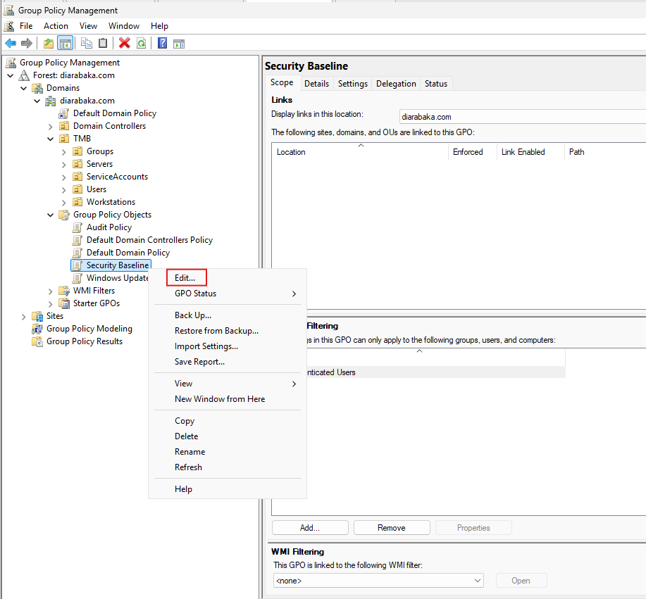
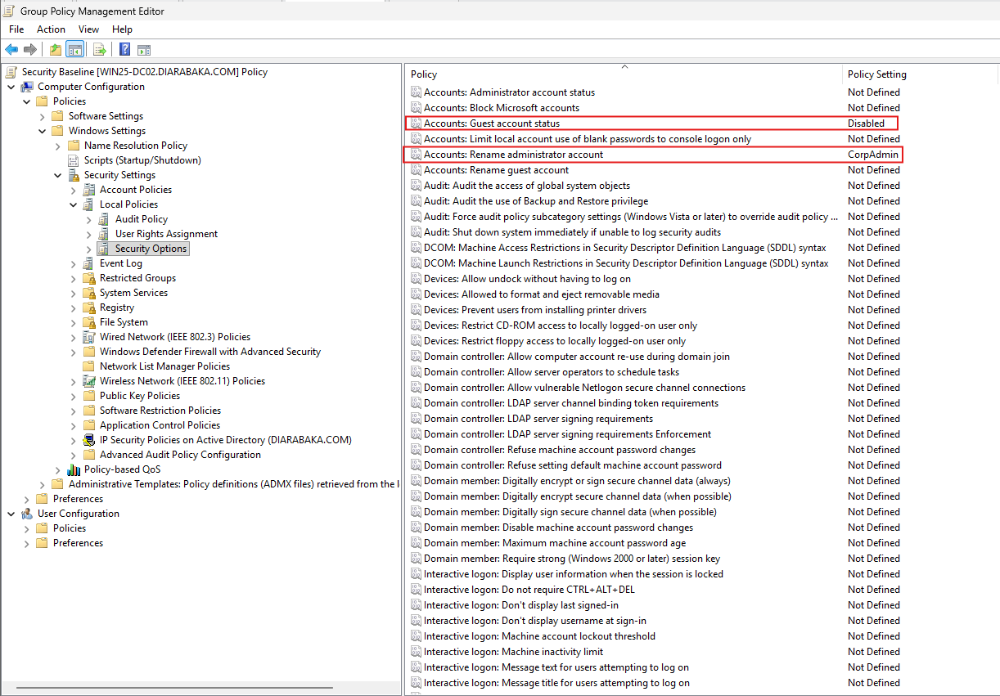
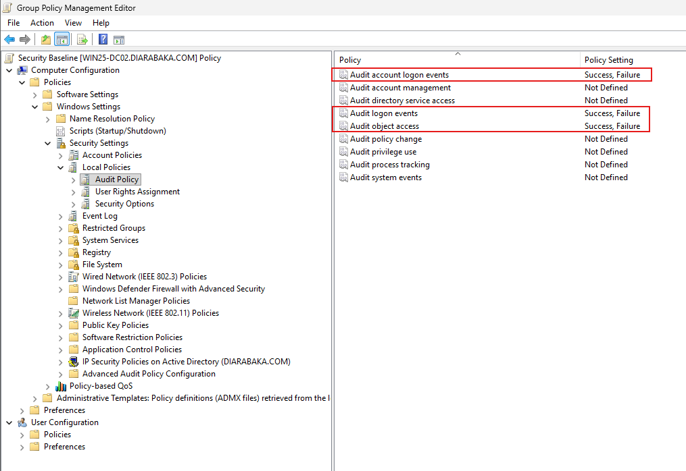
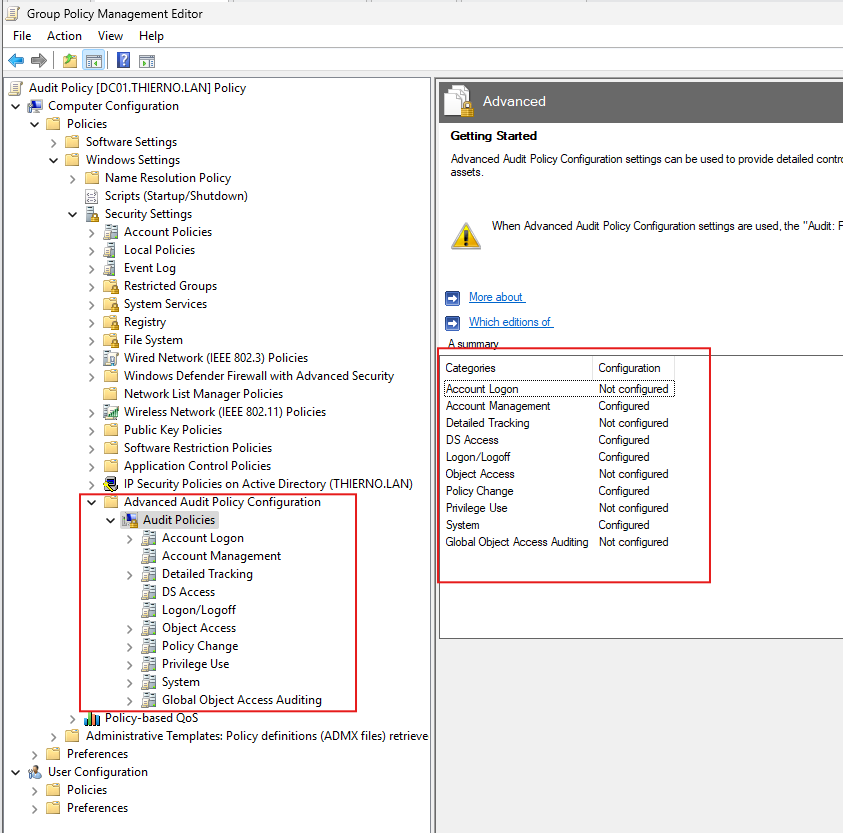

```sh
Computer Configuration
 └── Policies
     └── Windows Settings
         └── Security Settings
             └── Advanced Audit Policy Configuration

Active :

🔐 Logon/Logoff
Audit Logon → Success + Failure
👤 Account Management
Audit User Account Management → Success + Failure
📁 Directory Service Access
Success + Failure (si AD monitoring)
⚙️ Policy Change
Audit Policy Change → Success + Failure
🖥 System
Audit System Events → Success + Failure
```
