# Just Enough Administration (JEA)

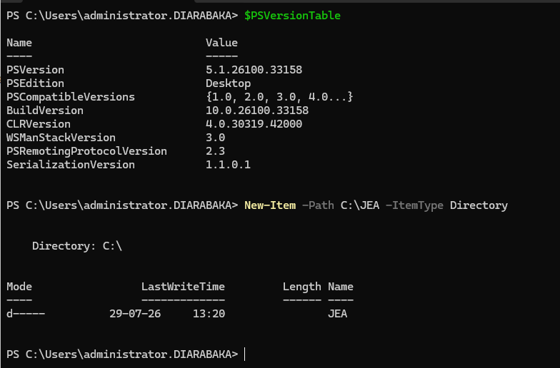
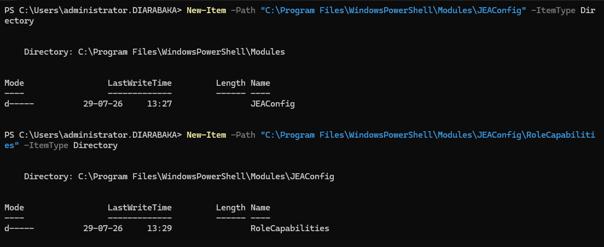
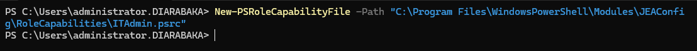
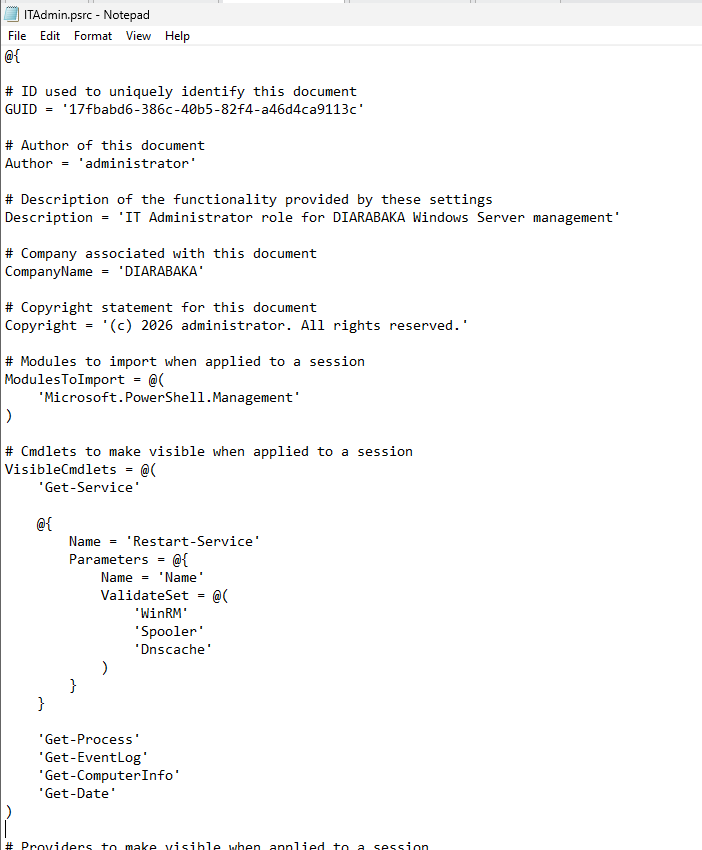
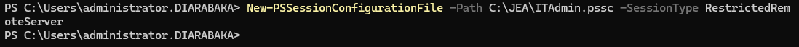
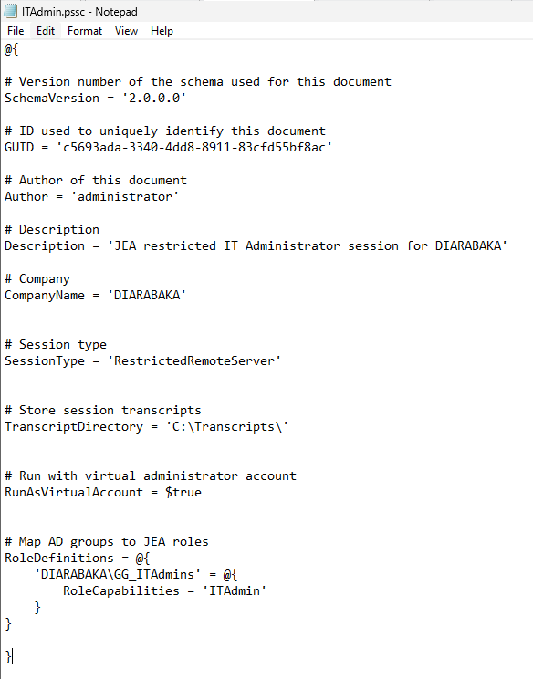
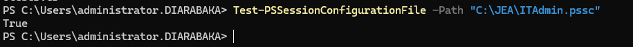
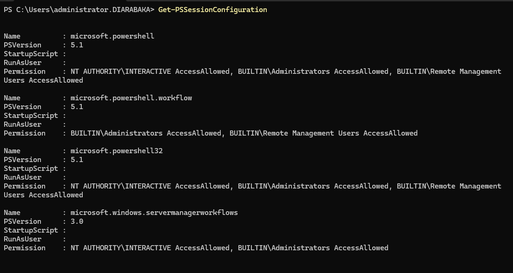
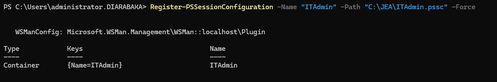
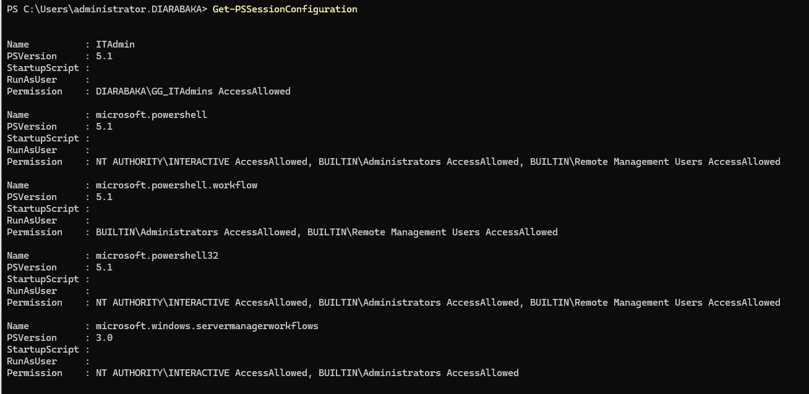

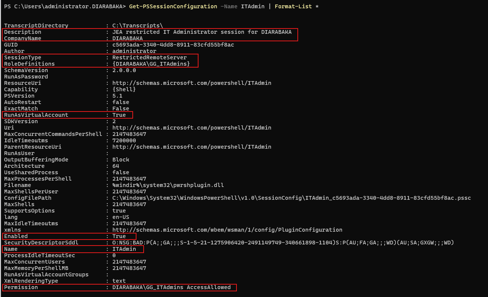
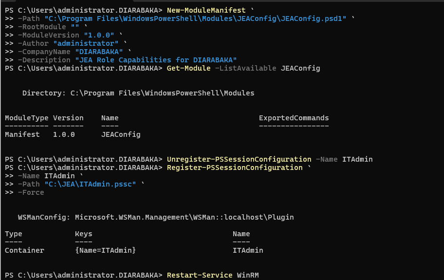
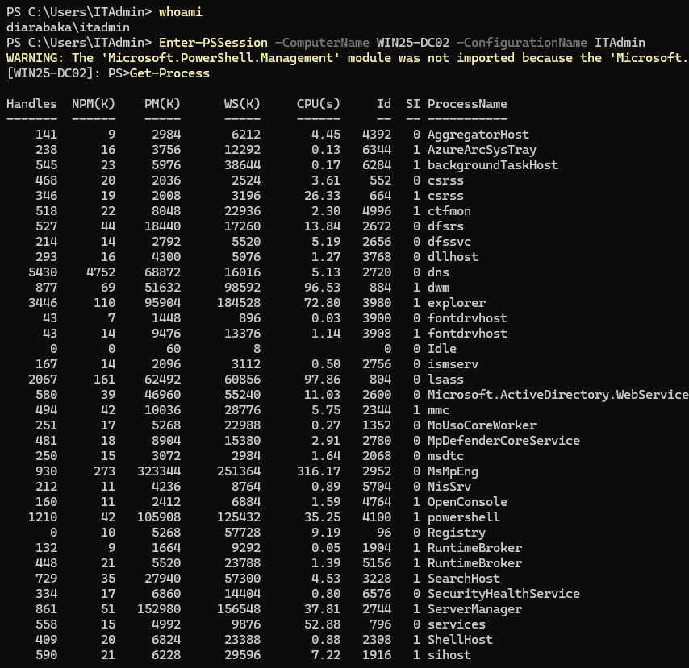

```sh
@{

# ID used to uniquely identify this document
GUID = '17fbabd6-386c-40b5-82f4-a46d4ca9113c'

# Author of this document
Author = 'administrator'

# Description of the functionality provided by these settings
Description = 'IT Administrator role for DIARABAKA Windows Server management'

# Company associated with this document
CompanyName = 'DIARABAKA'

# Copyright statement for this document
Copyright = '(c) 2026 administrator. All rights reserved.'


# Modules to import when applied to a session
ModulesToImport = @(
    'Microsoft.PowerShell.Management'
)


# Cmdlets to make visible when applied to a session
VisibleCmdlets = @(
    'Get-Service'

    @{
        Name = 'Restart-Service'
        Parameters = @{
            Name = 'Name'
            ValidateSet = @(
                'WinRM'
                'Spooler'
                'Dnscache'
            )
        }
    }

    'Get-Process'
    'Get-EventLog'
    'Get-ComputerInfo'
    'Get-Date'
)


# Providers to make visible when applied to a session
VisibleProviders = @(
    'FileSystem'
)

}
```

```sh
@{

# Version number of the schema used for this document
SchemaVersion = '2.0.0.0'

# ID used to uniquely identify this document
GUID = 'c5693ada-3340-4dd8-8911-83cfd55bf8ac'

# Author of this document
Author = 'administrator'

# Description
Description = 'JEA restricted IT Administrator session for DIARABAKA'

# Company
CompanyName = 'DIARABAKA'


# Session type
SessionType = 'RestrictedRemoteServer'


# Store session transcripts
TranscriptDirectory = 'C:\Transcripts\'


# Run with virtual administrator account
RunAsVirtualAccount = $true


# Map AD groups to JEA roles
RoleDefinitions = @{
    'DIARABAKA\GG_ITAdmins' = @{
        RoleCapabilities = 'ITAdmin'
    }
}

}
```

```sh
Restart-Service
Get-ComputerInfo
Get-Date
Get-EventLog
Get-Process
Get-Service
```
